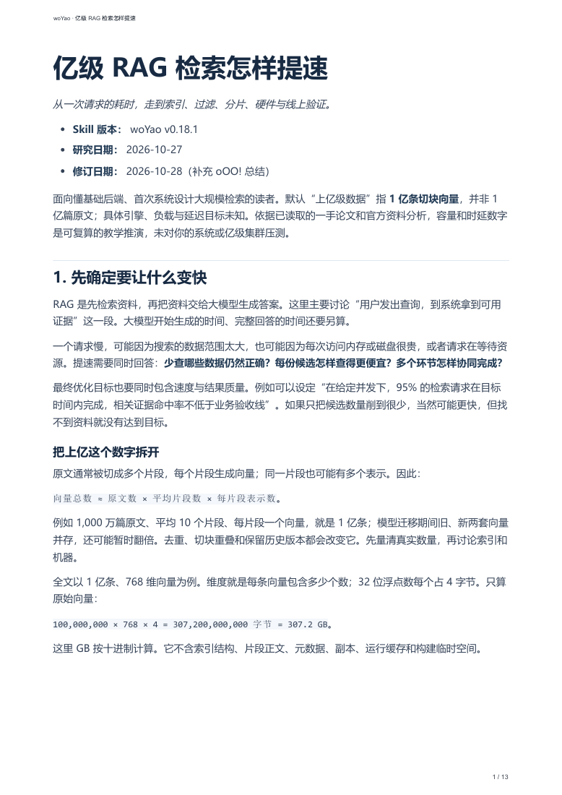

# woYao

把技术主题转化为有来源、能跟上推理、足够深入的中文学习报告，默认交付可编辑 Markdown 和同源 HTML，PDF 按需生成。

当前为 **0.19.0-preview.3 本地预览版**：强化具体案例闭环、术语出场顺序、阅读层级与图的信息增量，新增统一 HTML 导出入口，保留 A/B/C 自动适配。下方历史 PDF 案例保留原版本；历史漫画风 HTML 试读见 [故障恢复图解](examples/recovery-html-v2/故障恢复-漫画图解.html)。

当前版本见 [VERSION](VERSION)。采用 [MIT License](LICENSE)，允许使用、修改与再分发，保留许可声明。第三方依赖和引用材料适用各自许可。

## 看看生成效果

输入：

```text
使用 woYao 研究：线上 RAG 有上亿级数据，怎样从不同角度提高检索速度？
```

本地 v0.18.1 修订的 **13 页完整报告**：从容量与请求耗时进入过滤、HNSW/IVF、量化、磁盘索引、分片、缓存和重排，最后给出架构比较、线上验证方法和 `oOO!` 综合总结。开头简短，主要篇幅留给机制和工程取舍。

[完整 Markdown](examples/rag-100m/亿级RAG检索加速-从瓶颈到架构.md) · [PDF](examples/rag-100m/亿级RAG检索加速-从瓶颈到架构.pdf) · [可运行复算](examples/rag-100m/复算示例.py)



关键术语就近解释，用数字串起机制和判断，避免读完只有名词列表。


本例核对 13 份一手资料、运行算术复算并逐页检查 PDF；时延数字是教学推演，未执行亿级数据库压测。用户实际阅读效果和其他宿主的完整研究质量仍需分别验证。

历史示例：[BM25 Markdown](examples/bm25/BM25.md) · [15 页 PDF](examples/bm25/BM25.pdf)。它保留生成时的 v0.16.0 版本；[入门导读](examples/bm25/BM25-入门导读.md) 是 v0.17.0 的局部教学片段。

## 接入你的 Agent

仓库根目录就是标准 Skill，入口为 [SKILL.md](SKILL.md)。宿主需支持本地 Agent Skills 与文件操作；搜索和脚本执行能力由宿主提供。

```sh
npx skills add Sanery1/woYao --skill woyao
```

指定多个 Agent 的项目级安装示例：

```sh
npx skills add Sanery1/woYao --skill woyao -a codex -a claude-code -a cursor -y
```

加 `-g` 为全局安装，不支持符号链接时加 `--copy`。命令依据 [Skills CLI 官方说明](https://github.com/vercel-labs/skills/blob/main/docs/commands.md)，2026-10-24 查阅。离线源码可用 `npx skills add ./woyao --skill woyao`；手动复制时保留完整目录。

安装命令取得远端版本；本地候选修改要发布后才会被远端安装获取。安装 Skill 不自动安装 PDF 依赖。不同宿主调用语法可能不同，可直接说“使用 woYao 研究……”。

## 使用

```text
使用 woYao 研究 BM25
使用 woYao 研究向量数据库的过滤机制，假设我只懂基础后端
使用 woYao 快速解释 BM25 的长度归一化，只要 Markdown
使用 woYao tutorial 带我实现一个最小检索器
使用 woYao reference 整理指定版本 SDK 的参数与错误语义
```

仅给主题默认完整系统学习：短导入 → 核心机制 → 相关抽象原理 → 复杂情况与工程判断。必要概念和关键中间步骤不能因简化而省略，后层要推进理解。默认读者有基础编程经验、首次接触主题；可说明自己的基础。

只有明确的特殊用途才缩成 tutorial、how-to、reference 或 explanation；旧模式名仍识别，不必先选菜单。“快速”缩小范围但保留核心事实核验；“只要 Markdown”仅交付正文源；PDF 只在明确要求时生成。

报告开头展示实际 Skill 版本与研究日期，默认以 `oOO!` 简短收束本质、收益与代价。其他章节、署名和练习题按需要组织；转换脚本不以 `oOO!` 为导出门槛。Markdown 是唯一正文源，修改后重建所需 HTML 或 PDF。

## HTML：默认导出命令

```sh
node scripts/export_html.cjs topic.md
# 修订时指定新的文件名，保留已有 HTML
node scripts/export_html.cjs topic.md --output output/topic-v2.html
```

使用 Node.js 与下方同一套锁定依赖，不启动或下载浏览器。支持普通 Markdown、表格、本地图片、数学公式、目录与图片放大。生成自包含 HTML，Markdown 和图源保留在原目录。图片限正文目录内的相对路径；Mermaid 先转成本地 SVG，原始 HTML 按文本显示。详细边界见 [HTML 规则](references/html-and-diagrams.md)。

## PDF：按需导出命令

日常导出需要 **Node.js 22.12+、npm、Chrome/Chromium 和中文字体**，无需 Python 或虚拟环境。已有依赖与浏览器优先复用；首次缺依赖时在 Skill 根目录运行：

```sh
npm ci --prefix scripts --ignore-scripts --no-audit --no-fund
```

默认复用本机 Chrome；也可用环境变量 `WOYAO_BROWSER_PATH` 指定已有浏览器。均没有时，可在 `scripts` 目录用 `npx puppeteer browsers install chrome` 安装一次；Linux 还需浏览器实际要求的系统库。中文可用 Microsoft YaHei 或 Noto Sans CJK SC。

```sh
node scripts/export_pdf.cjs topic.md --output-dir output/topic-v1
```

同源导出 Markdown、PDF 并复制本地图片。普通 Markdown 也能转换，不强制品牌标题或固定章节；公式用 `$...$` / `$$...$$`，图可用 Mermaid 围栏，图片位于源文档目录内并以相对路径引用。转换阶段不下载外部图片。

已有同名文件会保留，修订时用新输出目录。失败保留源 Markdown；导出后仍需看每页，脚本不能代替内容与视觉检查。可追加 `--work build/topic-v1` 保留 HTML、SVG 与构建清单以排查问题。

无执行能力时可以完成 Markdown，不能保证生成 PDF。只要 Markdown 时无需安装导出依赖。

## 验证与维护

维护者可用 Python 运行现有回归；这是开发验证环境，不是日常导出的前置条件：

```sh
python -m pip install -r scripts/requirements.txt
python -X utf8 -m unittest discover -s tests -p "test_*.py" -v
```

本地 v0.18.0 的 21 项回归覆盖普通 Markdown、数学、Mermaid、本地资源、失败与已有文件保护；另生成并检查上述完整 RAG 报告。v0.16.0 曾在隔离目录验证 Codex、Claude Code、Cursor 的 Skills CLI 安装，未在三个宿主分别执行新版完整研究。工程测试和安装识别不证明跨宿主研究质量，详见 [验证要求](references/validation.md)。

渲染基于 md-to-pdf 5.2.5，适配数学、Mermaid、渲染完成等待与资源保护。为确保失败时关闭浏览器与本地服务，适配器使用锁定版本的内部转换入口；升级 md-to-pdf 时需要复核接口并运行回归。依赖体积并未因换引擎明显下降，简化主要是默认使用路径与维护职责。

`render_knowledge.cjs` 保留候选构建接口；`check_document.py` 和 `publish_document.py` 是可选的历史清单校验/授权更新工具，不进入默认导出路径。

VERSION 是 Skill 发布版本权威来源；package.json 与锁文件记录渲染依赖包版本，两者保持同步，不要求与 Skill 预览版本相同。发布包含源码、LICENSE、锁文件、tests 与必要 assets，排除 node_modules、虚拟环境与临时构建。历史报告保留真实版本，不能只改版本字段伪装成新构建。
