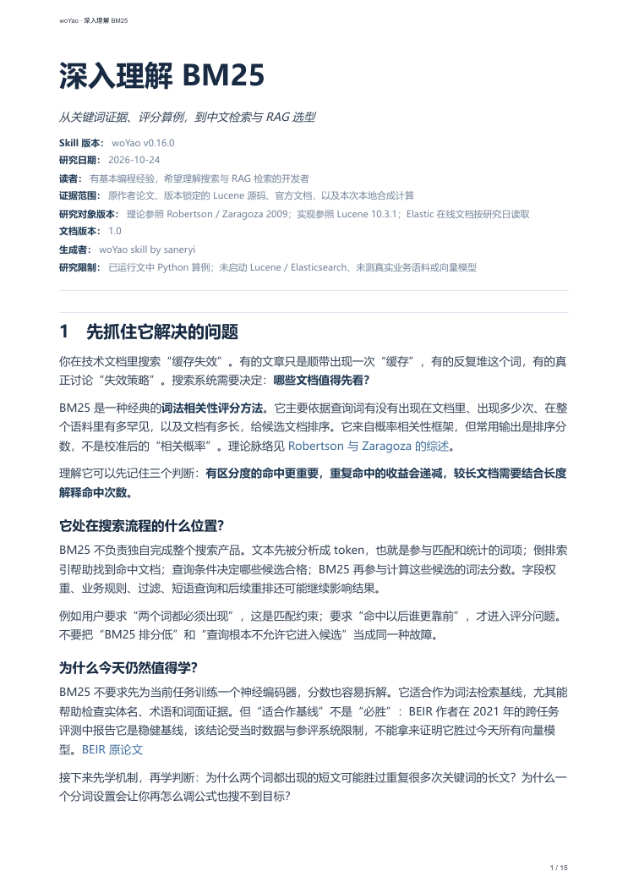
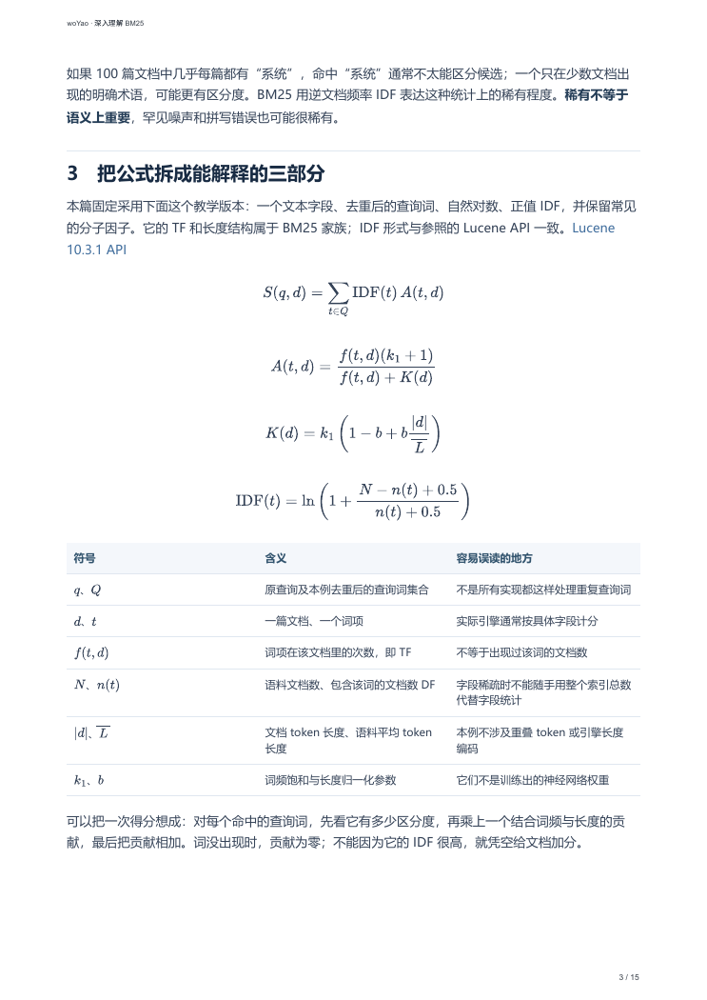
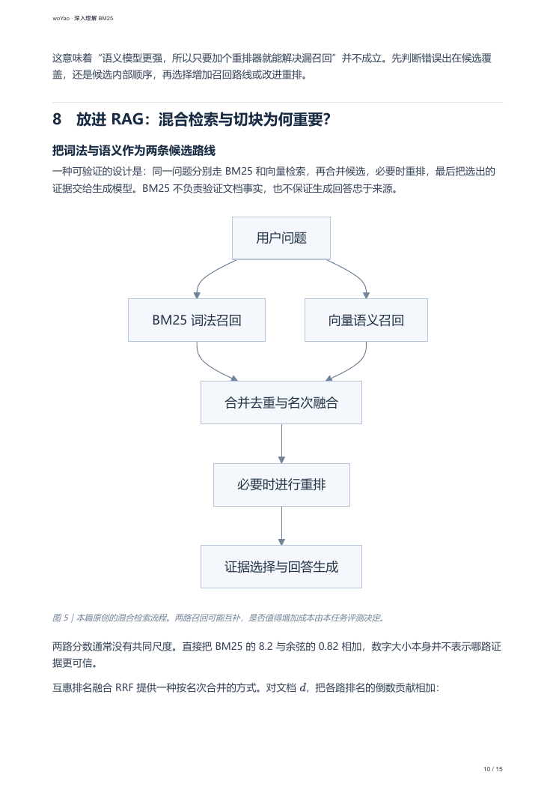

# woYao

把一个技术主题转化为有来源、有例子、可编辑的中文学习文档，并生成同源浅色 PDF。

当前版本见 [VERSION](VERSION)。本版为 Beta；采用 [MIT License](LICENSE)，允许使用、修改和再分发，保留许可声明。第三方依赖及报告引用的材料适用各自许可。

## 看看生成效果

输入一句话：

```text
使用 woYao 研究 BM25
```

得到一份 **15 页技术学习笔记**：从检索直觉到公式拆解，包含六篇文档的完整算例、中文分词、向量检索对比与 RAG 选型。

[阅读完整 Markdown](examples/bm25/BM25.md) · [查看 PDF](examples/bm25/BM25.pdf) · [下载 PDF](https://github.com/Sanery1/woYao/raw/refs/heads/main/examples/bm25/BM25.pdf)

### 清楚交代范围与版本

报告开头展示生成所用 Skill 版本、研究日期、目标读者与证据边界。



### 公式与符号放在一起解释

把 BM25 拆成词的重要程度、词频饱和与长度归一化，配合符号表阅读。



### 用图展示过程与应用

从词法召回和语义召回，到合并、重排与证据生成，解释 BM25 在 RAG 中的位置。



这个示例使用 **woYao v0.16.0** 重建；正文研究与教学算例来自此前真实任务。Python 算例已运行，PDF 已逐页检查；未执行 Elasticsearch/Lucene 实例或真实语料基准测试。示例展示实际产物，不代表所有主题或 Agent 都已通过完整验证。原始命令为 `$woyao BM25`，与上面的自然语言调用意图相同。

## 接入你的 Agent

本仓库根目录就是一个标准 Skill，入口为 [SKILL.md](SKILL.md)。需要支持本地 Agent Skills 和文件操作的宿主；联网研究与 PDF 构建分别需要宿主提供搜索和执行能力。

一条命令启动安装并选择目标 Agent：

```sh
npx skills add Sanery1/woYao --skill woyao
```

同时接入指定 Agent 的非交互示例（项目级安装）：

```sh
npx skills add Sanery1/woYao --skill woyao -a codex -a claude-code -a cursor -y
```

加 `-g` 可全局安装；不支持符号链接时加 `--copy`。已有安装先确认更新范围。命令依据 [Skills CLI 官方说明](https://github.com/vercel-labs/skills/blob/main/docs/commands.md)，2026-10-24 查阅。

离线源码也可以安装：`npx skills add ./woyao --skill woyao`。不使用该 CLI 时，将完整目录放入目标宿主支持的 Skill 目录；请保留 VERSION、references、scripts 和 assets。

安装 Skill 不自动安装 PDF 运行环境。第一次要求 PDF 时，Agent 按下节准备依赖；无执行能力的宿主只能完成其支持的部分，不能保证双产物。不同宿主的调用语法可能不同，可直接说“使用 woYao 研究 BM25”。

## 使用

```text
使用 woYao 研究 BM25
使用 woYao 快速解释 BM25 的长度归一化，只要 Markdown
使用 woYao 带我实现一个最小检索器
使用 woYao reference 整理指定版本 SDK 的参数与错误语义
```

仅给主题默认系统学习/general；目的明确时自动选择 tutorial、how-to、reference 或 explanation。显式模式优先。“快速”缩小覆盖范围，不降低核心事实核验要求，也不自动取消 PDF。默认交付同名 Markdown、PDF 及必要图片；“只要 Markdown”跳过 PDF。

报告开头显示实际 Skill 发布版本、文档修订版本和研究对象版本。Markdown 是唯一正文源，修改后重新构建 PDF。

## PDF 环境与构建

需要 Node.js 20+、npm、Python 3.10+、Chromium/Chrome，以及 Microsoft YaHei 或 Noto Sans CJK SC 等中文字体。搜索能力由 Agent 宿主提供。首次安装在仓库根目录运行：

```sh
npm ci --prefix scripts --no-audit --no-fund
python -m venv .venv
```

Windows：

```powershell
.venv/Scripts/python.exe -m pip install -r scripts/requirements.txt
```

macOS/Linux：

```sh
.venv/bin/python -m pip install -r scripts/requirements.txt
```

有本机 Chrome 可直接构建。没有 Chrome 或已下载 Chromium 时，在 scripts 目录运行 `npx playwright install chromium`；Linux 若缺系统库需按 Playwright 提示处理。`WOYAO_BROWSER_PATH` 可指定浏览器。依赖安装不会由安装 Skill 命令自动触发。

准备好候选文档（格式见 references/output-contract.md）后：

```sh
node scripts/render_knowledge.cjs topic.md --work build
python scripts/check_document.py topic.md --manifest build/build-manifest.json --pdf build/document.pdf
python scripts/publish_document.py topic.md --build build --output-dir output
```

上面 python 应替换成虚拟环境 Python，或先激活环境。每次构建使用新目录。先检查内容与每页 PDF，再运行发布命令；默认拒绝覆盖。只要 Markdown 时只运行 `python scripts/check_document.py topic.md`，然后交付 Markdown 及必要图片。

## 验证与已知边界

```sh
python -X utf8 tests/test_pipeline.py -v
python -X utf8 tests/test_renderer.py -v
```

已在 Windows 本机验证干净目录 npm ci、独立 Python 虚拟环境、19 项工程测试和 BM25 15 页重渲染；54 处公式 SVG 完整，PDF 页面已检查。使用 Skills CLI 的本地源码安装已在隔离项目中成功接入 Codex、Claude Code 和 Cursor，未在这三个宿主中分别执行完整研究任务。其他系统和多个 Agent 的完整研究流程仍需分别实测；安装可识别不等于研究质量已验证。五种模式由模型执行，脚本只检查结构、版本、资源与构建一致性。真实行为评测要求见 references/validation.md。

## 维护与发布

VERSION 是发布版本的唯一权威来源；scripts/package.json 及锁文件中的版本是发布镜像，更新时同步。报告生成时读取 VERSION，不从 README 或历史报告猜测版本。

上传仓库时包含源码、LICENSE、锁文件、tests 与必要 assets，排除 node_modules、虚拟环境和临时构建。发布前运行测试，并以 VERSION 对应版本创建发布记录。


从 0.15 升级：旧文章若没有 Skill 发布版本字段，需在候选副本补充本次安装的版本并重建；不要直接修改旧 PDF 或伪造旧构建版本。旧产物保留原样。有版本记录的历史产物按其构建清单验证。
