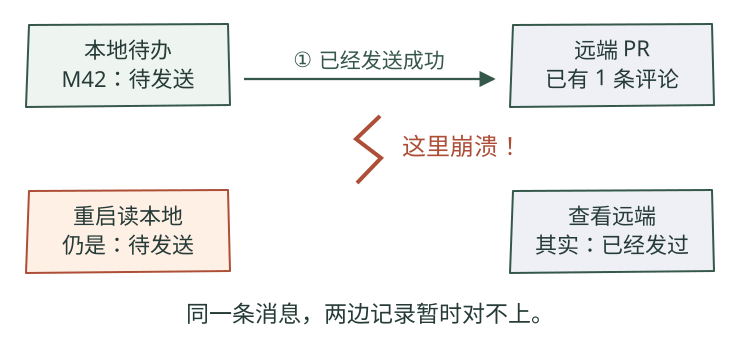
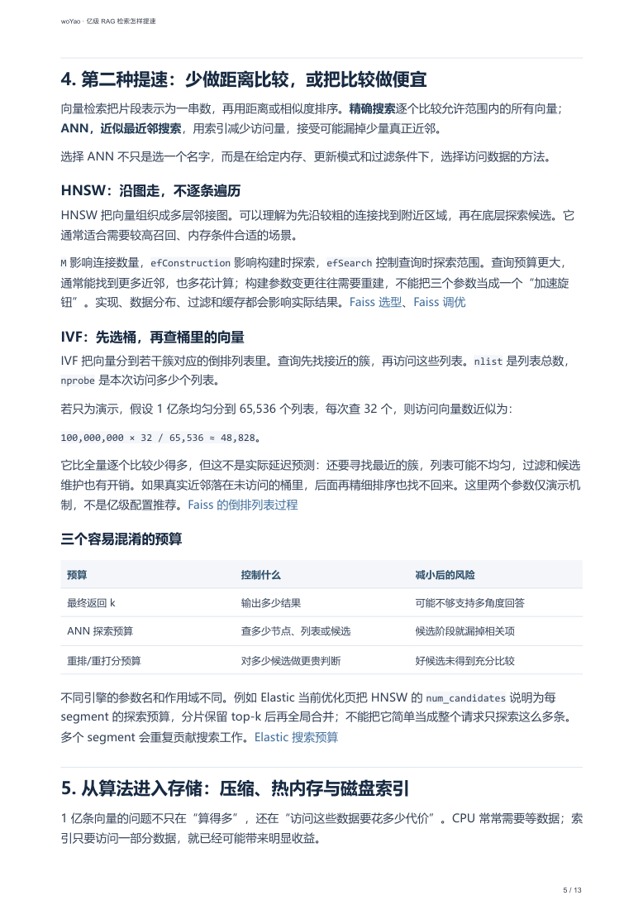

# woYao

把一个技术主题，变成一份**有来源、讲得明白、能逐层深入**的中文学习报告。

默认交付 **Markdown + 可离线阅读的 HTML**，PDF 按需生成。开头简短进入问题，主体展开机制、关键步骤、抽象原理和工程取舍。

当前版本：**[0.19.0-preview.5](VERSION)**。系统学习报告先走完一个具体过程，再沿案例中的疑问解释内部设计。

## 看看生成效果

### HTML 图解试读：Agent 崩溃之后如何继续？

用一次工具调用串起正常执行、崩溃、重复执行和身份核验，图解配合文字解释机制。

[HTML 文件](examples/recovery-html-v2/故障恢复-漫画图解.html) · [Markdown 源稿](examples/recovery-html-v2/故障恢复-漫画图解.md)

下载 HTML 后用浏览器打开即可离线阅读；GitHub 文件页展示的是源码。



这是保留原样的历史漫画风试读，生成基线为 v0.18.1，**不代表当前默认外观**。现在默认根据内容选择下方 A/B/C 图型，正文与图字使用清楚的正常字体。

### 完整研究示例：上亿级数据的 RAG 检索加速

```text
使用 woYao 研究：线上 RAG 有上亿级数据，怎样从不同角度提高检索速度？
```

从容量与请求耗时进入过滤、HNSW/IVF、量化、磁盘索引、分片、缓存和重排，再比较候选架构与验证方法。

[完整 Markdown](examples/rag-100m/亿级RAG检索加速-从瓶颈到架构.md) · [13 页 PDF](examples/rag-100m/亿级RAG检索加速-从瓶颈到架构.pdf) · [可运行复算](examples/rag-100m/复算示例.py)



本例为 v0.18.1 历史报告，核对一手资料并运行算术复算；时延数字是教学推演，未执行亿级数据库压测。另有 [BM25 完整报告](examples/bm25/BM25.md)、[PDF](examples/bm25/BM25.pdf) 与 [入门导读](examples/bm25/BM25-入门导读.md)，各自保留生成时的版本。

## 接入你的 Agent

仓库根目录就是标准 Skill，入口为 [SKILL.md](SKILL.md)。宿主提供搜索、文件与脚本执行能力。

```sh
npx skills add Sanery1/woYao --skill woyao
```

安装到 Codex、Claude Code、Cursor 的示例：

```sh
npx skills add Sanery1/woYao --skill woyao -a codex -a claude-code -a cursor -y
```

加 `-g` 为全局安装，不支持符号链接时可加 `--copy`。离线源码可用 `npx skills add ./woyao --skill woyao`，也可将完整目录放入宿主的 Skills 目录。命令参考 [Skills CLI 文档](https://github.com/vercel-labs/skills/blob/main/docs/commands.md)。

安装 Skill 后即可让 Agent 使用；导出依赖在需要生成 HTML/PDF 时准备。不同宿主的调用语法可能不同，可直接说“使用 woYao 研究……”。

## 怎样使用

```text
使用 woYao 研究 Pi Durable，假设我只懂基础后端
使用 woYao 研究向量数据库的过滤机制
使用 woYao 快速解释 BM25 的长度归一化，只要 Markdown
使用 woYao tutorial 带我实现一个最小检索器
使用 woYao 研究亿级 RAG 检索加速，并额外生成 PDF
```

仅给主题时，默认以老练行业专家向外行娓娓道来的方式组织完整学习报告，面向有一般理解能力、缺少本领域背景的读者，也可以补充自己的背景、目标和关注点。“快速”缩小范围；tutorial、how-to、reference、explanation 按明确用途调整，无需预先选择模式菜单。

报告的阅读顺序随主题安排，主要做到：

- **先理解问题，再认识术语。** 必要先修就近补齐，新概念在例子中立即使用，公式结合具体量和结果解释，逐层进入抽象。
- **核心知识逐项讲完整。** 按主题使用算例、运行过程或论证，交代输入、中间变化、原因、结果与边界，再连成整体。
- **图和文字一起解释。** 图呈现状态、顺序、数量或结构差异，文字解释因果与适用边界。
- **来源和版本可回查。** 开头显示 Skill 版本与研究日期，区分资料结论、教学示意和实际运行结果。
- **结尾形成理解闭环。** 默认用 `oOO!` 贯通本质、收益与代价，回应起始问题。

### 图形如何选择

| 图型 | 适合解释 |
| --- | --- |
| A：分步骤模块化论文图 | 多阶段方法、系统总览、模块内机制 |
| B：轻量线稿流程图 | 调用顺序、请求生命周期、故障恢复与反馈 |
| C：正式论文线稿 | 复杂架构、双路径对照、变量关系与严谨机制 |

Agent 按内容自动适配，保持统一字体、角色颜色与连线语义；也可采用更合适的时间轴或数据图。正文保持正常字体，漫画风可明确指定。风格逻辑参考 [Paper Framework Figure Studio Pro](https://github.com/c-narcissus/paper-framework-figure-studio-pro)，具体规则见 [HTML 与图解说明](references/html-and-diagrams.md)。

## 从 Markdown 导出

Markdown 是唯一正文源。修改内容后重新导出 HTML/PDF；HTML 自包含，可单独分享，Markdown 与可编辑图源保留在原目录。

以下命令在 Skill 根目录执行；如果由 Agent 使用，Agent 应定位安装目录后调用脚本。

### 准备依赖

使用 **Node.js 22.12+ 与 npm**。已有依赖可复用，首次缺失时运行：

```sh
npm ci --prefix scripts --ignore-scripts --no-audit --no-fund
```

| 输出 | 额外要求 |
| --- | --- |
| 只要 Markdown | 无需导出环境 |
| HTML（默认） | 上述 Node 依赖；导出不启动或下载浏览器 |
| PDF（按需） | Chrome/Chromium 与可用中文字体 |

HTML/PDF 共用现有锁定依赖包，目前未拆成独立的轻量安装包。

### HTML：默认输出

```sh
node scripts/export_html.cjs topic.md
# 修订时指定新文件名
node scripts/export_html.cjs topic.md --output output/topic-v2.html
```

支持标题目录、表格局部滚动、图片放大与离线数学公式。图片以相对路径引用，限正文目录内；Mermaid 围栏需先转成本地 SVG。公式用 `$...$` 或独立 `$$...$$`，原始 HTML 按文本显示。转换阶段不下载远程图片。

默认在正文旁生成同名 HTML，已有文件拒绝覆盖。导出后检查桌面、窄屏和配图；转换成功不代表内容质量已经验证。

### PDF：按需输出

```sh
node scripts/export_pdf.cjs topic.md --output-dir output/topic-v1
```

导出 Markdown、PDF 并复制本地图片，支持公式和 Mermaid 围栏。优先复用本机 Chrome，也可通过 `WOYAO_BROWSER_PATH` 指定已有浏览器；均没有时，在 `scripts` 目录运行 `npx puppeteer browsers install chrome` 安装一次。中文字体可用 Microsoft YaHei 或 Noto Sans CJK SC。

已有同名文件会保留，修订时用新输出目录。可追加 `--work build/topic-v1` 保留构建材料。PDF 生成后仍需逐页查看，详见 [PDF 说明](references/visuals-and-pdf.md)。

## 验证与维护

v0.19.0-preview.3 发布前通过 **21 项 Python 回归、HTML 导出回归与 Skill 校验**；用完整 Pi Durable 原稿重渲染检查了离线、窄屏、目录、图片放大与禁用脚本阅读。新教学规则的阅读效果仍需后续报告试读，尚未在不同 Agent 中分别验证新版完整研究流程。

```sh
node tests/test_html.cjs
# Python 仅用于维护者测试
python -m pip install -r scripts/requirements.txt
python -X utf8 -m unittest discover -s tests -p "test_*.py" -v
```

工程检查、内容核验与读者理解分别验证，详细标准见 [验证说明](references/validation.md)。PDF 适配器使用 md-to-pdf 5.2.5 的内部接口；升级依赖时需运行回归。`check_document.py` 与 `publish_document.py` 为历史清单工具，不进入默认导出流程。

[VERSION](VERSION) 记录 Skill 版本；`scripts/package.json` 与锁文件记录渲染依赖包版本。发布排除 node_modules、缓存和临时构建，历史报告保留真实生成版本。

## 许可

采用 [MIT License](LICENSE)，允许使用、修改与再分发，保留许可声明。随包字体附带各自授权，引用材料和第三方依赖适用各自许可。
