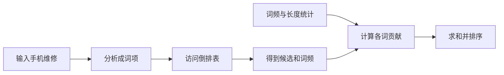

# BM25：搜索为什么不能只数关键词

> 读者：会写后端但未做搜索｜范围：词项匹配、评分与调试路径｜证据：官方原文由协调代理联网获取后共享；教学公式已本地复算，无搜索效果实测。

你给售后知识库接一个搜索接口。用户输入“手机 维修”，数据库能找出包含关键词的文章，可是“维修”重复很多遍的长篇故障汇总，未必比直接介绍手机维修的短文更有帮助。接口还缺一个答案：已经找到的文章，谁应该先显示？

## 1 从一次查询走到候选

先固定一个小知识库。**词项**是分析程序最终交给检索器的匹配单位，可能是中文词、英文单词或其他切分结果。这里假定“手机维修”被切成“手机”和“维修”。词项不是天然存在的汉字边界；改变切分规则就改变了检索器看见的内容。〔官方〕[分析器文档](https://www.elastic.co/docs/reference/text-analysis/analysis-standard-analyzer)

**倒排索引**把“一个词在哪些文档出现”预先整理好。后端可以把它想成以词项为键的索引：读“维修”的列表，就拿到对应文档标识和出现次数，不用在每次请求时扫描全库。〔官方〕[match查询文档](https://www.elastic.co/docs/reference/query-languages/query-dsl/query-dsl-match-query)说明普通text字段查询会先分析；查询经过同样兼容的分析处理后，检索器访问这些列表，取出参与计算的候选文档，再按分数保留靠前结果。

这张图回答：BM25 位于查询链条的哪一步？〔示意〕

箭头表示请求推进；统计数据来自索引过程。BM25负责候选的评分，查询的“或”“且”、过滤条件、短语匹配则由查询结构决定。比如要求两个词都出现，和允许任意一个词出现，会得到不同候选；不能把这项差别归因于BM25本身。

## 2 一个词如何变成一份贡献

$$
\frac{f(t,d)(k_1+1)}{f(t,d)+k_1(1-b+b|d|/avgdl)}
$$

其中q是查询、d是文档、t是查询中的词项；f(t,d)是t在d内的次数，称为**词频**。文档长度记作|d|，索引内平均文档长度记作avgdl，单位都是分析后的词项数。k₁控制重复命中的收益曲线，b控制长度调整的力度。先固定分词、词频和集合统计，这个式子才是在比较同一种对象。

### 2.2 为什么重复不能无限加分

先看长度恰好等于平均值的文档，长度比为1，公式的词频部分就变为f(k₁+1)/(f+k₁)。分子随f增加，分母也随f增加，所以多出现一次带来的增量逐渐变小。这叫**词频饱和**：重复仍提供证据，但证据收益递减。

取教学参数k₁=1.2，词频从1变到2时，词频因子从1变成1.375；变到10时约1.964286；变到100时约2.173913。固定长度、固定其他参数而让词频持续增大，因子趋近2.2。〔示意〕实际文档词频受长度约束，这里把长度项固定，是为了单独观察函数形状，不是在构造一篇只有固定词数却无限重复的文章。

饱和的原因是第一次出现常常比后面重复更有信息量。维修指南写到维修，是主题相关的一条线索；机械地再贴很多遍关键词，不应得到同比例增长的奖励。k₁较大通常让饱和来得更慢；把它调小，会削弱高频文档因重复获得的额外优势。它调的是证据的利用方式，不会替你判断文章是否写得好。

### 2.3 为什么长度也要进入分母

长文章可以覆盖更多话题，因此容易碰巧包含查询词。BM25用|d|/avgdl表示“相对典型文档有多长”，再通过1-b+b|d|/avgdl调节分母。长于平均值时，这个量在b为正时变大，同样词频的贡献被压低；短于平均值时相反。

b=0意味着长度因素退出计算；b=1意味着在这一项里完全使用相对长度比。中间取值则保留部分调整。长度补偿有代价：一篇确实详细、相关的长指南，也可能被压低。因此b的效果必须连同文档切分策略看；整本手册作一篇和每个故障作一篇，长度分布与“相关文档”的业务含义都不同。

## 3 把公式放回四篇文档

现在只算“维修”这个词的贡献，让“手机”的影响暂时留在表外。这样可以看清重复和长度如何相互作用，不能把单词贡献误当作完整查询的最终分数。

| 文档 | 词项长度 | “维修”次数 | “维修”贡献 |
| --- | --- | --- | --- |
| 短指南 | 50 | 1 | 0.490428 |
| 普通指南 | 150 | 3 | 0.560489 |
| 长汇总 | 300 | 3 | 0.461579 |
| 其他说明 | 100 | 0 | 0 |

这里有一个容易漏掉的因果条件。若真往长汇总里不断追加“维修”，它的词频和长度会一起变；更新索引后，平均长度也可能变。因此真实改写不能只把公式里的f变大、其他统计永远冻结。固定其他变量的实验用来理解局部机制，实际排序还取决于另外几篇文档与其他查询词。〔推断〕

### 一个总分怎样解释

当某个查询词没有在文档里出现，它的词频为零，在这里贡献就是零；其他词仍可贡献分数。因此允许任意词命中的查询可能把只谈手机的文章排进来。若业务要求同时包含维修意图，就应在查询构造或候选约束里表达。调高一个词的权重可以影响相对排序，但不等同于禁止缺少该词的文档进入候选。〔推断〕

## 4 搜得不好时沿链条定位

现在把用户的问题改成“手机退货”。知识库有“手机退款流程”，却没有“退货”这个词。基础词项匹配能否把它带回来，首先取决于分析与查询构造：若既没有共同词项，也没有同义词展开等额外处理，BM25就没有那条词项命中证据。调k₁或b只会重新分配已有证据，无法凭空建立“退货”和“退款”的关系。若“手机”产生宽泛候选，它也不足以表达售后意图。〔推断〕

验证改动时，保留一批真实业务查询，为它们标记相关文档，再比较相同任务下的结果。检查候选里漏了谁，也检查首屏是否把最有用文档放前面；不要把“分数变大”当成效果变好。查询集至少应覆盖短词、长问题、同义表达与容易误命中的场景。本文没有运行搜索引擎、没有业务标注实验，参数仅服务于理解公式。Lucene 10.3.1文档列出k₁=1.2、b=0.75的默认值，但本例是显式公式的教学复算，未验证其全部评分细节；生产环境应以实际版本的解释输出为准。〔官方〕[Lucene API](https://lucene.apache.org/core/10_3_1/core/org/apache/lucene/search/similarities/BM25Similarity.html)

## 回到开头

下一次接口返回不理想结果，先确认查询被切成什么、相关文档是否进入候选，再拆各词贡献。若用户表达和文档词汇根本没对上，应改变获取证据的方式；若证据齐全却排序不对，才在固定评估任务上讨论权重、长度和字段。

      

                                           

                                
                             
          

                                   

                                
                                          
          

                                 

                                
                                         
          

## 证据边界

本代理外网访问失败后，由协调代理实际联网打开官方页面并共享原文片段，逐段核对再引用。已核对四份官方来源，包括Elastic的词频饱和与参数讲解；历史算法讲解不等同于当前引擎全部数值细节。教学数据及公式脚本实际运行，输出保存在_work/calc；这些算术结果不代表产品效果。独立读者测验：待独立读者测验。没有展开概率模型完整推导、BM25变体和具体引擎配置。

## 参考来源

- 〔官方〕[Elasticsearch Standard analyzer](https://www.elastic.co/docs/reference/text-analysis/analysis-standard-analyzer)：分析器与词项。
- 〔官方〕[Elasticsearch match query](https://www.elastic.co/docs/reference/query-languages/query-dsl/query-dsl-match-query)：普通text字段先分析后匹配的契约。
- 〔官方〕[Elastic BM25算法与参数](https://www.elastic.co/blog/practical-bm25-part-2-the-bm25-algorithm-and-its-variables)：历史算法讲解，k1的饱和与b的长度影响。