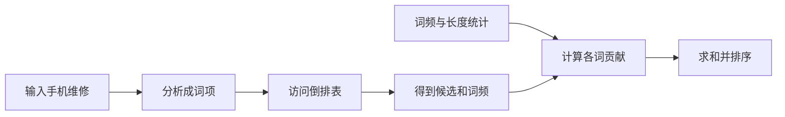

# BM25：搜索为什么不能只数关键词

> 读者：会写后端但未做搜索｜范围：词项匹配、评分与调试路径｜证据：官方原文由协调代理联网获取后共享；教学公式已本地复算，无搜索效果实测。

你给售后知识库接一个搜索接口。用户输入“手机 维修”，数据库能找出包含关键词的文章，可是“维修”重复很多遍的长篇故障汇总，未必比直接介绍手机维修的短文更有帮助。接口还缺一个答案：已经找到的文章，谁应该先显示？

**BM25** 是一种按词项匹配证据给文档排序的评分方法。它把“提到几次”“这个词多罕见”“文章有多长”放进同一个计算。读完应能拆开一个分数，判断该查分词、候选还是排序参数，而不是看到搜索不好就开始调权重。

## 1 从一次查询走到候选

先固定一个小知识库。**词项**是分析程序最终交给检索器的匹配单位，可能是中文词、英文单词或其他切分结果。这里假定“手机维修”被切成“手机”和“维修”。词项不是天然存在的汉字边界；改变切分规则就改变了检索器看见的内容。〔官方〕[分析器文档](https://www.elastic.co/docs/reference/text-analysis/analysis-standard-analyzer)

四篇文档的长度分别为50、150、300、100个词项，平均150。“手机”每篇都有，“维修”分别出现1、3、3、0次。这是为了展示评分而构造的数据，文章标题或业务相关性没有被拿来充当真实标注。〔示意〕

**倒排索引**把“一个词在哪些文档出现”预先整理好。后端可以把它想成以词项为键的索引：读“维修”的列表，就拿到对应文档标识和出现次数，不用在每次请求时扫描全库。〔官方〕[match查询文档](https://www.elastic.co/docs/reference/query-languages/query-dsl/query-dsl-match-query)说明普通text字段查询会先分析；查询经过同样兼容的分析处理后，检索器访问这些列表，取出参与计算的候选文档，再按分数保留靠前结果。

这张图回答：BM25 位于查询链条的哪一步？〔示意〕

箭头表示请求推进；统计数据来自索引过程。BM25负责候选的评分，查询的“或”“且”、过滤条件、短语匹配则由查询结构决定。比如要求两个词都出现，和允许任意一个词出现，会得到不同候选；不能把这项差别归因于BM25本身。

拿到候选还不能只数命中次数。“手机”全库都有，出现它几乎没把范围缩小；“维修”则能排除一篇。同时，一篇长文自然有更多机会写到同一个词。评分需要把这些不同来源的证据拆开。

## 2 一个词如何变成一份贡献

我们要算的是文档对查询的匹配强度。对每个查询词，先计算一份贡献，再把各词贡献相加。下面采用非负IDF的一种常用BM25写法；具体产品是否采用这一式，仍需对照其实现。

$$
S(q,d)=\sum_{t\in q} IDF(t)\,
\frac{f(t,d)(k_1+1)}{f(t,d)+k_1(1-b+b|d|/avgdl)}
$$

其中q是查询、d是文档、t是查询中的词项；f(t,d)是t在d内的次数，称为**词频**。文档长度记作|d|，索引内平均文档长度记作avgdl，单位都是分析后的词项数。k₁控制重复命中的收益曲线，b控制长度调整的力度。先固定分词、词频和集合统计，这个式子才是在比较同一种对象。

### 2.1 为什么稀有词更有区分力

**逆文档频率（IDF）**描述词项在整个集合中的稀有程度。这里使用下面的版本，其中N是文档总数，df(t)是至少出现一次t的文档数，而非t出现的总次数：

$$
IDF(t)=\ln\left(1+\frac{N-df(t)+0.5}{df(t)+0.5}\right)
$$

在四篇文档里，“维修”的df是3，得到IDF约0.356675；“手机”的df是4，得到约0.105361。〔示意〕这说明相同词频和长度条件下，“维修”贡献更大，因为命中它对缩小范围更有帮助。这里的非负IDF形式可对照〔官方〕[Lucene 10.3.1 API](https://lucene.apache.org/core/10_3_1/core/org/apache/lucene/search/similarities/BM25Similarity.html)。一次文档里出现一百遍“手机”，也不会把它变成只在少数文档出现的稀有词。df和词频衡量的是两个尺度。

这不是“罕见词一定重要”的语义判断。错别字也可能罕见，罕见程度只是在当前集合里提供一种区分信号。关键词权重合理，还需要它们确实表达用户的问题。

### 2.2 为什么重复不能无限加分

先看长度恰好等于平均值的文档，长度比为1，公式的词频部分就变为f(k₁+1)/(f+k₁)。分子随f增加，分母也随f增加，所以多出现一次带来的增量逐渐变小。这叫**词频饱和**：重复仍提供证据，但证据收益递减。

取教学参数k₁=1.2，词频从1变到2时，词频因子从1变成1.375；变到10时约1.964286；变到100时约2.173913。固定长度、固定其他参数而让词频持续增大，因子趋近2.2。〔示意〕实际文档词频受长度约束，这里把长度项固定，是为了单独观察函数形状，不是在构造一篇只有固定词数却无限重复的文章。

饱和的原因是第一次出现常常比后面重复更有信息量。维修指南写到维修，是主题相关的一条线索；机械地再贴很多遍关键词，不应得到同比例增长的奖励。k₁较大通常让饱和来得更慢；把它调小，会削弱高频文档因重复获得的额外优势。它调的是证据的利用方式，不会替你判断文章是否写得好。

### 2.3 为什么长度也要进入分母

长文章可以覆盖更多话题，因此容易碰巧包含查询词。BM25用|d|/avgdl表示“相对典型文档有多长”，再通过1-b+b|d|/avgdl调节分母。长于平均值时，这个量在b为正时变大，同样词频的贡献被压低；短于平均值时相反。

b=0意味着长度因素退出计算；b=1意味着在这一项里完全使用相对长度比。中间取值则保留部分调整。长度补偿有代价：一篇确实详细、相关的长指南，也可能被压低。因此b的效果必须连同文档切分策略看；整本手册作一篇和每个故障作一篇，长度分布与“相关文档”的业务含义都不同。

## 3 把公式放回四篇文档

现在只算“维修”这个词的贡献，让“手机”暂时留在表外。卡点是：长文多写几次“维修”，加分和长度调整到底谁占上风？把它拆成连续两步，比同时盯着整个公式容易。

第一步，把次数换成“按文章相对长度调整后的次数”。记长度调整量为L=1-b+b|d|/avgdl，则调整后词频是f/L。这里的L不是字数本身：它描述这篇文章相对集合里的典型文章，需要接受多大程度的长度调整。b=0时L恒为1；b为正、文章长于平均值时L大于1，相同的次数除以更大的量，会变小。

第二步，才把f/L送进饱和曲线。把上一节公式的分子、分母同时除以L，可得到同一个词的贡献：

$$
IDF(t)(k_1+1)\frac{f/L}{f/L+k_1}
$$

这不是另换一种算法，只是对原式做代数改写。固定这个词的IDF和k₁后，f/L越大贡献越大，但仍然越加越慢。因此先比较调整后的次数，再看饱和后的贡献，就能把两种影响连起来。〔推断〕

固定N=4、df=3、avgdl=150，教学参数k₁=1.2、b=0.75，脚本实际输出如下：〔示意〕

| 文档 | 词项长度 | “维修”次数f | 长度调整量L | 调整后次数f/L | “维修”贡献 |
| --- | --- | --- | --- | --- | --- |
| 短指南 | 50 | 1 | 0.5 | 2 | 0.490428 |
| 普通指南 | 150 | 3 | 1 | 3 | 0.560489 |
| 长汇总 | 300 | 3 | 1.75 | 1.714286 | 0.461579 |
| 其他说明 | 100 | 0 | — | 0 | 0 |

先沿普通指南与长汇总这一对看：两篇都出现3次，长汇总的长度是平均值的2倍；b只取0.75，因此L是1.75，而非直接取2。3除以1.75后只剩约1.714份调整后的证据，小于普通指南的3份，贡献随之降低。再比较短指南与长汇总：短指南虽然只出现1次，但它很短，L只有0.5，调整后的次数为2，反而高于长汇总约1.714。所以“次数更多”本身不保证胜出；需要连相对长度一起看。

现在只改长汇总：再加3个“维修”词项，其他三篇保持不变。它的次数从3变6，长度从300变303，全库总长度也增加3，平均长度从150变150.75。这里假定一次更新后立即使用这组准确统计，不模拟具体引擎统计更新时机。〔示意〕

复算后，L约为1.757463，调整后次数约3.414013，贡献约0.580606。〔示意〕次数增长在这次改写里超过了长度调整的影响，所以贡献上升；但贡献并没有翻倍，因为调整后的次数还会经过饱和曲线。把词重复下去，也不能据此断定一定超过其他文档：另外几篇的相对长度会随平均值改变，完整查询还要加“手机”的贡献。这个单词的局部结果也没有证明内容对用户更有用。〔推断〕

### 一个总分怎样解释

若一篇文章排在前面，可以把总分拆成“手机贡献”和“维修贡献”，逐项追问哪项更大。相同词可以因为词频、相对长度不同而贡献不同；稀有程度则决定这个词整体有多大的区分权重。这里的单词贡献不是完整查询的最终分数，更不是“用户认为相关的概率”。换集合、字段或分析规则后，统计的含义也变了。

若一个查询词完全没在文档里出现，f为零，调整后仍然是零；增加其他词的分数不能替它补一份命中证据。下一节就沿这条线区分：文档根本没进入候选，和已经进来但排得靠后，应怎样分别检查。

## 4 搜得不好时沿链条定位

现在把用户的问题改成“手机退货”。知识库有“手机退款流程”，却没有“退货”这个词。基础词项匹配能否把它带回来，首先取决于分析与查询构造：若既没有共同词项，也没有同义词展开等额外处理，BM25就没有那条词项命中证据。调k₁或b只会重新分配已有证据，无法凭空建立“退货”和“退款”的关系。若“手机”产生宽泛候选，它也不足以表达售后意图。〔推断〕

**召回**是先把有可能相关的结果找进候选；**排序**是决定这些候选的先后。工程调试先看相关文档是否在候选中，再问它为什么排得低。查不到时查看实际词项、同义词和过滤条件；查得到但靠后时，拆开每个查询词的词频、IDF、长度和字段贡献。这能把“算法不好”转成可验证的具体问题。

还要区分词袋证据与短语关系。“维修手机”和“手机维修”可能得到相似的词项集合，BM25基本评分本身没有表达词序；位置索引配合短语查询才能增加这类约束。同样，标题比正文重要是业务设计，需要字段或查询层表达，不能假定BM25知道页面结构。

验证改动时，保留一批真实业务查询，为它们标记相关文档，再比较相同任务下的结果。检查候选里漏了谁，也检查首屏是否把最有用文档放前面；不要把“分数变大”当成效果变好。查询集至少应覆盖短词、长问题、同义表达与容易误命中的场景。本文没有运行搜索引擎、没有业务标注实验，参数仅服务于理解公式。Lucene 10.3.1文档列出k₁=1.2、b=0.75的默认值，但本例是显式公式的教学复算，未验证其全部评分细节；生产环境应以实际版本的解释输出为准。〔官方〕[Lucene API](https://lucene.apache.org/core/10_3_1/core/org/apache/lucene/search/similarities/BM25Similarity.html)

## 回到开头

售后知识库的长汇总没有理由仅凭多写几次“维修”就占据首位：稀有程度决定词项有多少区分力，饱和限制重复收益，长度调整补偿长文天然更多的命中机会。三者共同给出可解释的匹配信号。

下一次接口返回不理想结果，先确认查询被切成什么、相关文档是否进入候选，再拆各词贡献。若用户表达和文档词汇根本没对上，应改变获取证据的方式；若证据齐全却排序不对，才在固定评估任务上讨论权重、长度和字段。

      

                                           

                                
                             
          

                                   

                                
                                          
          

                                 

                                
                                         
          

## 证据边界

本代理外网访问失败后，由协调代理实际联网打开官方页面并共享原文片段，逐段核对再引用。已核对四份官方来源，包括Elastic的词频饱和与参数讲解；历史算法讲解不等同于当前引擎全部数值细节。教学数据及公式脚本实际运行，输出保存在_work/calc；这些算术结果不代表产品效果。独立读者测验：待独立读者测验。没有展开概率模型完整推导、BM25变体和具体引擎配置。

## 参考来源

- 〔官方〕[Lucene 10.3.1 BM25Similarity](https://lucene.apache.org/core/10_3_1/core/org/apache/lucene/search/similarities/BM25Similarity.html)：参数、IDF与平均字段长度。
- 〔官方〕[Elasticsearch Standard analyzer](https://www.elastic.co/docs/reference/text-analysis/analysis-standard-analyzer)：分析器与词项。
- 〔官方〕[Elasticsearch match query](https://www.elastic.co/docs/reference/query-languages/query-dsl/query-dsl-match-query)：普通text字段先分析后匹配的契约。
- 〔官方〕[Elastic BM25算法与参数](https://www.elastic.co/blog/practical-bm25-part-2-the-bm25-algorithm-and-its-variables)：历史算法讲解，k1的饱和与b的长度影响。
