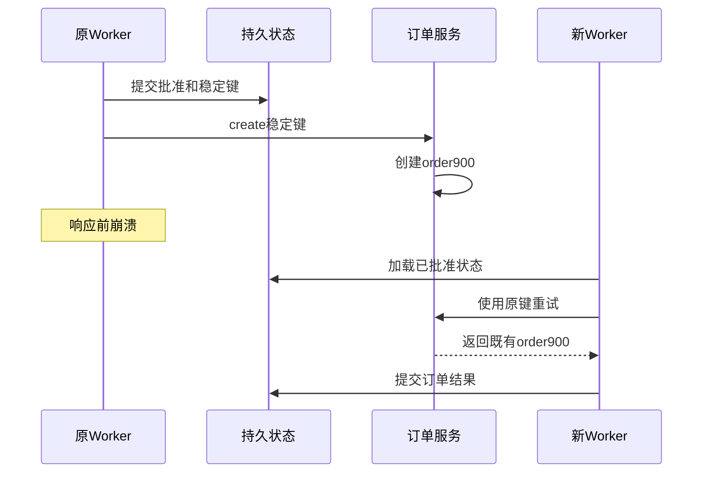
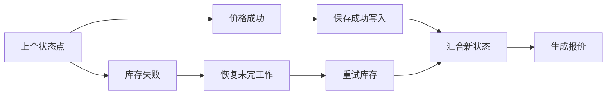

# Agent 进程崩溃以后：checkpoint、持久化执行与恢复

> 读者：会后端、不熟悉持久化Agent｜范围：LangGraph与Temporal恢复机制｜证据：官方文档与教学推导，未运行框架实验。

你已经会写后端服务。本文从一个报价审批 Agent 出发，研究进程消失后怎样继续执行，重点对照 LangGraph 与 Temporal。所有订单、金额、崩溃时刻都是教学构造；本次阅读官方在线文档，没有启动 LangGraph、Temporal 集群，没有做故障注入实测或性能比较。在线文档随版本演进，本文明确讨论所读页面的语义，不把文档示意当作某个已安装版本的运行保证。

## 1. 用户看到的是一笔请求，服务器看到的是许多次动作

设想一个采购助手：收到“帮我购买三台设备”的请求后，检索商品，调用模型形成报价，让负责人批准，最后调用订单服务创建采购单，再告诉用户订单号。这个流程可能跨越几分钟，也可能因为审批等待两天。你不会让一个 HTTP 连接一直占着，也无法保证同一台机器两天都在线。

如果只把对话和当前步骤存在 Python 变量中，进程崩溃以后，新进程只知道有一笔未完成的采购请求。它不知道已经查过哪款商品、负责人是否批准、订单接口是否已经成功。让模型重新读用户问题，可能再次形成一个报价，甚至再次下单。这不是单纯的聊天记录丢失，而是执行位置、业务依据和外部效果之间失去对应关系。

我们需要恢复的目标很具体：保留已确认的报价和审批，从尚未完成的工作继续；如果外部订单可能已经创建，要先确认其结果，避免把“不知道”误认为“没有发生”。**持久化执行**，就是让一次逻辑任务的推进依据超出单个工作进程的寿命。它需要记录，也需要一套根据记录重新安排工作的规则。只写一条日志，不会自动有人重新接手。

〔官方〕LangGraph 的 **checkpointer** 是保存执行状态的组件，把一个 **thread**（一条执行状态历史的身份）下的图状态保存为 **checkpoint**（可恢复状态点）；跨 thread 的长期知识则是另一类 store。[Persistence](https://docs.langchain.com/oss/python/langgraph/persistence) 这已经给出第一个关键分界：用户偏好“喜欢某品牌”即使长期保存，也不能回答“这一笔采购已经执行到哪里”。

## 2. 先完整走过一次崩溃

〔示意〕给采购请求一个稳定标识 `purchase-42`。起始输入是商品要求与申请人；模型产出报价 `quote-v1`，包含三台设备、总价 3000 元。负责人批准的是这份报价。调用订单工具时，宿主传入 **幂等键** `purchase-42:create-order:v1`：让目标服务识别不同请求其实属于同一次业务动作。订单服务接收后创建 `order-900`，但响应还没有到达 Agent，工作进程就崩溃了。

为了让这个例子可追踪，先假设每次重要状态提交都真正写入持久数据库，且订单服务支持按幂等键返回同一业务结果。它们是本例的成立条件，不是任何 Agent 框架天然提供的能力。时间线如下：

| 时刻 | Agent 已确认并保存的内容 | 订单服务真实情况 | 恢复时可作的判断 |
| --- | --- | --- | --- |
| A | 输入、当前等待报价 | 没有请求 | 可以执行报价步骤 |
| B | `quote-v1`，等待审批 | 没有请求 | 使用原报价继续等待 |
| C | 批准 `quote-v1`，准备创建订单，幂等键已固定 | 没有请求 | 可以按原键发起订单请求 |
| D | 仍是 C 的状态 | 已创建 `order-900` | Agent 本地无法仅凭 C 判断订单是否存在 |
| E | 工具结果 `order-900`，准备答复 | 已创建订单 | 可以生成答复，不应再次创建订单 |

崩溃发生在 D。新进程加载 C，发现订单步骤没有已确认结果。如果简单再执行一次，它确实会再次发送 HTTP 请求。但这次携带相同幂等键，订单服务返回已经创建的 `order-900`，而不是创建 `order-901`。宿主随后提交 E，继续生成最终答复。用户得到一笔订单，网络层却可能发生了两次请求。

这张图回答：为什么加载旧状态并再次发送请求，仍可只形成一个订单？〔示意〕



图中重复的是向订单服务的请求；订单服务通过同一键识别已经存在的效果。若删掉这条去重条件，图中的第二次请求就可能形成第二笔订单。

这条路径的效果不是“崩溃点后的每条机器指令只执行一次”。我们允许某些工作重跑，通过稳定身份和业务约束使重跑不会造成第二笔订单。另一方面，若第一次请求根本没有到达订单服务，同一恢复动作也能创建第一笔订单。因此同一条恢复规则覆盖“未执行”和“已执行但响应丢失”两种本地无法区分的情况。

如果订单服务既不接受幂等键，也不能根据采购号查询，我们在 D 只能标记结果未知，转人工核对或等待可靠的外部通知。直接重试有重复风险，直接宣告失败也可能与真实订单冲突。这个限制先于框架选择存在。LangGraph 官方故障文档也明确说明，节点重试可以重跑整个节点，不能令外部副作用自动恰好一次。[Fault tolerance](https://docs.langchain.com/oss/python/langgraph/fault-tolerance)

## 3. 恢复需要保存的，比一份 messages 多什么

从这个案例反推最小恢复信息，会比先列框架名词更清楚。首先是业务输入：采购要求、申请身份与报价。其次是控制位置：当前等待审批还是准备创建订单。再次是已完成动作的结果：是否已经记录订单号，以及未完成工具的调用身份。最后是解释这些数据所需的版本，例如状态结构版本和报价版本。

可以把教学状态写成：

```text
run_id: purchase-42
schema_version: 1
phase: create_order
quote: {version: v1, item: device-A, quantity: 3, total_yuan: 3000}
approval: {quote_version: v1, decision: approved}
order_operation: {idempotency_key: purchase-42:create-order:v1,
                  status: prepared, result: null}
next: [create_order]
```

这是业务层的教学结构，不是 LangGraph checkpoint 的原始序列化格式。`next` 让恢复器知道下一件工作；`approval.quote_version` 防止把旧批准套到新报价；`idempotency_key` 让外部服务认识这仍是同一动作。把最后一项留到重试时临时随机生成，就破坏了第 2 节的论证，因为第二个请求会被当成新的操作。

对话历史可以是状态的一部分，但不能代替控制状态。模型曾经说“接下来将下单”，不代表工具已经被调度；工具输出出现在流式界面，也不代表结果已经耐久提交。恢复器应读取明确字段和框架的执行记录，不能靠自然语言猜测系统到底到了哪一步。

同样，进程中的数据库连接、HTTP 会话、线程锁不是应当保存的业务状态。新进程可以重新创建这些资源；应保存的是重建工作所需的数据和身份。如果状态里放一个无法序列化的连接对象，恢复机制会在保存或加载时失败。若保存了“当前客户端内存中的缓存结果”，却没有结果来源与版本，新进程可能加载到看似完整、实则无法继续解释的状态。

判断某字段是否必要，可以做一个具体的反事实：只给新进程持久记录和同一份程序，能否继续作出正确业务决策？删掉 `quote`，它不能证明审批对应哪个金额；删掉 `next` 或等价控制记录，它不能区分等待与执行；删掉操作身份，它不能安全重试。这个“能够重建下一步所需的信息闭合”是本文的分析方法，不是某框架的专有术语。

## 4. checkpoint 为什么必须与执行边界一起讨论

前面已经把 checkpoint 定位为可恢复状态点。现在新增的问题是：把状态写入存储只解决“有东西可读”；要形成恢复，还必须确定哪些动作已经算完成，哪些动作可以再做，存储写入什么时候才算成功。对于一个纯计算步骤，情况相对简单：输入固定，重跑就得到同一结果。对于访问外部世界的步骤，保存位置决定了风险。

先看“执行以后再保存”：请求订单服务成功，随后把订单号写入 checkpoint。如果两者之间崩溃，就出现 D，恢复器只知道旧状态。这避免漏掉尚未执行的动作，却需要处理重复。再看“先保存已完成，再执行”：如果保存成功后进程崩溃，订单根本没有请求，但恢复器以为完成了。把顺序反过来，并不能消除漏洞，只是把重复风险换成丢执行风险。

用一个简化模型表示：`S_i` 是第 i 个已持久状态，`A_i` 是基于它执行的动作，`R_i` 是动作结果。理想推进是：

```text
读取 S_i → 执行 A_i → 得到 R_i → 提交 S_(i+1) → 调度后续动作
```

若动作只是同一数据库里的更新，你有机会把业务更新和推进记录放进一个事务，使它们共同提交或回滚。但订单服务是另一个系统，本地 checkpoint 事务通常不能覆盖远端创建订单。任何“已经持久化所以恰好一次”的推论，都需要说明这两个提交点为什么具有共同原子性；没说明，就仍有未解决的窗口。

这也解释为什么 checkpoint 粒度重要。若一个节点内包含“生成报价、发邮件、创建订单”三个动作，恢复时可能重跑整个节点。状态快照再频繁，只要没有在这些动作之间形成可识别的完成边界，仍无法独立复用前半部分结果。把昂贵或有副作用的动作拆成独立恢复单元，可以减少重做范围；代价是更多调度和持久化记录。

粒度不是越细越好。每个字符串拼接都做一次数据库提交，会增加延迟、存储和结构复杂度，却没有相应的恢复收益。一个实用判断是：这个边界之前的工作是否昂贵、不可随意重复，或会等待外部输入？采购例子中，模型报价、负责人批准、创建订单都有独立价值；格式化一段本地展示文本通常没有同等级的边界需求。

## 5. LangGraph：以图状态和执行步为恢复坐标

将采购流程放进图中，可以有 `quote`、`approve`、`create_order`、`respond` 四个节点。节点读取当前状态并返回更新，边决定后续节点。checkpointer 不只保存你在业务上命名的一个 `phase`；框架还需要跟踪图运行到哪里。〔官方〕checkpoint 按 thread 组织，在 **super-step** 边界保存；它是图的一次执行推进，同一步的多个节点可以一起运行。[Checkpointers](https://docs.langchain.com/oss/python/langgraph/checkpointers)

先用串行图理解：报价节点完成，状态中有 `quote-v1`，后续是审批；审批完成，后续是订单。恢复器加载最新 checkpoint，就可以把下一步交给对应节点。这里 `thread_id` 是查找这条状态历史的身份，不是“从 Python 哪一行继续”的指针。多个采购共用同一个 thread，可能错误地混合状态；每次重启随机换 thread，又会找不到旧状态。

还要区分三种“继续”。提交新输入，是给现有状态增加一次新的工作；错误后恢复，是重新安排未完成工作；回答人工中断，是把批准或拒绝送回中断位置。官方文档分别展示 `graph.invoke(input, config)`、`graph.invoke(None, config)` 和 `graph.invoke(Command(resume=answer), config)`。同一个 `thread_id` 并不能使这三个入口自动等价。[Checkpointers：Choose how to continue a thread](https://docs.langchain.com/oss/python/langgraph/checkpointers)

以下是入口语义示意，不是本次运行结果，也不包含完整图构建代码：

```python
config = {"configurable": {"thread_id": "purchase-42"}}
# 首次输入：进入流程。
graph.invoke({"request": "购买三台设备"}, config)
# 节点失败后：加载最新状态，继续未完成工作。
graph.invoke(None, config)
# 若停在人工 interrupt：恢复值需要明确的 Command。
graph.invoke(Command(resume={"approved": True, "quote_version": "v1"}), config)
```

这三行不是应该连续盲跑的脚本；具体执行哪一行取决于保存状态。若流程已经完成，错误恢复入口可能直接返回保存结果。若想检查历史分支，则要显式选取历史 checkpoint；那会改变执行起点，与“恢复最新未完成任务”不同。业务接口应明确表达用户想要新任务、继续旧任务还是重放历史，避免把一个“重试”按钮接到新输入路径。

接着考虑并行。报价前同时查询价格与库存，二者处于同一个 super-step。价格成功，库存失败。若只保存一个“整步完成”的布尔值，整步失败会让价格也重跑。LangGraph 的 pending writes 会保存同一步中已成功节点的写入，恢复时可避免重跑这些成功节点。[Checkpointers](https://docs.langchain.com/oss/python/langgraph/checkpointers) 这比“最后成功的整步状态”更细，但仍不能把失败节点内部的一半 Python 指令当作独立完成单位。

这张图回答：同一步部分失败时，恢复为什么不一定把两个分支都重做？〔示意〕



价格结果通过保存的写入进入汇合，库存分支才需要重新执行。这张图只展示节点级结果；价格节点内部如果还没完成的网络动作，不在成功分支的保证范围内。

由此可推导节点设计的影响：在价格节点内连续调用两个外部系统，即便另一个库存节点成功被保留，价格节点失败时自身前半段仍可能重跑。并行调度的恢复能力和节点内部副作用的恢复能力是两个层级。把它们混为一谈，会导致对 pending writes 的保证范围理解过大。

## 6. 保存到哪里、何时保存，决定“进程死了”能保住什么

内存 checkpointer 适合演示状态流转，但进程终止以后内存也消失。你在同一进程里看到“第二次调用记得第一次内容”，只能证明对象还活着，不能证明跨崩溃恢复。需要跨进程耐久性时，应使用真正持久存储，并验证该后端的提交、连接恢复和部署配置。官方区分 checkpointer 与跨 thread 的 store，二者的名称都不能代替存储介质本身的耐久保证。[Persistence](https://docs.langchain.com/oss/python/langgraph/persistence)

在可以选择耐久模式的 LangGraph 文档中，`sync`、`async`、`exit` 表达的是持久写入与计算推进的不同关系。`sync` 在继续下一步前等待 checkpoint 写入；`async` 允许推进与写入重叠；`exit` 主要在运行退出时持久化。模式名称及具体支持情况应以你安装版本和当前官方说明为准。[Checkpointers：Durability modes](https://docs.langchain.com/oss/python/langgraph/checkpointers)

把模式放回采购时间线，区别才有实际含义。同步提交审批结果完成以后再发订单请求，至少能保证恢复器看到这份批准。异步情况下，如果批准只在进程内生效而后台写入尚未完成，进程硬崩溃就可能回到更早状态；你可能需要重新等待或重新执行某一步。仅在退出时提交，在一个运行中途硬崩溃时可损失更多中间进度。它们是耐久性与吞吐/延迟之间的选择，不能只按“哪个快”决定。

但同步模式也没有把远端订单与 checkpoint 合成一个事务。即使 C 已同步提交，D 仍然可能发生。这个结论很重要：同步 checkpoint 缩小的是已推进状态未落盘的窗口，幂等机制处理的是外部动作完成而本地确认缺失的窗口。两者解决不同问题，增加同步频率不会自动替代订单去重。

数据库返回写入成功的含义也取决于底层配置。应用等待一次客户端写调用，并不能独自证明掉电、磁盘损坏或跨机房故障后的数据保留。本文不对任何后端配置给出灾难恢复等级承诺。你的系统需要先定义故障模型：只是某个 worker 被杀死，还是数据库节点一起丢失？恢复设计要覆盖的是明确的故障范围，不能把一次进程重启演示扩张成所有灾难都可恢复。

## 7. Temporal：从事件历史重新建立程序的执行状态

LangGraph 带我们看到“保存图状态与下一步”的思路。Temporal 的解释入口不同：一次 Workflow Execution 有一份事件历史，记录足以重建执行推进的事件；Worker 执行 Workflow 代码，必要时根据历史重放以恢复执行状态。Workflow 是组织步骤的代码，Activity 则承载外部工作，例如访问模型或订单服务。[Workflow Definition](https://docs.temporal.io/workflow-definition)、[Activity Execution](https://docs.temporal.io/activity-execution)

先把采购流程写成以下教学伪代码，重点看等待外部结果的位置：

```text
quote = await execute_activity(make_quote, request)
approval = await wait_for_approval(quote.version)
if approval.accepted:
    order = await execute_activity(create_order,
        quote, stable_key="purchase-42:create-order:v1")
    return order.id
return rejected
```

第一次运行时，Workflow 安排报价 Activity，并等待结果。Activity 在另一个执行任务中调用模型，完成后把结果交给服务；相关事件进入历史。Workflow 后续拿到结果，继续等待批准。Worker 崩溃以后，新 Worker 再执行这段 Workflow 代码，并不意味着重新调用模型；SDK 在遇到已经由历史确认完成的 Activity 时，可以从历史提供它的结果，重建局部变量 `quote`，然后继续尚未完成的等待或任务。

可以用一个简化的历史说明这个差别。以下事件名是便于理解的教学缩写，不是完整官方事件字段：

```text
1 WorkflowStarted(request)
2 ActivityScheduled(make_quote)
3 ActivityCompleted(make_quote, quote-v1)
4 ApprovalReceived(quote-v1, approved)
5 ActivityScheduled(create_order, stable_key)
```

恢复器读到第 3 项，报价结果可复用；读到第 4 项，批准已知；第 5 项表明订单工作已安排，但若尚无完成事件，就还不能把订单结果交给 Workflow。系统要继续管理该 Activity 的执行、超时与重试。若订单接口已经创建订单但 Activity 来不及报告完成，它仍遭遇第 2 节的未知窗口。事件历史恢复了编排状态，没有替远端订单服务证明只创建一次。

因此要分清“重放 Workflow 代码”和“重试 Activity 工作”。前者重建控制逻辑及已知变量；后者可能真的再次发出请求并造成业务效果。说“Temporal 会从头跑代码”，如果省略历史结果的作用，会让人误以为每次恢复都会重做所有操作；说“Temporal 不会重复执行”，如果省略 Activity 的确认窗口，又会掩盖真实的重复风险。

保存事件历史也不是把 Python 堆内存完整冻结。局部变量通过可重放路径重新算出；外部结果通过记录重新提供。这个方式让流程看起来仍像普通顺序程序，却要求该程序在面对相同历史时，能够做出兼容的编排决定。这个要求就是下一节的确定性问题。

## 8. 确定性约束为什么会改变 Agent 的代码放置

假设 Workflow 代码在批准以后直接读取真实时钟，根据“现在是否超过下午五点”决定先下单还是先发通知。第一次执行是四点五十九，崩溃后重放是五点零一，同一份历史便可能产生不同的下一步命令。SDK 不再能可靠地把历史事件与代码预期配对。Workflow 的确定性，关注的是相同历史下产生兼容的命令序列，而不是要求整个业务永远得到同一个现实结果。[Workflow Definition：Determinism and constraints](https://docs.temporal.io/workflow-definition)

模型调用更明显：同一输入可以生成不同报价；即使采样参数看似固定，模型版本、服务实现或外部检索结果也可能变化。直接在可重放的 Workflow 逻辑里做一次普通 HTTP 模型请求，会把不可控输入带进恢复路径。把它放进 Activity，取得结果后由服务记录，Workflow 重放时复用该结果，就把“这一笔报价到底是哪一份”固定下来。

这不是说报价 Activity 自身不会重复请求模型。如果进程在模型返回后、Activity 完成确认前崩溃，重试 Activity 仍可能产生另一份报价及额外调用费用。业务必须决定：可以接受重新报价，还是需要在自己的结果表中按操作身份保存第一份可接受结果？若这份报价已经被批准，就不能让重试悄悄替换成不同金额。稳定结果的业务要求比“能成功调用模型”更严格。

用纯函数关系可以表达恢复推理。设 `H` 为已保存事件历史，`P` 为 Workflow 程序版本，`C` 为它下一步发出的编排命令，则希望 `C = replay(P, H)` 在兼容版本下保持一致。如果 `P` 隐式读取了未记录的网络响应 `N`，真实关系变成 `C = replay(P, H, N)`，新 Worker 得到的 `N` 可变，相同历史便不足以确定下一步。Activity 完成结果进入历史，正是把重要外部输入从 `N` 变成 `H` 的一部分。

这里的等式是本文的教学抽象，不是 Temporal 的实现公式。它帮助你判断代码应该放在哪里：纯业务分支和框架提供的可重放等待，留在 Workflow；外部 I/O、模型推理和现实随机性，放在合适的 Activity 或受支持的记录机制中。框架提供的时间、随机数等 API 可能具有专门语义，不能一概用 Python 标准库调用代替。

LangGraph 的 checkpoint 路径未必要求你的全部节点代码满足相同的 Workflow 重放契约，但这不意味着可以忽略不可重现输入。节点重跑也会再次读时钟和模型；若状态中未保留已经承诺给用户的结果，重跑可能改变业务。两种框架通过不同边界组织恢复，都需要识别哪些外部事实必须固定、哪些工作允许重新计算。

## 9. 对比快照和事件历史，避免用一个词覆盖两套机制

可以把两种主要解释模型放在同一张表中。这里概括各自文档最有助于理解的恢复坐标，不声称一种框架内部只有快照、另一种只有日志；真实实现还包含缓存、任务记录与其他优化。

| 问题 | LangGraph 的主要理解路径 | Temporal 的主要理解路径 |
| --- | --- | --- |
| 恢复时查什么 | thread 下的 checkpoint、任务及相关写入 | Workflow Execution 的事件历史 |
| 怎样知道下一步 | 图状态与待运行节点 | 重放 Workflow 决定后续命令 |
| 已完成外部工作如何复用 | 已保存的节点状态或任务结果，取决于边界 | 已确认完成的 Activity 结果进入历史 |
| 什么可能重跑 | 未完成节点及其内部动作 | Workflow 代码重放；未确认完成的 Activity 可重试 |
| 开发者首要边界 | 状态更新、节点拆分、保存时机 | Workflow 确定性、Activity 边界、历史兼容 |
| 外部订单为何不重复 | 业务幂等/查询或等价机制 | 同样需要业务幂等/查询或等价机制 |

快照把某个时刻的状态直接保存下来，读取后距离下一步较近；历史把形成状态的事实逐步保留，可以重建状态和解释过程。你会在数据库设计中遇到类似选择：保存账户当前余额，还是保存交易流水再折算余额。这个类比只说明恢复依据不同，不代表 Workflow 历史等同业务财务账本；订单真实性仍以订单系统为准。

从成本推导，两者都不免费。大状态每一步反复写入，会增加存储与序列化工作；长历史重放，需要处理更多记录。框架可能通过增量、缓存或历史分段缓解，但没有负载和版本条件就不能推出“哪一个更快”。采购流程若有几条关键状态和长时间等待，瓶颈可能在外部服务；如果 Agent 每轮都追加大文档，状态与历史体积才更快变成实质问题。

因此选择不能只根据是否喜欢写 DAG。已有图式 Agent、需要检查和调整会话状态，LangGraph 的状态坐标通常容易直接对应；跨天的业务编排、复杂外部活动与等待，Temporal 的持久工作流模型值得评估。这是从机制推导的适配方向，具体可靠性、运维成本和开发体验需要在自己的工作负载下验证，本文没有执行横向基准。

## 10. 恢复安全的核心：业务身份、未知状态与提交协议

回到订单。一个好幂等键不是“随便生成一个 UUID”，而是标识同一业务动作。首次操作与重试共用；真正的新订单使用新键。对采购请求来说，键可包含采购号、动作类型与业务版本。若报价版本改变以后允许重新创建订单，需要明确它是原操作参数更新，还是一个新动作，不能靠每次启动时的随机数隐式决定。

订单服务还需要定义同键不同参数的行为。若第一次是 3000 元、第二次是 3300 元，静默返回哪个结果都容易误导调用者。可以记录参数摘要，同键异参返回冲突；也可以用业务唯一约束绑定采购号与订单号。具体契约由业务拥有者决定。仅在 Agent 内记住“我用过这个键”，却没有远端去重，不能防止丢确认后的重复创建。

一个教学实现可以维护 `operations` 表，列为 `operation_id`、`request_hash`、`status`、`external_id`、`result`。准备执行时先提交 `prepared`；请求得到可确认结果后提交 `succeeded`；明确业务拒绝写 `failed`；网络超时写 `unknown`，保留原身份再查询或重试。`unknown` 不是为了增加状态而增加状态，它表达在网络边界上确实存在的知识缺口。

如下伪代码只表达协议，没有在本次运行：

```text
op = load_or_create(stable_operation_id, hash(request))
if op.status == succeeded:
    return op.result
if op.request_hash != hash(request):
    raise OperationConflict
try:
    result = orders.create(request, idempotency_key=op.id)
except timeout:
    mark_unknown(op.id)
    raise RecoverableUnknown
commit_result(op.id, result)
return result
```

若 `commit_result` 失败，新 Worker 用原键再联系订单服务，仍可拿到同一订单。若服务的幂等保留期短于流程最长重试期，原键可能不再有效，这个协议的假设就不成立；应使用更长寿命的业务唯一约束或可查询业务标识。框架的重试期、数据清理期与业务去重期必须一起设计。

当你控制本地数据库与消息发布，但不能原子提交二者，可以把待发布消息和业务更新放入同一事务，由后台发布者补发，这通常称为 outbox 思路。它解决的是“业务已提交但消息未发”的窗口，发布者仍可能重复发送，接收者需要去重。若已经执行了一个无法撤销的外部动作，补偿流程是在业务上做一个相反动作，例如取消订单；它不是让时间倒流，也不能承诺外部世界从未看见原操作。

由此可以精确表述“恰好一次”：一次函数尝试、一次网络投递、一个最终业务效果，是三个不同计数。我们常让前两者至少一次，通过稳定身份与目标系统约束得到一个业务效果。若目标系统不合作，单靠工作流层不能把三者合并为一条强保证。恢复系统提供的是已知边界内的推进依据，业务提交协议提供的是外部效果的约束。

## 11. 等待、超时、人工批准：恢复还必须保留哪些因果关系

审批等待最容易揭示“暂停进程”和“暂停逻辑任务”的差异。负责人两天以后才批准时，你希望工作进程可以退出，批准本身带着采购号与报价版本进入系统，再唤醒这条逻辑任务。保存等待状态后，系统无需靠某个 Python 栈在内存里坚持两天。恢复时重新安排等待，不意味着让负责人再批准一次。

人工恢复的入口必须绑定等待实例。若 `quote-v1` 已经失效并产生 `quote-v2`，旧批准到达时，应拒绝或转人工确认，不能单凭 `approved=True` 放行。批准里需要保留对象版本、决定和必要审计身份。若前端用户连点两次批准，后端也应按同一等待实例处理重复消息。工作流持久化不会代替申请接口的鉴权和业务有效性检查。

在 LangGraph 中，中断后的节点可能从节点开头重新执行，而不是从 `interrupt()` 调用后的下一条机器指令接着走。因此中断之前的动作也要考虑重跑。官方恢复入口说明明确指出被中断节点会从头开始。[Checkpointers](https://docs.langchain.com/oss/python/langgraph/checkpointers) 一个具体设计是把“创建审批记录”做成按等待身份幂等的动作，或者拆成前置已完成节点，避免每次回答中断都产生新审批单。

超时同样只是观察条件。工作流等不到订单结果，不代表订单服务已取消请求。把超时转成重试，需要先问订单创建能否重复；把超时转成取消，也需要确认对端取消语义。对于耗时 Activity，心跳可以报告仍在工作并携带可供新尝试参考的进度，但最后一次心跳以后完成的工作仍可能重做，保存进度也不能自动提交外部业务。

取消应区分“停止安排后续动作”“请求正在执行的动作合作退出”和“撤销已经完成的业务效果”。负责人撤回申请时，可能已经创建订单；单纯把图状态改成 `cancelled`，不会让订单系统自动取消。你需要在清晰的业务分支里处理实际订单状态。恢复器看到取消与订单成功的先后关系，应按明确规则决定后续补偿，而不是把取消当作抹去历史。

这几类情况有共同结构：外部输入带来新事实，系统必须把事实与它影响的那个状态版本关联。只记一个最新布尔值，会丢失这种因果关系。采购请求、报价、等待实例和操作身份看似都是“ID”，实际承担不同角色；区分它们，比堆更多错误重试选项更能保护恢复后的业务一致性。

## 12. 两个 Worker 与一次代码升级，会打破哪些隐含假设

目前我们默认只有一个恢复者。现实中原 Worker 可能只是网络隔离，新 Worker 已经被调度；二者短时间同时工作。若两者都读到 C，再分别请求订单，远端幂等可以保护订单效果，却未必保护状态提交：旧 Worker 可能用旧报价覆盖新审批结果。需要限制同一逻辑任务的并发推进，或在提交时检查状态版本。

一个教学方案是比较并交换：读取状态版本 `v=7`，提交时执行 `UPDATE ... WHERE version=7`，成功后版本变成 8。另一 Worker 仍拿着 7，更新行数为 0，必须重新加载状态。对于租约持有者，在外部资源支持的情况下，可以使用单调递增的 fencing token，让新持有者的更大令牌使旧持有者失去写权。仅靠本地线程锁，保护不了另一个进程。

这些是后端系统通用的推导，并非建议绕开框架自行编写一套调度器。使用框架时应首先查清它对同一执行实例的并发运行、状态更新和取消的契约，再决定业务层需要补什么。若 checkpoint 存储能保存历史，却允许两个调用者无约束地覆盖最新状态，你仍可能得到一条可读但错误的执行历史。

代码升级带来另一个问题。昨天暂停在 `create_order` 前的状态，今天新版本把节点改名或把报价结构拆分，新进程能否读旧数据并找到下一步？如果一个字段从元改成分而未标版本，恢复可能表面成功、金额却放大百倍。需要状态 schema 版本和迁移策略；不能因为 Python 字典能反序列化，就认为业务语义仍兼容。

Temporal 的历史重放还要求新代码与已有历史兼容。若历史已记录先安排报价、再安排订单，而新代码在前面插入另一个 Activity，重放可能产生不兼容的命令序列。可采用框架支持的版本/补丁机制、兼容分支或保留旧 Worker 路径；具体 API 与部署策略以当前 SDK 文档为准。[Workflow Definition：Handling code changes](https://docs.temporal.io/workflow-definition) 不应把“新代码通过单元测试”视为“能重放所有旧历史”。

长流程也意味着旧数据活得比一个部署周期更久。保留策略若提前删除未完成流程依赖的 checkpoint、历史或外部结果，恢复依据就不完整。大文档可以存对象存储引用，减少每步记录体积，但引用对象必须保留、可访问且有版本；一个过期下载链接不是耐久结果。压缩状态与确保恢复闭合之间，需要一条可以验证的约束。

## 13. 怎样验证恢复，而不是只演示重新运行

本文没有实际运行恢复实验，下面是可以落地的故障注入方案。先写出验收不变量：对同一 `purchase-42`，最多有一笔有效订单；没有对应报价批准，不允许下单；已确认的订单号在恢复后不变；每次重试仍能追到原操作身份。随后建立一个可控订单模拟服务，记录接收次数和真实创建次数，二者分开统计。

先跑一条无故障基线，保存每个 checkpoint 或事件历史、操作表、订单服务记录。再分别在下列位置终止 Worker：动作开始前；订单服务已经提交但故意不返回响应时；结果到达 Worker 后、持久确认前；持久确认后、最终答复前。重启时必须使用同一执行身份，确实启动一个新进程，不能只在同一对象上再次调用函数。

最有信息量的场景是“订单服务已提交、响应丢失”。预期可能是接收请求两次、创建订单一次、最终返回同一订单号。这才能检验未知窗口是否被业务幂等覆盖。如果只在动作开始前杀进程，系统完全没机会产生重复效果，即使恢复成功也没有检验最关键风险。反过来，使用新采购号重跑成功，只证明新任务能跑，与旧任务恢复无关。

再加一条并行场景：价格节点成功、库存节点失败，检查恢复是否复用成功结果；一条人工等待场景：进程退出后批准到达，恢复只接受原报价的批准；一条升级场景：用旧代码创建待恢复状态或历史，再用新代码接管。每个场景都应同时核对业务事实和编排记录，因为界面显示“已完成”不能证明订单只有一笔。

记录结果时要限定断言。一次 worker 强杀恢复成功，支持的是该版本、该存储配置下的进程崩溃场景；不能证明数据库丢盘后可恢复，也不能证明所有外部 API 都安全。错误路径最好记录稳定 ID、阶段、尝试次数和确认状态，使失败能回到第 2 节时间线中的具体窗口，而不是只有一条“Agent failed”。这类观察也是维护恢复系统的日常工具。

最后检验一个反例：取消远端幂等支持，让模拟订单服务每个请求都创建新订单，重做响应丢失实验。如果生成两笔订单，你应该能解释这与工作流恢复正常并不矛盾；如果系统选择标记未知并停止自动推进，也应能解释为什么它此时比盲目重试更符合业务要求。能说清这个反例，才算理解持久化执行的边界。

## 回到开头

进程崩溃以后继续工作，本质上是把“现在知道什么、下一步允许做什么”从易失内存迁到可恢复的记录中。LangGraph 通过图状态、执行步与 checkpoint 组织这些依据；Temporal 通过事件历史和可重放的 Workflow 代码重建推进过程。它们减少从头返工，让长等待和多步骤任务不再依赖一台机器持续存活，代价是持久存储、恢复边界、版本兼容和业务语义都必须清晰。

采购 Agent 最难的窗口始终在订单服务成功、本地尚未确认之间。checkpoint 与历史让系统知道该从哪里继续，稳定操作身份和外部业务约束让继续执行不变成重复下单。评估一个恢复方案时，顺着这条时间线追问每份事实保存在哪里、哪一段可能重做、未知结果怎样解决，比问框架是否“支持断点续跑”更能得到可靠答案。

      

                                                          

                                

                                                                                            

          

                                                               

                                

                                                                                               

          

                                                 

                                

                                                                                     

          

## 证据边界

本文已读取官方页面中取得的定义、恢复入口、pending writes与节点重试段；后续LangGraph durability及Temporal replay/确定性/升级关键段抓取遇到连接、SSL和connector传输失败，细节定位待补核。相应解释采用通用机制教学重建，未对安装版本实测；不能用页面已打开代替所有细节逐段核实。采购流程、简化事件、公式和故障测试是示意或推导；未运行框架、未做性能或灾难恢复测试。远端幂等、存储耐久和代码兼容都是需要自己验证的成立条件。

## 参考来源

- [LangGraph：Persistence](https://docs.langchain.com/oss/python/langgraph/persistence)，官方在线文档，2026-11-25 访问；区分 thread 级 checkpointer 与跨 thread store。未把内存示例当作跨进程耐久性实测。
- [LangGraph：Checkpointers](https://docs.langchain.com/oss/python/langgraph/checkpointers)，官方在线文档，2026-11-25 访问；支持 checkpoint、thread、super-step、pending writes、恢复入口与耐久模式的契约。本次未安装对应包运行。
- [LangGraph：Fault tolerance](https://docs.langchain.com/oss/python/langgraph/fault-tolerance)，官方在线文档，2026-11-25 访问；说明节点重试和外部副作用边界。页面注明部分节点超时与错误处理能力要求 `langgraph>=1.2`；本文不依赖这些新接口实现代码。
- [Temporal：Workflow Definition](https://docs.temporal.io/workflow-definition)，官方在线文档，2026-11-25 访问；支持 Workflow 定义、重放确定性和代码变更约束。不据此声称任意旧历史可被任意新代码接管。
- [Temporal：Activity Execution](https://docs.temporal.io/activity-execution)，官方在线文档，2026-11-25 访问；支持 Activity 由服务管理执行和重试、结果与历史的关系。采购业务、状态结构、简化历史、公式和故障测试方案均为本文教学推导，未作实测。
