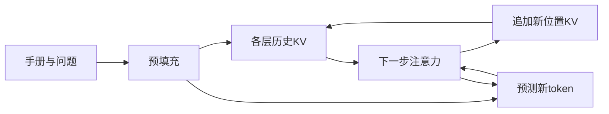

# KV cache：长文助手为什么吃显存，产品经理怎样谈成本

> 读者：不写代码的产品经理｜范围：常规逐词生成模型的推理缓存｜证据：官方文档、原论文及本地教学算术，无服务性能实测。

你在做长文客服助手：用户上传产品手册，连续追问，工程师说“模型放得下，但长上下文加并发顶不住”。你需要决定该缩短材料、限制并发，还是投入缓存优化。只知道模型参数量，回答不了这个问题。

沿着同一个助手看一次问答，你会分清哪些工作可以省、哪些显存必须随会话增长，以及为什么“缓存命中”不能直接翻译成“费用下降同样比例”。

## 1 一次回答怎样留下可复用的中间结果

模型先把手册和问题切成 **token**，即模型处理的文本单位；一个汉字未必恰好对应一个token。生成时，它依据已有文本预测下一个token，再把新结果接回上下文继续预测。手册越长，每次预测可能需要参考的历史位置越多。读者讨论长度时应先确认使用哪一种分词器，不能把页面字数直接当作缓存长度。

在模型的一层中，**注意力**负责判断当前位置应该从哪些历史位置取信息。当前token产生 **Q（查询向量）**，表达“现在需要什么”；每个可见位置产生 **K（键向量）**，用于匹配查询，以及 **V（值向量）**，提供被加权汇集的内容。它们都是模型计算出来的一组数字，并非文字摘要，也不是数据库的一条键值记录。

**KV cache**保存各层历史位置的K和V。为什么这些结果能存起来？常规生成使用因果注意力：较早位置看不到未来文本。只要模型、前缀和位置等计算条件不变，后面新生成一个词不会反过来改变旧位置的K、V。下一步可以读取旧结果，只计算新增位置所需的部分。〔官方〕[Transformers v4.57.1缓存说明](https://huggingface.co/docs/transformers/v4.57.1/en/cache_explanation)

例如助手已经读完手册和问题，正在写“保修期限为……”。预测接下来的内容时，当前Q仍然要与历史K匹配，再汇集相应V。缓存省下的是反复生成历史K、V的工作；对历史的读取和注意力计算仍然存在。工程上因此会遇到另一种慢：显存里放得下，搬运这些数据却花时间。

这张图回答：同一请求的缓存在哪一步建立，又在哪一步增长？〔示意〕

**预填充（prefill）**把输入前缀处理完并建立KV；**解码（decode）**则逐步生成后续token，并继续向缓存追加数据。图中回路解释了为何回答越来越长也会增加缓存，不能只统计上传手册的长度。两阶段的耗时应分开看，后面才能判断一次优化究竟改善了“等首字”还是“等回答写完”。

## 2 为什么放得下模型，仍会放不下会话

把显存预算拆成三笔：模型参数、缓存，以及运行时临时空间和预留。**权重**是模型学到的参数，同一个服务实例通常可供多请求共用；请求各自的上下文不同，KV通常要分别保存。新增用户未必复制一份权重，却会新增其会话状态。因此，权重能装入显存，只证明固定底座放得下。

先估算缓存数据本身。设L为有缓存的层数，H为每层的KV头数，D为每个头的数字个数，S为每个数字的字节数。**头**可理解为一组并行的信息通道。总缓存token数T是所有活跃请求实际保留长度之和，输入和已生成内容都要计入。K和V各存一份，所以未考虑共享、量化附加信息和分配开销的估算是：

> KV字节数 ≈ 2 × L × H × D × S × T。

这不是让产品经理记模型内部结构，而是让工程师给出可核对的“每token缓存多大”。同样的参数总量，KV头数可能不同；不能拿查询头数直接代替KV头数。**GQA（分组查询注意力）**允许多个查询头共用一组KV头，因而减少要保存的KV通道；这是模型结构差别，需要确认模型配置，不能靠服务端随意切换且保持原模型不变。〔论文〕[GQA v3](https://arxiv.org/abs/2305.13245)

<!-- calc: kv_budget -->
给助手设一组教学配置：32层、8个KV头、头维度128、每元素2字节。相乘后，每个缓存token占128 KiB。一条请求保留8192个token时，KV数据为1 GiB；32条同样长度的活跃请求就是32 GiB。这里的GiB按二进制换算，和商品页面常见的十进制GB需区分。〔示意〕（算术已复算）

这笔32 GiB还没加权重、临时张量、缓存管理信息和碎片。用“显存总容量减去权重大小，再除以单请求KV”只能得粗略上界；正式容量规划还要预留运行空间并观察峰值。反过来，也不应假设每个请求都同时达到最长：实际长度分布、调度和缓存保留策略共同决定占用。

## 3 长度、并发和费用为什么不是同一件事

<!-- calc: kv_budget -->
沿用上面的助手，只把每条请求保留长度翻倍，其他条件固定，KV就翻倍；只把同时活跃的请求数翻倍，也翻倍。两项同时翻倍，缓存数据变成原来的四倍。这里的“并发”指服务实际同时保留和执行的请求，排队中的请求是否已占用KV要看服务实现。〔示意〕

<!-- calc: kv_budget -->
| 条件 | 每请求缓存长度 | 活跃请求数 | KV数据估算 |
| --- | --- | --- | --- |
| 原方案 | 8192 token | 32 | 32 GiB |
| 只加长度 | 16384 token | 32 | 64 GiB |
| 长度、并发都加 | 16384 token | 64 | 128 GiB |

所以“更长上下文”和“更多同时在线用户”会竞争同一笔状态预算。产品可先根据手册的必要段落、回答长度和交互目标确定分布，再让工程师测能承受多少活跃请求，避免把最大上下文直接当作每次输入目标。

但缓存四倍不能推出账单四倍。**吞吐**是单位时间能完成多少工作；**延迟**是某个请求等待多久。更大批次可能提高设备利用率，却增加等待；更长历史即使有缓存仍要读取，可能受内存带宽限制。省下一部分显存是否能少买设备，取决于现有瓶颈是否真在容量，以及业务延迟目标下还能多承载多少请求。〔推断〕（依据前述缓存过程）

因此先约定成本分母：例如“满足延迟目标的成功问答”，并固定输入输出长度和质量标准。比较该分母下的设备费用、利用率及失败重试成本，才有业务意义。若购买外部API，还需核对实际计费规则；后端省了多少缓存不会自动等比例传给客户。

## 4 三种缓存优化，各自省了哪一笔

第一种是 **分页管理**：把KV分成块，请求通过映射使用这些块，无需一次预留一大段连续空间。可以把它理解为手册按页存放，目录知道每页在哪里；数据仍在，只是更少因预留过大或连续空间不足而浪费。PagedAttention论文讨论的正是碎片和重复复制导致的容量损失。它改善物理分配效率，不会凭空减小每个逻辑token的KV。〔论文〕[PagedAttention v1](https://arxiv.org/abs/2309.06180)

第二种是 **前缀缓存**：不同问题前面若有相同的手册前缀，且计算条件一致，可以复用已经建立的前缀KV，少做一遍预填充。它比“同一请求内部复用旧KV”再多跨了一步。把相同手册放在不同随机文本之后，可能使可匹配的前缀缩短；语义相似但token不同也不等于相同前缀。实际匹配和保留还受框架策略约束。

对助手而言，连续问同一本手册可能有利，但首次上传没有已有结果可用。命中后新问题和回答仍需计算，解码仍读取历史KV。vLLM文档明确把收益限定在预填充，不能据此承诺长回答生成也按同样比例加快。〔官方〕[vLLM前缀缓存，latest访问快照](https://docs.vllm.ai/en/latest/features/automatic_prefix_caching/)

第三种是 **KV量化**：用更低精度保存这些数字，降低公式中的S；但实际实现还有缩放信息、部分高精度数据和转换工作，不能只按位数比例承诺总显存。它可能影响数值误差和延迟，要同时检验长文查找准确性与速度。将缓存放到CPU等设备则是迁移存放位置，以传输时间交换GPU容量。Transformers v4.57.1专门提醒，短上下文且显存充足时，量化缓存可能损害延迟。〔官方〕[KV策略](https://huggingface.co/docs/transformers/v4.57.1/en/kv_cache)

这三项可组合，但先看问题在哪：分配浪费找分页，重复长前缀找共享，每token状态太大再评估精度或迁移。缩短上下文、改变模型结构和改变存储格式解决的层面不同，方案评审时应逐项说清。

## 5 怎样把讨论变成一份可验收的需求

交给工程师的输入应包含：模型与版本、实际token长度分布、输出长度上限、同时活跃请求分布，以及手册前缀重复率。所谓**首字延迟**是从请求发出到首个输出token的时间，包含排队；逐token延迟描述后续生成节奏。两者分开记录，避免首字更快但总回答体验变差却被平均数掩盖。

对照试验固定硬件、模型、质量评估集和长度分布，分别比较缓存优化开关。重复手册做冷缓存和热缓存两组；独立手册覆盖低命中情形；并发从业务常态逐步加到峰值，同时加入长请求。记录首字延迟和逐token延迟的高分位、完成请求吞吐、峰值显存、超时和内存不足次数，再计算满足约定目标的成功问答成本。高分位用于观察较慢的那部分请求，例如p95表示有95%的请求不超过该延迟，比只看平均数更容易发现排队问题。

验收门槛由产品与工程在试验前填写，不能等结果出来再移动。例如先确定用户可接受的首字等待和整段完成时间，以及质量下降容忍度；优化只有在这些约束内释放了可用容量或降低了成本才算通过。若分页降低显存峰值却没有增加可服务请求，继续检查计算或带宽瓶颈；若热缓存收益大但线上命中低，先改善可复用前缀的组织方式，而非直接外推最佳测试结果。〔推断〕

## 回到开头

工程师说“模型放得下，但长文多并发顶不住”，现在可以要求把共享权重、每token缓存和其他运行开销分开列。用实际保留长度乘活跃请求数建立容量解释，再由压测确定业务延迟目标下的可用范围。

你要推动的决策也更具体：先识别可删的无关输入，再判断是分配浪费、重复预填充还是状态尺寸过大。最后用相同质量和延迟约束下的成功问答成本验收，不把缓存命中率单独当成省钱结论。

## 自测题

1. 同一模型把回答上限提高，上传手册长度不变，为什么容量仍可能下降？

答案要点

生成的token也追加KV；实际同时保留的总长度增加会挤占容量，是否触顶取决于真实输出分布。

2. 手册不变但每次都在最前面加不同的长随机字符串，前缀缓存收益能照搬吗？

答案要点

不能；相同手册不再位于相同计算前缀中，需看实际token匹配和框架规则。

3. 某优化显存占用下降而首字延迟上升，你会立即上线吗？

答案要点

先检查业务延迟和质量门槛，再看是否增加达标吞吐、降低成功问答成本；容量收益本身不足以决定上线。

## 证据边界

算例为普通全注意力、各层配置相同且无共享的KV数据估算，未绑定真实模型。滑动窗口、混合架构、并行切分和不同缓存实现需另算。GQA、PagedAttention仅采用论文机制说明，不移植论文速度数字。vLLM引用为2026-11-25访问的latest页面，未锁定安装包；实际功能以部署版本为准。本次仅执行算术脚本，没有GPU压测、质量测试或计费验证。

## 参考来源

- [Transformers缓存说明](https://huggingface.co/docs/transformers/v4.57.1/en/cache_explanation)：官方，v4.57.1，因果KV复用。
- [GQA](https://arxiv.org/abs/2305.13245)：论文，v3，2023，KV头共享。
- [PagedAttention](https://arxiv.org/abs/2309.06180)：论文，v1，2023，缓存分页管理。
- [vLLM前缀缓存](https://docs.vllm.ai/en/latest/features/automatic_prefix_caching/)：官方，latest访问快照，预填充收益范围。
- [Transformers KV策略](https://huggingface.co/docs/transformers/v4.57.1/en/kv_cache)：官方，v4.57.1，量化和迁移权衡。
