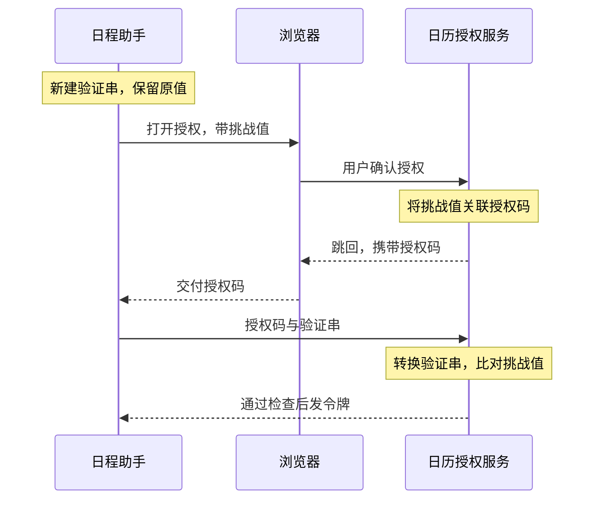

# PKCE：授权码被截走后，为什么还换不到通行证

> 读者：不写代码的产品人员｜范围：授权码拦截、PKCE流程与防护边界｜证据：四份IETF规范，由协调代理实际联网获取后共享原文片段；未运行真实接入实验。

你做一个日程助手，希望用户点击“连接日历”后，允许助手读取日历。用户去了日历平台的页面，同意授权，再跳回助手。你可能以为同意之后就全部安全了；但如果跳回来的那份临时凭据被另一个应用抢走，它能否冒领访问权限？

**PKCE**是一套让授权码的兑换者证明“我持有这次流程开始时准备的秘密”的机制。它直接处理的是授权码被截获后遭到冒用的问题。理解它，你就能向研发追问保护发生在哪一步，也能判断某个“安全了”的说法是否越过了它的能力范围。〔官方〕[RFC 7636](https://www.rfc-editor.org/rfc/rfc7636.html)

## 1 先弄清楚三份东西

**OAuth 2.0**让第三方应用获得受限制的访问权限。在这个例子里，日历平台保管数据，日程助手请求读取日历，用户决定是否同意；用户无需把日历账号密码交给助手。日历平台中负责处理授权和发凭据的部分，叫**授权服务**。〔官方〕[RFC 6749](https://www.rfc-editor.org/rfc/rfc6749.html)

先把几件容易混淆的东西分开。**授权码**是用户同意后、经跳转送回助手的一张临时兑换凭据。**访问令牌**则是兑换成功后交给助手、用于访问日历接口的凭据。它们分工不同：拿授权码向授权服务兑换，拿令牌向日历接口请求数据。页面跳回成功也不等于兑换成功；后台的检查还有可能失败。

**回调地址**是授权后把用户带回哪里。移动应用常通过系统把这个跳转交给某个应用。某些自定义链接形式可能被多个应用注册，因此“跳转到了同一台手机”不保证“只有真正的助手能收到”。RFC 8252专门讨论了这种拦截风险；这是系统分发回调的风险，不要求攻击者破解日历平台。〔官方〕[RFC 8252 §8.1](https://www.rfc-editor.org/rfc/rfc8252.html#section-8.1)

整个连接分为前后两段。前段经过浏览器，让用户看见请求并决定是否授权；后段由助手向授权服务兑换令牌。PKCE在开始之前加入准备动作，把这两段关联起来。这样即使有人看到前段送回的授权码，也还缺少兑换所需的另一份材料。

## 2 一次连接怎样走完

助手先为本次连接生成一份新的随机秘密，叫**验证串（code_verifier）**，暂存在自己这边。它足够随机，让旁人难以猜中。这个秘密属于这次授权尝试，不是用户密码，也不是所有安装包共用的固定密码。每次新授权都重新准备，才能把证明约束到本次流程。

随后，助手对验证串做**摘要**：按确定规则生成一个指纹，同一输入会得到同一结果，却难以只从指纹倒推出原输入。PKCE中把先送出的这份指纹叫**挑战值（code_challenge）**。当前应优先理解和采用S256方式，即用SHA-256生成摘要后按规定编码；这里不需要会写算法，只要掌握“可以核对、难以倒推”的性质。〔官方〕[RFC 7636 §4](https://www.rfc-editor.org/rfc/rfc7636.html#section-4)、[RFC 9700 §2.1.1](https://www.rfc-editor.org/rfc/rfc9700.html#section-2.1.1)

用户点击连接后，助手把挑战值和使用的转换方式放进授权请求。用户在日历平台同意，授权服务把挑战值与本次授权码关联，再通过回调返回授权码。到这里，浏览器跳转已完成，但助手尚未因此获得访问令牌。

助手接着在令牌兑换请求里同时提交授权码和原始验证串。授权服务找出该码之前关联的挑战值，按同样方式对收到的验证串重新生成指纹，再比较两份指纹。相同才继续其他必要检查并发令牌；对不上则拒绝。PKCE匹配成功不是跳过其他检查的特许证。〔官方〕[RFC 7636 §4.6](https://www.rfc-editor.org/rfc/rfc7636.html#section-4.6)

这张图回答：秘密什么时候留在助手、什么时候才交给授权服务？〔示意〕流程依据RFC 7636 §1.1。

图里的挑战值经过浏览器授权过程，原始验证串直到后段兑换才交给授权服务。安全差别就在这里：前段被观察的人看到的是指纹，后段的提交者必须持有能生成该指纹的原材料。

### 为什么不把同一个秘密传两次

假如助手在授权开始时就把验证串原值放进前段请求，攻击者若能读取这个请求，就同时得到了之后兑换所需的秘密。让它再提交一次原值，只证明它看过请求，并没有增加新的门槛。先送指纹则让“看过授权请求”与“持有验证串”分离；服务端先记下承诺，之后再检验秘密是否兑现承诺。

PKCE的早期规范也定义了plain方式，这时挑战值就是验证串本身。它对只截到回传授权码的某些情况仍可能形成限制，但不能覆盖连前段请求也被读取的场景。2025年RFC 9700要求选择不在授权请求暴露验证串的挑战方式，并指出当时S256是符合这一点的方法。产品验收因此应明确S256，而不是只检查请求里有没有某个PKCE字段。〔官方〕[RFC 9700 §2.1.1](https://www.rfc-editor.org/rfc/rfc9700.html#section-2.1.1)

### 验证的对象到底是谁

把过程想成寄存处先记下一个指纹、之后核对原物，可以帮助理解先后关系；但这里没有管理员凭长相认人。服务端确认的是兑换者持有本次秘密，不是识别手机里的某个应用真伪，更不是重新识别用户身份。用户是否同意，是授权页面处理的事；谁能把这次同意换成访问能力，才是PKCE补上的约束。

因此，同一个用户同时开两个连接页面时，产品层面也应把它们当成两次尝试。每次有自己的验证串、挑战值和授权码关联。一个页面返回的码不能随手拿另一个页面保留的秘密去配，失败后要恢复正确的流程状态，必要时重新连接。这里的重点不是让用户处理秘密，而是让应用替用户维护对应关系，避免把正常校验失败误报成账号密码错误。〔推断〕

## 3 同一个攻击者，改变他拿到的东西

让恶意应用截走跳回来的授权码。它知道助手的应用标识，甚至看到了最初挑战值，仍不掌握助手保留的验证串。它用自己的随机串去换令牌，生成的指纹与授权码关联的指纹不同，授权服务就应该拒绝。攻击没有必要被完全阻止在“看见码”这一步，PKCE把防线放在“成功兑换”这一步。〔官方〕[RFC 8252 §8.1](https://www.rfc-editor.org/rfc/rfc8252.html#section-8.1)

如果助手错误地把验证串写进攻击者可读的日志，条件便改变了。攻击者同时拿到授权码与对应验证串时，就有了满足这项校验的材料。它仍需满足兑换的其他条件，但PKCE这道门槛已经不能区分它和原发起方。这个判断来自校验方式本身，因此保护验证串是机制成立的条件。〔推断〕

再换一种情况：攻击者不管授权码，而是在连接成功后偷到了访问令牌。PKCE已经完成使命，无法在每次日历访问时再次要求验证串。访问令牌能否被直接使用，取决于该令牌自身的约束与保护方式。因此“用了PKCE”不能推出“令牌泄漏也无害”。RFC 9700把令牌重放保护单独列为问题，反映了两个阶段需要不同控制。〔官方·推断〕[RFC 9700 §2.2](https://www.rfc-editor.org/rfc/rfc9700.html#section-2.2)

这三个场景的分界不在攻击者叫什么，而在他持有什么。只截码时，秘密仍形成门槛；秘密也泄露时，门槛的前提消失；偷到已经发出的令牌时，攻击目标绕过了兑换阶段。

## 4 产品验收究竟该看什么

研发说“我们已经用了PKCE”，首先应能描述本次授权的挑战值怎样被保存关联、兑换时怎样强制核对。如果授权请求只带了字段，服务器随后无论验证串是否正确都发令牌，就没有实现这项防护。RFC 9700明确要求收到有效挑战值的授权请求，在令牌端必须强制执行验证串校验；还要防止流程被降级到缺少关联的状态。〔官方〕[RFC 9700 §2.1.1](https://www.rfc-editor.org/rfc/rfc9700.html#section-2.1.1)

你不必逐行审代码，可以让团队在测试环境演示一组成功与失败：同一次授权的正确验证串能完成连接；缺失或错误验证串时，令牌不应发出；重新开始授权后，旧流程的验证串不能随意套到新流程。记录接口结果和用户页面，才能分清“跳回了助手”与“连接完成”。这些是依据机制提出的验收建议，本文没有实际调用任何平台。〔推断〕

PKCE也不能代替检查回调地址。回调校验限定授权结果送向哪里，PKCE限定谁能兑换；两者保护不同环节。恶意或错误的跳转仍可能泄露信息、破坏流程，不能因为后面有秘密校验就放任地址任意变化。RFC 6749要求注册并校验相关回调地址，后续安全建议需结合具体平台落实。〔官方〕[RFC 6749 §10.6](https://www.rfc-editor.org/rfc/rfc6749.html#section-10.6)

同样，**HTTPS**提供网络通信的传输保护；PKCE不会把未加密传输自动变安全。尤其后段要发送原始验证串和取得令牌，仍需可靠保护。原生应用的本机回环跳转有专门规则，不能据此推导远程网络接口也可以取消HTTPS。〔官方〕[RFC 8252 §8.3](https://www.rfc-editor.org/rfc/rfc8252.html#section-8.3)

还有一个容易混淆的层次：应用标识回答“声明自己是哪一个应用”，验证串回答“是否持有这次流程的秘密”。应用标识是公开信息，不能拿它当秘密。服务器上的应用还可能有独立的客户端认证；PKCE不负责取代它。原生安装包里埋一份所有用户共用的固定秘密，也不能获得与受控服务器同样的保密能力。〔官方〕[RFC 6749 §2](https://www.rfc-editor.org/rfc/rfc6749.html#section-2)

## 回到开头

用户从日历平台跳回日程助手时，授权码只是一次兑换机会。PKCE让这份机会还受本次秘密约束：开始时先登记指纹，兑换时提交原值并核对。恶意应用只截到授权码，无法凭这一项完成兑换。

产品判断可以围绕三个时点展开：授权前是否新建并保住秘密，授权后是否把挑战值与码绑定、强制核验，发令牌后是否继续保护令牌和通信。这样既能说清PKCE为什么有用，也能说清哪些问题还要由其他机制承担。

## 自测题

1. 页面已跳回助手，却因验证串错误显示“连接失败”，这种失败是否符合PKCE的目的？

答案要点

符合。跳回只完成前段；兑换必须通过对应验证串校验才能取得令牌。

2. 测试人员能读取挑战值，却拿不到原始验证串，这是否意味着秘密已经暴露？

答案要点

S256下不是。挑战值是难以反推的指纹；若采用plain则条件不同。

3. 团队说令牌都存在前端日志里也没关系，因为已用PKCE。你如何回应？

答案要点

PKCE保护授权码兑换；令牌发出后的泄露是另一阶段风险，应独立保护，不能据此接受日志泄漏。

## 证据边界

使用RFC 7636（2015）、6749（2012）、8252（2017）及9700（2025）。本代理联网失败后，由协调代理实际打开页面并共享原文片段，再逐段核查；未把访问失败伪装成成功。示例不对应某个已测试产品，未展开OAuth全部模式、OIDC登录身份、请求伪造完整防护或SDK接入。独立读者测验：待独立读者测验。

## 参考来源

- 〔官方〕[RFC 7636：PKCE](https://www.rfc-editor.org/rfc/rfc7636.html)：§1.1、§4，验证串、挑战值、兑换校验。
- 〔官方〕[RFC 6749：OAuth 2.0](https://www.rfc-editor.org/rfc/rfc6749.html)：§2、§10.6，客户端性质、标识与回调。
- 〔官方〕[RFC 8252：原生应用](https://www.rfc-editor.org/rfc/rfc8252.html)：§8.1、§8.3，拦截威胁与本机跳转边界。
- 〔官方〕[RFC 9700：安全最佳实践](https://www.rfc-editor.org/rfc/rfc9700.html)：§2.1.1、§2.2，S256、强制校验、令牌阶段防护。
