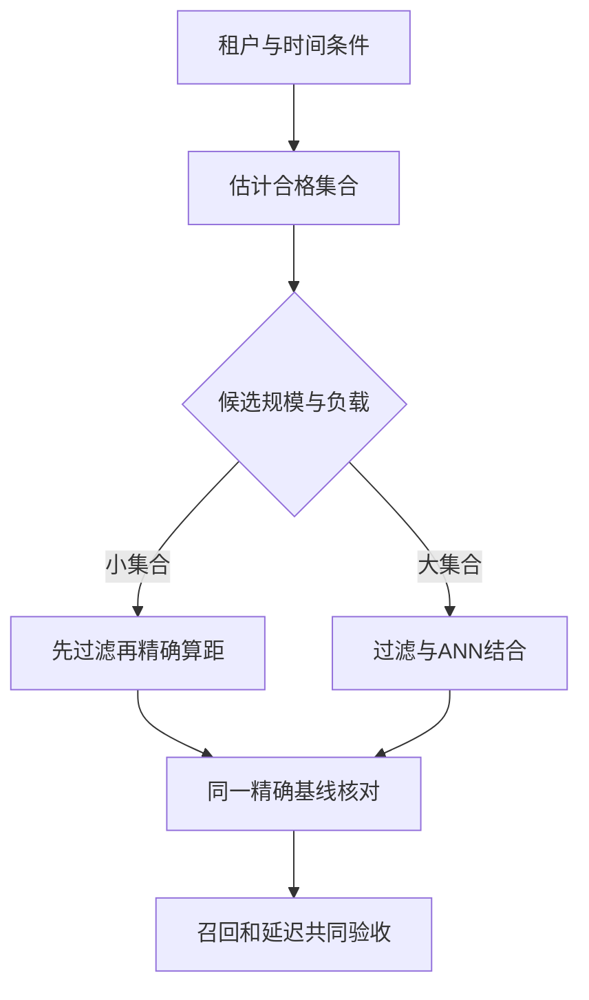

# 2000万条768维向量：已有PostgreSQL，怎样选pgvector或Milvus

> 读者：会编程、已有关系数据库经验｜范围：多租户文档库的带时间过滤检索｜证据：版本化官方资料及本地教学复算，未执行数据库压测。

文档库有约2000万条768维**向量**，即每条文档的一组数字表示，业务数据已经在PostgreSQL。一次查询要求“只看这个租户、这个时间段，返回最相近的若干文档”。选型的难点是过滤后还剩多少可检索数据，以及系统在目标结果完整度下能否按时返回，而不只是总行数。

建议先把pgvector作为验证起点，同时为Milvus准备同口径对照。现有信息不足以批准最终生产方案：每秒请求数、延迟目标、租户倾斜、更新量和新数据可见性仍未知。下面给出会改变建议的条件及验证方式。

## 1 需求：规模之外，还要量哪几件事

文档的数字表示采用固定长度数组；768维意味着有768个坐标。查询文本经过同一套嵌入模型得到查询向量，再按约定的距离找邻居。这里的 **top-k** 是在满足租户和时间条件的文档集合内，返回距离最小的k条。距离越小是否等于业务上越相关，取决于嵌入模型，数据库选型应先固定模型和距离定义。

先估算存储下界。设N为向量条数、D为维数，单精度数字每维4字节，则纯坐标大小为N×D×4。代入20,000,000×768×4，得到61.44 GB，约57.22 GiB。pgvector v0.8.0的vector值还包含每条8字节开销，按其类型公式合计61.60 GB，约57.37 GiB。〔示意〕类型公式见〔官方〕：[pgvector v0.8.0](https://github.com/pgvector/pgvector/blob/v0.8.0/README.md)。

这还没算表行、标量字段、索引、存储页、副本、日志及构建时临时空间。因此不能把57 GiB理解为整套系统的内存需求；更不能由“超过某容量”直接判定数据库类别。真正要问的是热数据和索引能放多少、磁盘读取代价多大，以及与现有事务负载是否互相干扰。

本场景需要补齐五个维度：租户和时间条件下的候选行数分布；常态及峰值请求速率；响应延迟与结果完整度目标；写入、删除和嵌入重建频率；团队能承担的资源与运维预算。候选行数尤其要看小租户和最大租户，不能用平均租户代表所有请求。窄时间窗口未必选择性高，热门租户近期可能集中写入大量数据。

把这些需求记成可验收合同：查询只在授权集合中找结果、精度达到预定目标、峰值下高分位延迟达标、新增和删除在约定时间内可见。后续每个候选都按同一合同测，避免一个用了较低结果完整度换速度，另一个按高质量运行，最后比较出误导性的“快”。

## 2 候选怎样工作：过滤为什么会改变近邻检索

**精确检索**对合格候选逐条计算距离，再取最小的k条；其工作量随候选集合增加。**ANN（近似最近邻检索）**则利用索引少看一部分向量，以遗漏部分真近邻的可能性交换速度。**召回率**衡量真实近邻找回多少，须以同一过滤集合内的精确结果作参照。

pgvector把向量类型和距离检索放入PostgreSQL，可选择精确路径或不同近似索引。**HNSW**通过分层邻居图寻找相近区域；**IVFFlat**先将空间分成若干列表，再搜索其中一部分。前者和后者都有搜索工作量与遗漏风险的权衡，不能用索引名代替本业务测量。〔官方〕[pgvector v0.8.0索引与Filtering章节](https://github.com/pgvector/pgvector/blob/v0.8.0/README.md)

在pgvector v0.8.0的官方比较中，HNSW有较好的速度—召回取舍，代价是构建较慢、占用更多内存；它无需IVFFlat那样的训练，可以在空表上建索引。IVFFlat构建较快、占用较少内存，但要在已有数据上训练列表划分。因而训练数据能否代表后续分布、是否有装载后建索引的窗口，以及图索引工作集能否承担，都影响选择；这不是对两者在任意机器上的性能排名。〔官方·推断〕[HNSW / IVFFlat](https://github.com/pgvector/pgvector/blob/v0.8.0/README.md)

搜索阶段也有不同旋钮：HNSW的`hnsw.ef_search`扩大动态候选列表，通常提高召回并降低速度；IVFFlat的`ivfflat.probes`决定搜索多少列表，探查更多会多算距离，换取更少遗漏。构建时多花资源不等于查询已达到业务召回：仍需用同一过滤基线测不同搜索量。更新删除会继续产生索引维护、死元组和回收工作，所以还要测持续写入后的状态，而非只测刚建完的只读索引。〔官方·推断〕[Query Options / Vacuuming](https://github.com/pgvector/pgvector/blob/v0.8.0/README.md)

重点看一种失败过程：先从全库拿近似候选，再检查租户和时间。候选里的大多数文档可能属于别的租户或超出时间范围，最后只剩很少几条。SQL里写了WHERE和LIMIT，也不意味着索引先在合格集合上完整找到了k条。即使最终凑满k条，仍可能漏掉过滤集合中的更近文档。

教学假设：某次扫描拿到100个近似候选，过滤通过比例为1%，且这个比例可代表候选分布，那么平均只留下1条；若目标为10条，按比例反推需要1000个候选才有10条的期望值。这里的独立、均匀假设经常不成立，所以1000既不是召回保证，也不是推荐参数。〔示意〕

pgvector v0.8.0加入迭代索引扫描，在过滤后不足时继续扫描，但受最大扫描量等限制。严格顺序指返回候选按距离排好，不保证搜索已经遍历所有合格向量。扩大搜索可提高找到结果的机会，同时消耗更多延迟和资源。〔官方〕[Iterative Index Scans](https://github.com/pgvector/pgvector/blob/v0.8.0/README.md)

Milvus v2.6.x也把过滤和ANN结合：标准过滤先限制元数据集合，再执行向量搜索；迭代过滤则逐步取向量候选并逐个检查标量条件，适用于需要控制复杂表达式过滤工作的场景。它提供了针对过滤搜索的专门路径，但标准过滤后的ANN仍有近似误差，不能据此宣称一定完整或一定更快。〔官方〕[Milvus过滤搜索](https://milvus.io/docs/v2.6.x/filtered-search.md)

这张图回答：同一租户查询为什么要按合格候选规模考虑不同路径？〔示意〕

图中没有固定分界行数，因为距离计算成本、缓存命中和并发都会改变分界。不能直接拿全库规模替代中间的合格集合，也不能拿规划器估计代替实际执行观察。

## 3 逐维对比：已有PostgreSQL带来什么优势与约束

| 判断维度 | pgvector验证重点 | Milvus验证重点 |
| --- | --- | --- |
| 小租户、窄窗口 | 标量索引筛选后精确排序是否足够快 | 额外服务和同步是否值得 |
| 大租户、宽窗口 | ANN搜索量、索引工作集及尾延迟 | 过滤路径、索引配置及扩容收益 |
| 事务数据结合 | 复用SQL、同库更新与查询契约 | 复制哪些字段、如何回查原文 |
| 持续写入与删除 | 事务负载、索引维护及回收影响 | 写入到搜索可见性的端到端滞后 |
| 运维与成本 | 是否干扰主库、备份恢复和重建 | 新服务、同步链路及恢复演练成本 |

这张表导向的是两种责任分配：同库方案减少数据搬运，但检索会竞争现有数据库资源；分离方案能独立建设检索容量，同时必须维护两套数据之间的契约。应比较完成业务目标的整套成本，包含存储、副本、运维时间和故障恢复，不能只比查询节点价格。〔推断〕

同库优势可以具体落到一次文档更新：业务字段与向量能在同一事务提交或回滚，查询可用JOIN关联租户、权限和正文表，无需再维护一条跨库同步链路。pgvector官方列出ACID事务、JOIN和时间点恢复等PostgreSQL能力；应用仍须写对权限条件，并按事务隔离和实际查询计划理解可见性。它简化数据契约，不保证向量会自动与正文同步生成，也不保证任意JOIN都会得到高效的ANN计划。〔官方·推断〕[pgvector v0.8.0](https://github.com/pgvector/pgvector/blob/v0.8.0/README.md)

“已有PostgreSQL”只有在团队能给检索留出CPU、内存与I/O余量，并承担索引构建、VACUUM回收、备份恢复和重建窗口时，才转化为运维优势。大图索引构建和维护若挤压主业务，复用同库的收益就可能被资源竞争抵消；可先评估资源隔离，再决定是否需要独立检索系统。〔推断〕（依据官方构建、Vacuuming及恢复说明）

对小租户，先用租户与时间的标量条件筛出很小集合，再精确算距离，可能比维护全局ANN更合适。对大租户则要测试ANN；不要假定PostgreSQL会自动组合标量索引与图索引得到期望计划，应检查执行计划、实际扫描行数和过滤丢弃行数。

**分区**把逻辑大表拆成物理小表。若主要按时间取近期资料，可以评估按时间分区，让不可能匹配的旧分区被剪除。PostgreSQL 17文档说明，分区剪枝依据分区边界，而不是有无索引；只有查询条件能证明某分区无匹配时才可排除。〔官方〕[PG17分区剪枝](https://www.postgresql.org/docs/17/ddl-partitioning.html)

因此分区应服务实际过滤条件和生命周期。不要为了每个小租户都建一个分区而增加大量对象；先分析租户倾斜、时间窗口和跨分区查询，再试少量可维护方案。窄窗口筛掉大量旧数据和宽窗口遍历多个分区，是两种不同负载，需分别验收。

## 4 推荐：先验证pgvector，哪些结果会让建议改变

在已有PostgreSQL、要求租户和时间过滤、峰值性能尚未知的条件下，优先做pgvector验证，理由是能复用现有数据与SQL能力，并有机会把高选择性查询缩小为便宜的精确任务。这里推荐的是验证顺序，不是宣告2000万条一定能在现有机器上达标。〔推断〕

若最大租户的宽窗口查询占主要负载，调参后仍无法同时满足召回与尾延迟；或检索资源挤压事务业务、独立扩展成为硬需求，则进入Milvus对照验证。若pgvector已经达标，新增专用库必须拿出可量化收益抵消同步、运维和恢复成本。反之，如果现有数据库本就无法承担索引构建和峰值，专用库试验可提前并行开展。

引入Milvus时，建议明确PostgreSQL为业务真相源，提交后的变更通过可重试的增量同步写入检索系统。事件应有稳定主键和版本，以处理重复投递、乱序更新和删除；删除传播、权限变化与重建追平都需要验收。检索系统保留必要的租户与时间字段，在检索时应用条件；最终取正文仍以授权状态为准。〔推断〕（应用架构建议）

Milvus v2.6.x提供Strong、Bounded、Eventual、Session一致性级别，文档的默认值为Bounded。但即便选择Strong，也只能约束数据已进入Milvus之后的搜索可见性，不能消除PostgreSQL到Milvus之间尚未投递的延迟。〔官方·推断〕[Milvus一致性](https://milvus.io/docs/v2.6.x/consistency.md)

所以“更新提交后马上搜到”和“删除提交后马上不可见”必须分开设计。搜索结果回查真相源可拦住已经删除或失权的结果，但不能把尚未同步的新文档变出来；回查后结果变少也要纳入用户体验验收。这个契约往往比向量索引参数更能改变最终选型。

## 5 验证方案：怎样得到可推翻建议的证据

先冻结同一批真实数据快照、同一嵌入版本、距离度量及k值。采样真实查询，按租户大小、时间跨度、过滤后候选规模分桶，覆盖高峰和长尾。精确基线必须先应用完全相同的租户、时间和删除条件，再算距离，避免拿全库top-k当答案。距离并列时约定统一的处理规则；合格文档少于k时，单独记录真实不足。

对每个查询，令E为过滤后精确检索的目标ID集合，A为候选方案返回的ID集合，计算召回率为两者交集大小除以E的大小。空合格集合单列，不做除零运算。召回不足、返回不足、错误越权是不同失败，必须分别计数。

测试pgvector的过滤后精确路径、近似路径和迭代扫描；Milvus对照同一距离、过滤表达式、索引精度及一致性目标。先在小样本排除查询语义错误，再在目标全量数据上运行，因为索引工作集与租户倾斜会随规模改变。测试矩阵覆盖冷启动与稳态缓存、只读与持续更新、普通查询与最大租户查询。

在试验前填写召回下限、p95/p99延迟上限、目标请求速率和同步可见性目标，然后逐步加压直到失败或达到峰值。记录CPU、内存、磁盘、索引大小、构建时间与失败恢复时间。在相同资源预算或清楚列出的不同预算下比较，测试至少覆盖一次业务峰谷、索引维护和更新追平，不把刚预热后的短时数字当生产结论。

通过条件应逐桶满足质量和延迟，并证明写入、删除、恢复达标；总体平均达标掩盖最大租户失败也应判失败。若pgvector通过，保留它并记录容量余量；若失败，保留瓶颈证据再看Milvus是否在同合同下通过。两者都失败时应重新检查数据布局、资源和嵌入方案，不把更换产品名当作已完成优化。〔推断〕

## 回到开头

2000万条768维说明你需要认真规划存储和索引，却不足以决定必须迁移。先量出过滤后的真实工作量，在现有PostgreSQL里验证精确与ANN路径，是最容易获得第一批有效证据的起点。

最终选择由同一召回、延迟、数据可见性和成本合同裁决。只有专用库带来的可验证收益超过新增数据链路的代价时，才有理由推进迁移；当前没有压测结果，结论保持为有条件的验证顺序。

      

                                   
                                
                                          
          

                           
                                
                                 
          

                                              
                                
                                      
          

## 证据边界

来源限定pgvector v0.8.0、PostgreSQL 17、Milvus v2.6.x；未推断用户实际安装版本。原始数据量为用户约数，容量计算按精确2000万条作教学估算。未运行任何数据库、索引构建或性能测试；QPS、硬件、延迟预算、租户分布及更新负载未知。建议不包含性能排名、迁移承诺或产品价格；压测计划需由团队填入业务验收值后执行。

## 参考来源

- [pgvector v0.8.0 README](https://github.com/pgvector/pgvector/blob/v0.8.0/README.md)：官方版本文档，类型大小、过滤、精确和近似索引、迭代扫描。
- [Milvus过滤搜索](https://milvus.io/docs/v2.6.x/filtered-search.md)：官方，v2.6.x，标准与迭代过滤。
- [Milvus一致性](https://milvus.io/docs/v2.6.x/consistency.md)：官方，v2.6.x，内部数据可见性。
- [PostgreSQL分区](https://www.postgresql.org/docs/17/ddl-partitioning.html)：官方，17，分区剪枝机制。
