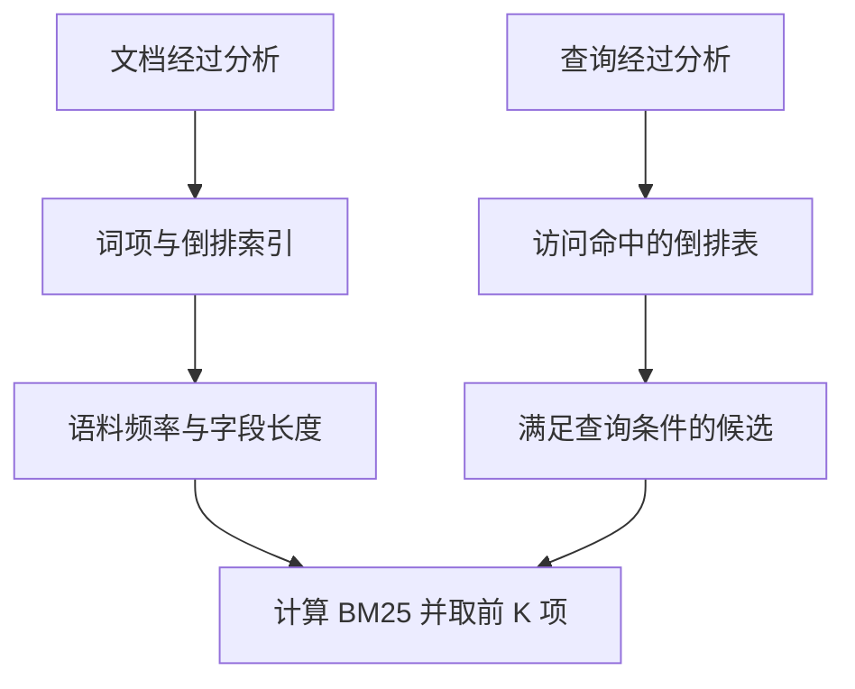
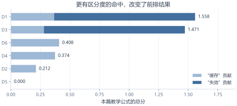
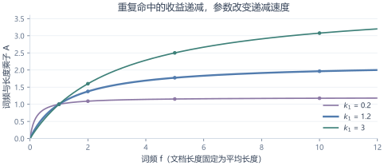
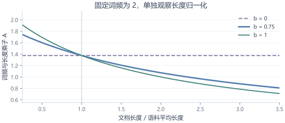
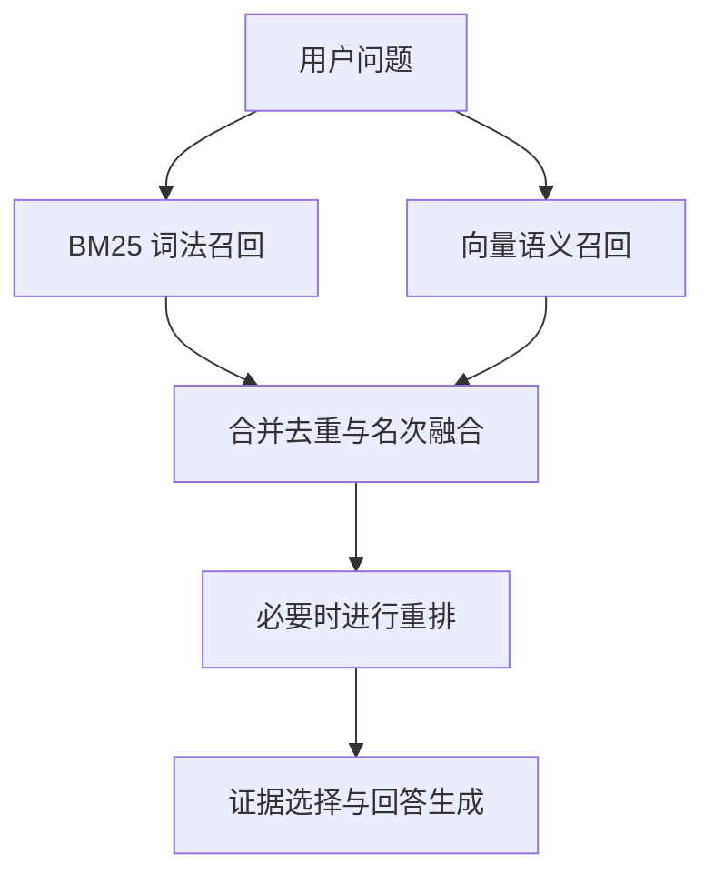

# 深入理解 BM25

*从关键词证据、评分算例，到中文检索与 RAG 选型*

<!-- woyao:metadata -->
- **Skill 版本：** woYao v0.16.0
- **研究日期：** 2026-10-24
- **读者：** 有基本编程经验，希望理解搜索与 RAG 检索的开发者
- **证据范围：** 原作者论文、版本锁定的 Lucene 源码、官方文档，以及本次本地合成计算
- **研究对象版本：** 理论参照 Robertson / Zaragoza 2009；实现参照 Lucene 10.3.1；Elastic 在线文档按研究日读取
- **文档版本：** 1.0
- **生成者：** woYao skill by saneryi
- **研究限制：** 已运行文中 Python 算例；未启动 Lucene / Elasticsearch、未测真实业务语料或向量模型
<!-- /woyao:metadata -->

## 1　先抓住它解决的问题

你在技术文档里搜索“缓存失效”。有的文章只是顺带出现一次“缓存”，有的反复堆这个词，有的真正讨论“失效策略”。搜索系统需要决定：**哪些文档值得先看？**

BM25 是一种经典的**词法相关性评分方法**。它主要依据查询词有没有出现在文档里、出现多少次、在整个语料里有多罕见，以及文档有多长，给候选文档排序。它来自概率相关性框架，但常用输出是排序分数，不是校准后的“相关概率”。理论脉络见 [Robertson 与 Zaragoza 的综述](https://www.staff.city.ac.uk/~sbrp622/papers/foundations_bm25_review.pdf)。

理解它可以先记住三个判断：**有区分度的命中更重要，重复命中的收益会递减，较长文档需要结合长度解释命中次数。**

### 它处在搜索流程的什么位置？

BM25 不负责独自完成整个搜索产品。文本先被分析成 token，也就是参与匹配和统计的词项；倒排索引帮助找到命中文档；查询条件决定哪些候选合格；BM25 再参与计算这些候选的词法分数。字段权重、业务规则、过滤、短语查询和后续重排还可能继续影响结果。

例如用户要求“两个词都必须出现”，这是匹配约束；要求“命中以后谁更靠前”，才进入评分问题。不要把“BM25 排分低”和“查询根本不允许它进入候选”当成同一种故障。

### 为什么今天仍然值得学？

BM25 不要求先为当前任务训练一个神经编码器，分数也容易拆解。它适合作为词法检索基线，尤其能帮助检查实体名、术语和词面证据。但“适合作基线”不是“必胜”：BEIR 作者在 2021 年的跨任务评测中报告它是稳健基线，该结论受当时数据与参评系统限制，不能拿来证明它胜过今天所有向量模型。[BEIR 原论文](https://arxiv.org/abs/2104.08663v4)

接下来先学机制，再学判断：为什么两个词都出现的短文可能胜过重复很多次关键词的长文？为什么一个分词设置会让你再怎么调公式也搜不到目标？

## 2　从文本到可计算的证据

### 先建词项，再建统计

假设一段文档经过分析后成为：`python / 缓存 / 缓存 / 失效`。此时“缓存”的词频是 2，文档长度是 4 个 token。这里的长度不是汉字数、字符数、字节数，也不是模型的上下文长度。

搜索系统会维护“词项 → 哪些文档出现过它”的倒排表，以及评分需要的频次和长度等信息。对“缓存失效”的查询，若分析得到 `缓存 / 失效`，就能沿这两个词项的倒排表访问候选。



*图 1｜本篇原创的概念流程。索引在离线或增量写入时准备证据，查询时使用这些证据；图不代表任何引擎的全部执行细节。*

图中从 C 到 G 的箭头很关键：同一篇文档的分数还依赖整个语料的统计。即使文章没改，换了索引范围或切块方式，也可能改变分数。

### 先分清两个容易混淆的频率

**词频 TF** 问的是“某一个文档里出现了几次”；**文档频率 DF** 问的是“整个语料里有多少个文档出现过”。一篇文档里重复一百次，只会为该词的 DF 增加一个文档。

如果 100 篇文档中几乎每篇都有“系统”，命中“系统”通常不太能区分候选；一个只在少数文档出现的明确术语，可能更有区分度。BM25 用逆文档频率 IDF 表达这种统计上的稀有程度。**稀有不等于语义上重要**，罕见噪声和拼写错误也可能很稀有。

## 3　把公式拆成能解释的三部分

本篇固定采用下面这个教学版本：一个文本字段、去重后的查询词、自然对数、正值 IDF，并保留常见的分子因子。它的 TF 和长度结构属于 BM25 家族；IDF 形式与参照的 Lucene API 一致。[Lucene 10.3.1 API](https://lucene.apache.org/core/10_3_1/core/org/apache/lucene/search/similarities/BM25Similarity.html)

$$
S(q,d)=\sum_{t\in Q}\operatorname{IDF}(t)\,A(t,d)
$$

$$
A(t,d)=\frac{f(t,d)(k_1+1)}{f(t,d)+K(d)}
$$

$$
K(d)=k_1\left(1-b+b\frac{|d|}{\overline L}\right)
$$

$$
\operatorname{IDF}(t)=\ln\left(1+\frac{N-n(t)+0.5}{n(t)+0.5}\right)
$$

| 符号 | 含义 | 容易误读的地方 |
| --- | --- | --- |
| $q$、$Q$ | 原查询及本例去重后的查询词集合 | 不是所有实现都这样处理重复查询词 |
| $d$、$t$ | 一篇文档、一个词项 | 实际引擎通常按具体字段计分 |
| $f(t,d)$ | 词项在该文档里的次数，即 TF | 不等于出现过该词的文档数 |
| $N$、$n(t)$ | 语料文档数、包含该词的文档数 DF | 字段稀疏时不能随手用整个索引总数代替字段统计 |
| $\lvert d\rvert$、$\overline L$ | 文档 token 长度、语料平均 token 长度 | 本例不涉及重叠 token 或引擎长度编码 |
| $k_1$、$b$ | 词频饱和与长度归一化参数 | 它们不是训练出的神经网络权重 |

可以把一次得分想成：对每个命中的查询词，先看它有多少区分度，再乘上一个结合词频与长度的贡献，最后把贡献相加。词没出现时，贡献为零；不能因为它的 IDF 很高，就凭空给文档加分。

### 第一部分：稀有词的命中更有区分度

在其他量不变时，DF 越小，上式的 IDF 越大。本篇形式在词出现在全部文档时仍为一个较小正数。你可能还见过没有最外层“加 1”的对数比值，它会在词覆盖超过半数文档时变负；这是公式变体差异，不应混着手算。[BM25 原作者综述，§3.1、§3.4](https://www.staff.city.ac.uk/~sbrp622/papers/foundations_bm25_review.pdf)

### 第二部分：重复出现会加分，但不能无限线性加分

固定文档长度后，词频进入一个有上限的函数。第二次命中仍有价值，第十次的新增价值却小得多。本篇公式中，词频趋于无穷时，$A$ 接近 $k_1+1$，所以单个词的贡献接近其 IDF 乘这个上限。

这只约束**一个词的词频收益**，不意味着 BM25 已经能识别垃圾内容，也不代表整个文档总分有一个对所有查询通用的固定上限。

### 第三部分：次数需要结合文档长度解释

一个词在 20 个 token 的短段落里出现两次，与在 2,000 个 token 的长文里出现两次，传递的集中程度不同。长度项以语料平均长度为参照，而不是简单把分数除以文档字数。

固定词频时，若 $b>0$，较长文档的 $K(d)$ 更大，这个词的贡献更低。但长文可能包含更多查询词或有更高词频，因此**不能推导出“BM25 总是把短文排前面”**。

## 4　用六篇小文档算出完整排序

以下是本篇自行构造的教学语料。为让数字完全可核查，空格直接定义 token 边界；这不是某个中文分词器的真实输出，也不是检索质量数据集。

查询固定为 `缓存 / 失效`，取 $k_1=1.2$、$b=0.75$，且暂时允许只命中其中一个词的文档参与比较。

| 文档 | 已分好的 token 序列 | 长度 |
| --- | --- | --- |
| D1 | python 缓存 缓存 失效 | 4 |
| D2 | python 缓存 机制 设计 更新 更新 更新 更新 | 8 |
| D3 | java 缓存 失效 策略 | 4 |
| D4 | python 缓存 缓存 缓存 缓存 缓存 案例 日志 监控 调试 线程 并发 | 12 |
| D5 | python 列表 排序 算法 | 4 |
| D6 | python 缓存 缓存 缓存 | 4 |

### 第一步：先算语料统计

六篇文档共 36 个 token，因此平均长度为 6。注意 D2 的“更新”和 D4 的其他词虽不是查询词，仍然进入文档长度。

“缓存”出现在 D1、D2、D3、D4、D6，DF 为 **5**，IDF 为 **0.241162**；“失效”只出现在 D1、D3，DF 为 **2**，IDF 为 **1.029619**。DF 统计的是文档数，D4 里的五次“缓存”不能算五篇。

“缓存”在语料中很常见，“失效”更能区分文档。因此，两个词各命中一次，未必比单个词重复几次贡献相近。

### 第二步：算 D1 的两个贡献

D1 长度为 4，比平均长度 6 短，代入得到：

$$
K(\mathrm{D1})=1.2\left(0.25+0.75\times\frac{4}{6}\right)=0.9
$$

“缓存”出现两次，其词频和长度乘子为：

$$
A(\text{缓存},\mathrm{D1})=\frac{2\times2.2}{2+0.9}=1.517241
$$

于是“缓存”贡献约为 $0.241162\times1.517241=0.365901$。“失效”出现一次，贡献约为 $1.029619\times2.2/1.9=1.192191$。两者相加得到 **1.558092**。

### 第三步：比较所有文档

| 排名 | 文档 | “缓存”贡献 | “失效”贡献 | 总分 |
| --- | --- | --- | --- | --- |
| 1 | D1 | 0.365901 | 1.192191 | 1.558092 |
| 2 | D3 | 0.279240 | 1.192191 | 1.471431 |
| 3 | D6 | 0.408120 | 0 | 0.408120 |
| 4 | D4 | 0.373631 | 0 | 0.373631 |
| 5 | D2 | 0.212223 | 0 | 0.212223 |
| — | D5 | 0 | 0 | 0 |

D5 列在表里是为了说明“无命中就无词项贡献”；实际按命中取候选时，它通常不会出现在结果中，不是必须凑进第六名。表中所有值由本次本地 Python 计算，未把它们标成 Elasticsearch 返回值。



*图 2｜本篇根据上述合成语料计算的分数分解。浅蓝为“缓存”，深蓝为“失效”；这是公式演示，不是效果基准。*

这组排序给出三个可以解释的现象：D1 和 D3 都命中了区分度更高的“失效”；D1 与 D3 一样长，前者多一次“缓存”命中，所以略高；D6 的“缓存”只出现三次，却超过出现五次的 D4，因为它更短，且重复收益会饱和。

如果改成“两个词必须都命中”，D2、D4、D6 会在候选阶段被排除。这没有改变 BM25 公式，却改变了最终结果列表。

## 5　参数改变的是哪一种偏好？

Lucene 10.3.1 的默认参数是 $k_1=1.2$、$b=0.75$。它们是一个实现的默认起点，不是 BM25 的定义，也不是所有语料上的最优解。[版本锁定的 API 文档](https://lucene.apache.org/core/10_3_1/core/org/apache/lucene/search/similarities/BM25Similarity.html)

### 词频参数：愿意继续奖励多少次重复？

先固定文档长度等于平均长度，这时长度项简化，比较下表的 $A$，暂不乘 IDF。

| 词频 | $k_1=0.2$ | $k_1=1.2$ | $k_1=3.0$ |
| --- | --- | --- | --- |
| 1 | 1.000 | 1.000 | 1.000 |
| 2 | 1.091 | 1.375 | 1.600 |
| 5 | 1.154 | 1.774 | 2.500 |
| 10 | 1.176 | 1.964 | 3.077 |

小 $k_1$ 很快接近“出现过就差不多够了”；大 $k_1$ 在更多重复范围内保持明显区分。取 $k_1=0$ 时，对出现过的词，本篇乘子为 1，词频和长度都不再改变其贡献；没出现的词仍然是零。不能把这一边界理解成给所有词都加 1。



*图 3｜本篇从固定公式计算的曲线，文档长度固定为平均长度，纵轴为未乘 IDF 的 $A$。不同曲线有不同上限，不能只比较它们是否“更平”。*

图中第一次出现都落在 1，是“长度等于平均长度”这一设定的结果；在更短或更长的文档中，不要照搬这个数。

### 长度参数：多大程度把冗长当作折扣？

固定词频为 2、$k_1=1.2$，只改变长度相对平均值的比例：

| 文档长度 / 平均长度 | $b=0$ | $b=0.75$ | $b=1$ |
| --- | --- | --- | --- |
| 0.5 | 1.375 | 1.600 | 1.692 |
| 1 | 1.375 | 1.375 | 1.375 |
| 2 | 1.375 | 1.073 | 1.000 |

当 $b=0$，长度从这个公式中退出；当 $b=1$，长度按该形式完全参与归一化。后者不是“总分精确除以长度”。选哪一档取决于任务：一篇长文是重复啰嗦，还是覆盖了更多有用子话题？这个判断需要相关性数据，不能单凭偏爱短答案决定。



*图 4｜本篇自行计算；词频固定为 2。曲线解释一个控制变量，不代表自然语料中长文一定更差。*

调参前先核查切词、字段和语料单位。若目标文档压根没有命中，修改 $k_1$ 无法让零词项重叠自动变成语义匹配。

## 6　中文检索：分词不是公式前面的无关小事

BM25 看到的是分析后的词项。分析器通常由字符处理、tokenizer 和 token filters 组成，可能改变大小写、切分边界、停用词和同义词。它们共同决定什么算命中，也改变 TF、DF 和长度。[官方分析器组成说明](https://www.elastic.co/docs/manage-data/data-store/text-analysis/anatomy-of-an-analyzer)

### 一个词项边界能改变整个排序问题

设想“缓存失效策略”被某分析方案切为 `缓存 / 失效 / 策略`，另一个方案按单字切分，第三个保留为一个完整 token。用户搜索“缓存失效”时，候选集合和统计就可能完全不同。这三种都是**用来说明机制的假设切分**，不是在声称某个默认分析器实际如此输出。

索引和查询分析器不一定要是同一个对象，但产生的词项空间必须相容。文档里是一个完整术语、查询里却拆成无法对齐的词，或把型号中的符号去掉，都可能导致漏检。先看真实 token，再研究评分。

SmartCN 是一个官方提供的简体中文及中英混合文本分析方案，但这不构成“它对你的业务最优”的结论；领域词、人名、缩写、版本号和标识符应单独验证。[Smart Chinese 官方说明](https://www.elastic.co/docs/reference/elasticsearch/plugins/analysis-smartcn)

### 高频词、同义词与短语是三件不同的事

**高频词不必一律删掉。** 它们的 IDF 可能较低，但在短语、否定表达和业务术语中仍可能必要。“不支持退款”中的“不”，显然不是可以随意抹去的噪声。这里是任务设计判断，具体分析器行为应实际检查。

**同义词不是 BM25 自己学出来的。** 查询“缓存作废”，文档只写“缓存失效”，两者共有的“缓存”能贡献分数；“作废”和“失效”的对应关系则需要额外的分析、查询扩展或语义检索。别因为它命中部分词，就误以为公式理解了完整意思。

**基础词袋计分不表达语序。** 对同样的 token 次数与长度，基础公式不会区分“甲收购乙”和“乙收购甲”。若需要连续短语或位置约束，要在查询层加入相应机制；Elasticsearch 的 `match_phrase` 就是独立的短语查询入口。[短语查询文档](https://www.elastic.co/docs/reference/query-languages/query-dsl/query-dsl-match-query-phrase)

## 7　与 TF-IDF、向量检索、重排如何分工？

### 与 TF-IDF：亲近，但不是唯一固定公式的替换

TF-IDF 是“词频 × 逆文档频率”的权重家族，常用于稀疏文本向量；词频可以原始计数，也可对数化，向量还可能归一化。例如 scikit-learn 的默认设置使用平滑 IDF 和 L2 归一化。因此，“TF-IDF 永远线性奖励重复、完全不处理长度”是不准确的。[scikit-learn 官方定义](https://scikit-learn.org/stable/modules/feature_extraction.html#tfidf-term-weighting)

BM25 的识别点是这里的**饱和词频与相对平均长度的参数化组合**。它并不等同于把 TF-IDF 向量算一次余弦，也不能只换一个 IDF 就认为实现了 BM25。比较实验应明确双方的切词、词频变换、归一化和查询构造。

### 与向量检索：依赖的证据不同

稠密向量检索通常用编码器把查询与文档映射为向量，再按相似度检索。DPR 是双编码器学习表示的一个原始研究例子；它的论文结果只支持该论文的问答设置，不支持“向量总优于词法”的泛化。[DPR 原论文](https://arxiv.org/abs/2004.04906v3)

| 维度 | BM25 词法路线 | 稠密向量路线 |
| --- | --- | --- |
| 主要依据 | 分析后词项的重叠与统计 | 模型学习得到的表示及相似度 |
| 换一种说法 | 没有扩展时可能漏掉无重叠表达 | 有机会覆盖，但取决于模型和领域 |
| 术语、编号、罕见名称 | 切词保真且确有命中时有直接证据 | 是否保留细粒度差异需验证 |
| 主要准备成本 | 分析、建倒排、维护统计 | 文档编码、向量索引、查询编码 |
| 可解释性 | 可拆到词项、频率与长度 | 可查近邻，但“为何相似”通常更难直接拆解 |
| 典型失败 | 词汇不匹配、歧义、语序与否定 | 领域偏移、细节混淆、表示或近邻召回损失 |

这些是机制带来的观察方向，不是没有数据就能宣布的速度、成本或准确率排名。小库全扫描和大库倒排、精确向量检索和近似近邻，不能混在一起比较延迟。

### 与重排：先找到候选，再花更多计算做判断

重排器对已经取得的一小批候选重新打分，可能使用查询与文档的联合模型或其他特征。它解决的是“这一批里谁更相关”。如果正确文档根本没被第一阶段召回，后面的重排通常没有机会把它找回来。

这意味着“语义模型更强，所以只要加个重排器就能解决漏召回”并不成立。先判断错误出在候选覆盖，还是候选内部顺序，再选择增加召回路线或改进重排。

## 8　放进 RAG：混合检索与切块为何重要？

### 把词法与语义作为两条候选路线

一种可验证的设计是：同一问题分别走 BM25 和向量检索，再合并候选，必要时重排，最后把选出的证据交给生成模型。BM25 不负责验证文档事实，也不保证生成回答忠于来源。



*图 5｜本篇原创的混合检索流程。两路召回可能互补，是否值得增加成本由本任务评测决定。*

两路分数通常没有共同尺度。直接把 BM25 的 8.2 与余弦的 0.82 相加，数字大小本身并不表示哪路证据更可信。

互惠排名融合 RRF 提供一种按名次合并的方式。对文档 $d$，把各路排名的倒数贡献相加：

$$
\operatorname{RRF}(d)=\sum_{j:\,d\in R_j}\frac{1}{c+r_j(d)}
$$

这里 $R_j$ 是第 $j$ 路实际取出的候选列表，$r_j(d)$ 从 1 开始；$c$ 是平滑名次影响的常数，不是 BM25 的 $k_1$，也不是输出条数 K。没有进入某一路窗口的文档，不从该路获得贡献。[官方 RRF 机制](https://www.elastic.co/docs/reference/elasticsearch/rest-apis/reciprocal-rank-fusion)

例如词法排名是 A、B、C，语义排名是 B、C、A，取 $c=60$：A 约 0.032266，B 约 0.032522，C 约 0.032002，融合后 B 排第一。这些是本次计算的合成名次，不是某个检索服务的测量。RRF 避开了原始分数的直接相加，但不会让坏候选自动变好，候选窗口也仍然需要选择。

### 切块改变的不只是“把文章变短”

当一个 chunk 作为一篇可检索文档时，BM25 公式里的文档单位随之改变：原来的 100 篇文章可能变成许多 chunk，文档数、词的 DF、平均长度、局部词频都会变化。下面的判断直接来自对公式输入的分析，不是某个统一最佳切块实验。

- 切得更短，可能让局部主题更集中，但也可能把问题与答案、定义与条件分开。
- 重叠切块能保留边界附近上下文，也会让同一证据在多个候选中重复；检索时要考虑去重与证据多样性。
- 每块都重复相同标题或前缀，会改变其统计及命中模式；不能把前缀当作完全免费的元信息。

因此比较切块策略时要重新建索引并评测，而不是认为固定一组参数和分数阈值就能沿用。chunk 级命中、原文级覆盖和最终答案证据充分性也是不同指标。

## 9　把机制落到代码和可验证的选择

### 一段已实际运行的教学实现

下列代码只依赖 Python 标准库，完整复现第 4 节的六文档排序。它遍历所有文档，目的是看清公式，**不是生产搜索引擎**；没有倒排跳跃、查询改写、字段组合、norm 量化或分片统计。

```python
from collections import Counter
from math import log

texts = {
    "D1": "python 缓存 缓存 失效",
    "D2": "python 缓存 机制 设计 更新 更新 更新 更新",
    "D3": "java 缓存 失效 策略",
    "D4": "python 缓存 缓存 缓存 缓存 缓存 案例 日志 监控 调试 线程 并发",
    "D5": "python 列表 排序 算法",
    "D6": "python 缓存 缓存 缓存",
}
docs = {key: text.split() for key, text in texts.items()}
counts = {key: Counter(tokens) for key, tokens in docs.items()}
N = len(docs)
avgdl = sum(len(tokens) for tokens in docs.values()) / N
df = Counter(term for tokens in docs.values() for term in set(tokens))

def score(query, key, k1=1.2, b=0.75):
    K = k1 * (1 - b + b * len(docs[key]) / avgdl)
    total = 0.0
    for term in dict.fromkeys(query):
        f = counts[key][term]
        if f == 0:
            continue
        idf = log(1 + (N - df[term] + 0.5) / (df[term] + 0.5))
        total += idf * f * (k1 + 1) / (f + K)
    return total

ranked = sorted(docs, key=lambda key: -score(["缓存", "失效"], key))
for key in ranked:
    print(key, f"{score(['缓存', '失效'], key):.6f}")
```

本次实际输出：

```text
D1 1.558092
D3 1.471431
D6 0.408120
D4 0.373631
D2 0.212223
D5 0.000000
```

这段实现的扫描计分量随文档数与查询词数增长；生产系统可通过倒排访问命中项、候选剪枝和 top-K 收集减少工作。不要用这个 Python 循环的耗时代表 BM25 引擎的线上性能。

### 为什么你的 `_score` 不等于这里的手算值？

先核对“比较的是不是同一个公式、同一个输入”。参照的 Lucene 10.3.1 源码在单词项核心计分中使用与下面等价的形式：

$$
s_t=\operatorname{boost}\times\operatorname{IDF}(t)\times\frac{f}{f+K}
$$

与本篇教学乘子相比，这里没有分子的 $k_1+1$。在 $k_1$ 一致、输入和查询组合也相同的条件下，它是各候选共有的正比例缩放，因此可以不改变这一路的排序，却会改变绝对分数。若混用不同字段参数、不同计分路线或外部融合权重，就不能不加条件地忽略尺度差异。这是根据源码做的代数对照，未实际编译运行该引擎。[源码中的 scorer、doScore 与 explainTF](https://raw.githubusercontent.com/apache/lucene/releases/lucene/10.3.1/lucene/core/src/java/org/apache/lucene/search/similarities/BM25Similarity.java)

此外，实际引擎还会遇到字段统计、长度近似、查询 boost、词频计算和分片统计。Lucene 的说明使用字段文档数，平均字段长度来自相应统计，不能把每个字段都当成“整个索引所有文档”。多字段怎么组合也属于查询或更高层评分设计；分别计算再相加，并不自动等同 BM25F。

BM25F 是考虑多字段或多流的扩展路线。对初学者最有用的边界是：**一篇网页有标题和正文，并不意味着引擎一定自动采用了某个论文版本的 BM25F。** 要看实际查询与实现。[BM25F 原作者讨论，§3.6](https://www.staff.city.ac.uk/~sbrp622/papers/foundations_bm25_review.pdf)

### 先用可观察证据定位故障

如果使用 Elasticsearch 的普通 `text` 字段，可以先检查分析结果，再检查具体文档为什么命中或没命中。下面仅为官方 API 形式改写的诊断示例，**本次没有连接或调用 Elasticsearch**；`knowledge` 索引、`body` 字段和文档 `D1` 都需要替换为真实对象。

```text
POST /knowledge/_analyze
{
  "field": "body",
  "text": "缓存失效"
}
```

```text
GET /knowledge/_explain/D1
{
  "query": {
    "match": {"body": "缓存失效"}
  }
}
```

`_analyze` 帮助观察 token；`_explain` 帮助观察匹配和计分。`match` 查询对词法 `text` 字段会先分析文本，默认 OR，可显式要求 AND；不要将这个说明推广到会走语义检索的 `semantic_text` 字段。[Analyze API](https://www.elastic.co/docs/api/doc/elasticsearch/operation/operation-indices-analyze)、[Explain API](https://www.elastic.co/docs/api/doc/elasticsearch/operation/operation-explain)、[Match 查询](https://www.elastic.co/docs/reference/query-languages/query-dsl/query-dsl-match-query)

分片也是一个真实变量。Elastic 官方说明，默认的局部分片统计可能造成评分差异；`dfs_query_then_fetch` 可以先收集相关全局统计，但会增加一次统计阶段。它是定位特定统计偏差的一种工具，不是每个系统都应默认启用的优化。[一致性评分说明](https://www.elastic.co/docs/solutions/search/full-text/search-relevance/consistent-scoring)

### 真正的选型需要怎样的验证？

先固定语料快照、检索单位、分析器、查询与候选预算，再建立与任务相符的相关性标注。至少区分两类失败：正确文档没进入候选，以及已在候选中却排得靠后。前者优先检查词汇覆盖/分析/召回，后者再看参数、字段权重、融合或重排。

可以按下面顺序做一个有用的对照，而不是立即扫一大堆参数：

| 比较 | 要回答的问题 | 必须控制的变量 |
| --- | --- | --- |
| BM25 基线 | 词法证据能覆盖多少目标？ | 切词、字段、过滤、候选 K |
| 改分析或切块 | 漏检来自词项还是检索单位？ | 同一查询集与标注 |
| 调参数 | 重复与长度偏好是否更贴合任务？ | 索引、分析与其他排序规则 |
| 加向量召回与融合 | 是否补回不同说法的相关文档？ | 总预算、去重、候选窗口 |
| 加重排 | 已召回文档的前排质量是否改善？ | 同一批候选与成本约束 |

候选覆盖可看 Recall@K：前 K 项覆盖了多少已标注相关文档；前排质量可看 nDCG@K：把不同等级相关性与位置折扣结合后，相对理想排序做归一化。这些是指标含义，不是本篇实际测得的分数。若标注不完整，尤其是只有少数已知正例，数字也只反映这份标注范围。

将查询按编号术语、自然语言改写、短查询、长问题和领域新词分组看，比只看一个平均分更容易知道改动帮到了谁。调参用开发集，最终结论留给独立测试集，同时看延迟、资源和候选重复；本篇没有这些业务数据，因此不提供“最佳中文 $b$”或“混合检索必涨多少”的数字。

## 10　常见误解与明确边界

| 误解 | 应采用的理解 |
| --- | --- |
| 分数 0.8 就是 80% 相关 | BM25 是排序分数；不同查询、统计和实现下没有通用概率解释 |
| 只调参数就能理解同义词 | 参数只能改变已有词项证据的权重，不能凭空学出词义关系 |
| 搜索两个词就一定要求都出现 | 匹配条件取决于查询构造，词项求和本身不规定 AND |
| 词出现越多总是越好 | 固定长度时边际收益递减；自然文本中长度也会变化 |
| 字数就是 BM25 长度 | 输入是分析后的词项，实际引擎还有自己的字段长度处理 |
| 稀疏检索全都是 BM25 | “稀疏”描述表示形式；学习得到的稀疏权重也可能采用其他计分方式 |
| 加了向量或重排就能保证正确答案 | 需要验证候选覆盖、证据质量及生成过程，各阶段解决的问题不同 |

本篇已经确认公式结构、所选 Lucene 版本的 API/源码差异，以及所引用官方接口的语义；合成算例和曲线实际在本地计算。尚不能从这些内容确定你自己的最优参数、真实中文切词结果、生产吞吐或某个向量模型的相对效果。

## 读完以后，你应该能回答这些问题

1. BM25 解决什么检索问题，它在完整搜索或 RAG 流程中负责哪一部分？
2. 它怎样把词的稀有程度、重复出现和文档长度合成一个排序结果？
3. 为什么中文分词、查询条件和文档切块，会改变同一个公式得到的结果？
4. 它与 TF-IDF、稠密向量检索和重排有什么关键区别，怎样分工才合理？
5. 面对自己的文档库，什么时候值得以 BM25 为起点，又该用什么证据决定是否改进或替换？

## oOO!

说白了，BM25 就是在问：**这篇文档命中了哪些有区分度的词，命中证据有多集中，值不值得先拿出来看？** 它会奖励重复，但不让一个词只靠反复出现就无限加分。

和通过模型表示寻找相近意思的向量检索相比，它更直接依赖分析后的词项证据。好处是起步不需要训练当前任务的编码器、贡献容易拆；代价是改写、歧义和语序等问题需要额外机制。把它作为可解释的基线，再用自己任务的数据决定补什么，往往比先宣布某条路线过时更有用。

## 参考资料与证据级别

**[1] 原作者理论综述**｜Stephen Robertson、Hugo Zaragoza，2009，[The Probabilistic Relevance Framework: BM25 and Beyond](https://www.staff.city.ac.uk/~sbrp622/papers/foundations_bm25_review.pdf)。重点为 §2.5、§3.4、§3.6：排序解释、饱和与长度、BM25F。历史论文中的软件状态不代表今天实现。

**[2] 版本锁定的官方 API**｜[Lucene 10.3.1 BM25Similarity](https://lucene.apache.org/core/10_3_1/core/org/apache/lucene/search/similarities/BM25Similarity.html)。用于核对默认参数、IDF 与字段统计。

**[3] 版本锁定的源码**｜[Lucene releases/lucene/10.3.1：BM25Similarity.java](https://raw.githubusercontent.com/apache/lucene/releases/lucene/10.3.1/lucene/core/src/java/org/apache/lucene/search/similarities/BM25Similarity.java)。本次读取源码，未编译执行；正文的尺度对照是静态代码与代数分析。

**[4] 官方机制说明**｜Elastic，[Anatomy of an analyzer](https://www.elastic.co/docs/manage-data/data-store/text-analysis/anatomy-of-an-analyzer) 与 [Smart Chinese analysis plugin](https://www.elastic.co/docs/reference/elasticsearch/plugins/analysis-smartcn)。说明分析阶段与中文方案，不证明某业务的最佳切词。

**[5] 官方查询契约**｜Elastic，[Match query](https://www.elastic.co/docs/reference/query-languages/query-dsl/query-dsl-match-query) 与 [Match phrase query](https://www.elastic.co/docs/reference/query-languages/query-dsl/query-dsl-match-query-phrase)。用于区分词法分析、布尔匹配与位置约束。

**[6] 官方权重定义**｜[scikit-learn Feature extraction：TF-IDF](https://scikit-learn.org/stable/modules/feature_extraction.html#tfidf-term-weighting)。用于说明 TF-IDF 实现存在词频、IDF 与归一化选择；本次未运行该库。

**[7] 原作者研究论文**｜Karpukhin 等，2020，[Dense Passage Retrieval for Open-Domain Question Answering，v3](https://arxiv.org/abs/2004.04906v3)。双编码器稠密检索的研究例子；未复跑论文实验，不把其结果推广为所有任务。

**[8] 原作者评测论文**｜Thakur 等，2021，[BEIR，v4](https://arxiv.org/abs/2104.08663v4)。支持其评测范围内的基线观察；不作为当前所有模型的性能排行榜。

**[9] 官方融合机制**｜Elastic，[Reciprocal rank fusion](https://www.elastic.co/docs/reference/elasticsearch/rest-apis/reciprocal-rank-fusion)。用于核对按名次合并与候选窗口；正文数字为本篇合成计算。

**[10] 官方运行语义**｜Elastic，[Getting consistent scoring](https://www.elastic.co/docs/solutions/search/full-text/search-relevance/consistent-scoring)。用于说明分片统计与 DFS，未进行集群实测。

**[11] 官方诊断 API**｜Elastic，[Analyze API](https://www.elastic.co/docs/api/doc/elasticsearch/operation/operation-indices-analyze) 与 [Explain API](https://www.elastic.co/docs/api/doc/elasticsearch/operation/operation-explain)。文中请求仅为示例，未调用远端。

**[12] 本次本地计算与原创图示**｜第 4、5、8 节的数字及三个 SVG 图来自本文声明的公式和合成输入；第 9 节 Python 代码已执行并核对输出。两张 Mermaid 图为本篇原创机制解释。不存在外部实验复验或第三方图片授权结论。
