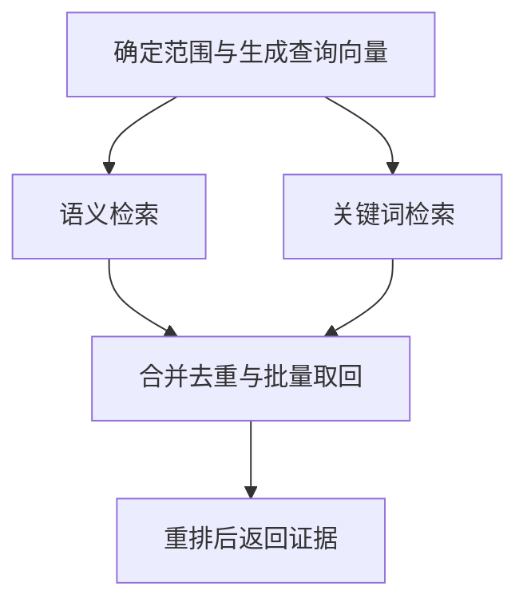
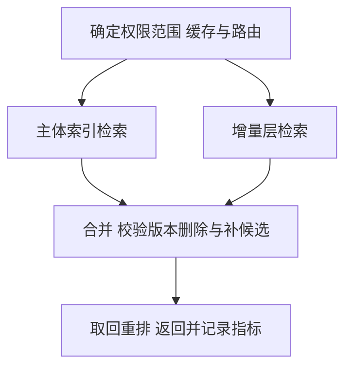

# 亿级 RAG 检索怎样提速

*从一次请求的耗时，走到索引、过滤、分片、硬件与线上验证。*

- **Skill 版本：** woYao v0.18.1
- **研究日期：** 2026-10-27
- **修订日期：** 2026-10-28（补充 oOO! 总结）

面向懂基础后端、首次系统设计大规模检索的读者。默认“上亿级数据”指 **1 亿条切块向量**，并非 1 亿篇原文；具体引擎、负载与延迟目标未知。依据已读取的一手论文和官方资料分析，容量和时延数字是可复算的教学推演，未对你的系统或亿级集群压测。

## 1. 先确定要让什么变快

RAG 是先检索资料，再把资料交给大模型生成答案。这里主要讨论“用户发出查询，到系统拿到可用证据”这一段。大模型开始生成的时间、完整回答的时间还要另算。

一个请求慢，可能因为搜索的数据范围太大，也可能因为每次访问内存或磁盘很贵，或者请求在等待资源。提速需要同时回答：**少查哪些数据仍然正确？每份候选怎样查得更便宜？多个环节怎样协同完成？**

最终优化目标也要同时包含速度与结果质量。例如可以设定“在给定并发下，95% 的检索请求在目标时间内完成，相关证据命中率不低于业务验收线”。如果只把候选数量削到很少，当然可能更快，但找不到资料就没有达到目标。

### 把上亿这个数字拆开

原文通常被切成多个片段，每个片段生成向量；同一片段也可能有多个表示。因此：

`向量总数 ≈ 原文数 × 平均片段数 × 每片段表示数`。

例如 1,000 万篇原文、平均 10 个片段、每片段一个向量，就是 1 亿条；模型迁移期间旧、新两套向量并存，还可能暂时翻倍。去重、切块重叠和保留历史版本都会改变它。先量清真实数量，再讨论索引和机器。

全文以 1 亿条、768 维向量为例。维度就是每条向量包含多少个数；32 位浮点数每个占 4 字节。只算原始向量：

`100,000,000 × 768 × 4 = 307,200,000,000 字节 = 307.2 GB`。

这里 GB 按十进制计算。它不含索引结构、片段正文、元数据、副本、运行缓存和构建临时空间。

| 表示方式 | 每条主要编码 | 1 亿条对应大小 |
| --- | ---: | ---: |
| float32 原向量 | 768 × 4 字节 | 307.2 GB |
| float16 原向量 | 768 × 2 字节 | 153.6 GB |
| int8 标量编码 | 768 × 1 字节 | 76.8 GB |
| 假设采用 96 字节 PQ 编码 | 96 字节 | 9.6 GB |

后两行的“变小”可能伴随精度变化、额外参数或重打分；不表示整个系统只需要这些内存。PQ 的含义和代价在第 5 节展开。

若图索引平均每点保存 64 条、每条 4 字节的边，光边就是 `1 亿 × 64 × 4 = 25.6 GB`；这只是说明图结构也要计费的简化模型，具体实现还有层级、偏移等开销。若原向量共有 3 份副本，单这部分就是 `307.2 × 3 = 921.6 GB`。Faiss 的存储表可用于核对具体编码，而不能直接当成数据库整体容量。[Faiss 编码与索引说明](https://github.com/facebookresearch/faiss/wiki/Faiss-indexes)

## 2. 把一次检索请求拆成能定位的耗时

假设用户在某企业知识库里问“这次退款为什么失败”。系统先确定其可见数据，把问题转为查询向量；随后并行做语义检索和关键词检索，合并结果，取回正文，再用更贵的模型重排。

**语义检索**找向量空间里接近的片段；**关键词检索**利用词项索引找字词匹配。**重排**只对较少候选做更细的相关性判断。这三个步骤处理的对象和成本不同。

*图 1：一条示意请求链。两路并行搜索在合并处等待，整体耗时要看关键路径。*

对这一条请求，可以用以下模型记账：

$$
T=T_{queue}+T_{embed}+\max(T_{dense},T_{lex})+T_{fuse}+T_{fetch}+T_{rerank}
$$

各项依次是排队、查询向量、语义搜索、关键词搜索、合并、正文取回和重排。并行两路取较慢的一路；若你的实现有串行改写、多次检索或流水线，要按实际依赖改模型。

看一条**构造的请求轨迹**：

| 阶段 | 耗时 | 为什么值得单独看 |
| --- | ---: | --- |
| 等待可用工作线程 | 25 ms | 数据库还没开始搜索就可能已变慢 |
| 查询向量生成 | 30 ms | 可能有模型计算或远程调用 |
| 语义检索 | 130 ms | 向量索引、过滤和存储访问 |
| 关键词检索，与上一行并行 | 55 ms | 可能成为另一条关键路径 |
| 合并去重 | 5 ms | 候选数量和跨服务传输 |
| 正文取回 | 25 ms | 文档存储、网络与序列化 |
| 重排 | 80 ms | 模型输入数量、长度、队列 |

总耗时是 `25+30+max(130,55)+5+25+80=295 ms`。把语义检索从 130 ms 降到 55 ms，总体也只是 `220 ms`；如果目标是 200 ms，这一项优化仍不够。

**这张表是一条请求的轨迹，不能拿各阶段 p95 相加当整体 p95。** p95 表示 95% 请求不超过的耗时，各阶段的慢请求未必是同一批。应对同一请求记录追踪 ID、各段耗时和排队，再统计整体分布。

### 第一批需要采集的观测

同时记录 p50/p95/p99、吞吐、错误/超时、真实召回质量，以及请求实际搜索了多少分片、访问/评估了多少候选、取回多少字节。p99 是慢的那 1% 请求的边界；平均值正常不代表这些请求正常。

再按租户、查询类型、过滤通过率、缓存冷热、数据新旧分组。一个“总 p95 很好”的数字可能掩盖小租户过滤查询特别慢，或新索引冷启动时大面积抖动。

## 3. 第一种提速：让本来就不该搜索的数据退出路径

假设用户只允许搜索租户 A 的有效资料。全库有 1 亿条，A 有 100 万条，那么正确的问题是“在这 100 万条里检索”，不是先查全库再随意丢弃结果。

这里有两种完全不同的缩范围方式：

- **确定性范围**：租户、权限、产品版本等是请求明确要求。裁掉范围外数据，不会额外改变范围内要比较的全集。
- **预测性范围**：模型猜用户在问“退款”，只查退款分区。猜错或问题跨领域，就可能直接漏掉相关证据。

后者也可以有价值，但必须把路由错误记入召回损失，并设置经过验证的跨域或回退策略。ANN 本身还会有近似误差，不能因为范围裁剪正确就声称最终零漏召回。

### 过滤条件也需要索引

向量索引帮助找“相近”，标量或元数据索引帮助找“符合租户、日期、状态条件”。缺少后者，系统可能为判断条件读取大量数据。Qdrant 的 payload 索引还提供过滤结果数量的估计，帮助选择执行路径；这些索引也消耗空间，不宜对所有字段无差别建立。[Qdrant 索引机制](https://qdrant.tech/documentation/manage-data/indexing/)

**过滤通过率**就是当前条件允许的数据占比。假设通过率为 0.1%，先从全库固定取 100 个近邻再过滤，粗略平均可能只剩 `100 × 0.001 = 0.1` 个。若希望平均留下 20 个，独立同分布的粗估需要 `20/0.001=20,000` 个候选；这既可能很贵，也不能保证每次够 20 个，因为实际条件和相关性未必独立。

这说明为什么“先取固定 top-k，再过滤”容易不足 k。这里 **k** 是要返回的结果数，不等于内部搜索探索了多少候选。

### 过滤方式会改变索引怎么走

| 方式 | 过程 | 主要收益与代价 |
| --- | --- | --- |
| 预过滤或搜索中联合过滤 | 在允许集合中找近邻，或在图遍历时处理条件 | 可满足范围内 top-k；条件判断和额外图探索有成本 |
| 固定 top-k 后过滤 | 全局先取有限候选，再剔除不匹配项 | 简单，但可能不足 k 或漏掉范围内更好的结果 |
| 迭代过滤 | 不断产生向量候选并判断条件，直到够数或搜索结束 | 某些复杂条件下有利；通过率低时可能检查很多项 |

图索引中的过滤未必“越严格越快”：限制条件可能让可走的相关节点变少，搜索反而要绕更多路；若允许集合很小，直接对该集合精确比较也可能更合适。Milvus 的标准/迭代过滤、Elastic 的搜索中预过滤和精确扫描回退，都是具体实现，不应只凭 API 上写了 `filter` 就当成同一件事。[Milvus 过滤](https://milvus.io/docs/filtered-search.md)、[Elastic 过滤行为](https://www.elastic.co/docs/solutions/search/vector/knn/filtered-knn-search)

### 分区要让业务范围真的减少访问

分区是存储或索引的组织边界。仅给数据增加 tenant_id 字段，不代表查询只会访问一个物理分区；如果一个租户散布在所有分片，每次仍可能扇出全库。

可按经常出现的确定性条件组织路由，但要处理大租户热点和小租户碎片。Milvus 的 partition key 通过哈希映射物理分区，不等于“一租户一分区”；当前文档的键隔离还存在 HNSW、单键值查询等限制。组织方式要按实际版本和流量验证。[Milvus 分区键](https://milvus.io/docs/use-partition-key.md)

## 4. 第二种提速：少做距离比较，或把比较做便宜

向量检索把片段表示为一串数，再用距离或相似度排序。**精确搜索**逐个比较允许范围内的所有向量；**ANN，近似最近邻搜索**，用索引减少访问量，接受可能漏掉少量真正近邻。

选择 ANN 不只是选一个名字，而是在给定内存、更新模式和过滤条件下，选择访问数据的方法。

### HNSW：沿图走，不逐条遍历

HNSW 把向量组织成多层邻接图。可以理解为先沿较粗的连接找到附近区域，再在底层探索候选。它通常适合需要较高召回、内存条件合适的场景。

`M` 影响连接数量，`efConstruction` 影响构建时探索，`efSearch` 控制查询时探索范围。查询预算更大，通常能找到更多近邻，也多花计算；构建参数变更往往需要重建，不能把三个参数当成一个“加速旋钮”。实现、数据分布、过滤和缓存都会影响实际结果。[Faiss 选型](https://github.com/facebookresearch/faiss/wiki/Guidelines-to-choose-an-index)、[Faiss 调优](https://github.com/facebookresearch/faiss/wiki/How-to-make-Faiss-run-faster)

### IVF：先选桶，再查桶里的向量

IVF 把向量分到若干簇对应的倒排列表里。查询先找接近的簇，再访问这些列表。`nlist` 是列表总数，`nprobe` 是本次访问多少个列表。

若只为演示，假设 1 亿条均匀分到 65,536 个列表，每次查 32 个，则访问向量数近似为：

`100,000,000 × 32 / 65,536 ≈ 48,828`。

它比全量逐个比较少得多，但这不是实际延迟预测：还要寻找最近的簇，列表可能不均匀，过滤和候选维护也有开销。如果真实近邻落在未访问的桶里，后面再精细排序也找不回来。这里两个参数仅演示机制，不是亿级配置推荐。[Faiss 的倒排列表过程](https://github.com/facebookresearch/faiss/wiki/Faiss-indexes)

### 三个容易混淆的预算

| 预算 | 控制什么 | 减小后的风险 |
| --- | --- | --- |
| 最终返回 k | 输出多少结果 | 可能不够支持多角度回答 |
| ANN 探索预算 | 查多少节点、列表或候选 | 候选阶段就漏掉相关项 |
| 重排/重打分预算 | 对多少候选做更贵判断 | 好候选未得到充分比较 |

不同引擎的参数名和作用域不同。例如 Elastic 当前优化页把 HNSW 的 `num_candidates` 说明为每 segment 的探索预算，分片保留 top-k 后再全局合并；不能把它简单当成整个请求只探索这么多条。多个 segment 会重复贡献搜索工作。[Elastic 搜索预算](https://www.elastic.co/docs/solutions/search/vector/knn/optimize-performance-accuracy)

## 5. 从算法进入存储：压缩、热内存与磁盘索引

1 亿条向量的问题不只在“算得多”，还在“访问这些数据要花多少代价”。CPU 常常需要等数据；索引只要访问一部分数据，就已经可能带来明显收益。

### 量化为什么既省空间，也可能损失质量

**标量量化**把每个坐标近似编码为较少位数；**PQ，乘积量化**把向量分为多个子段，每段用一个码本条目代表。假设 768 维分为 96 个子段，每段存一个 8 位编号，就得到 96 字节编码；还需共享码本、ID 和其他结构。

查询可以在压缩表示上筛选候选，再用原向量对这些候选**重打分**。这与用语言模型做语义重排不同：前者主要恢复向量距离精度，后者使用更细的文本相关性模型。

压缩收益有三层：索引更容易驻留内存、一次读取更少字节、部分距离计算更便宜。但误差也可能改变候选顺序。**重打分只能修正已经召回的候选，不能找回前面漏掉的项。** 扩大候选再重打分可以改善质量，却会增加访存与计算。[Qdrant 量化与重打分](https://qdrant.tech/documentation/manage-data/quantization/)

因此，正确比较是在同一质量门槛下画出“延迟—召回—资源”关系，而不是看压缩率。若原向量在磁盘，大量重打分还可能把节省的内存成本换成随机 I/O。

### 把不同数据放到合适的位置

热数据是经常被访问的数据；冷数据很少访问。可以让压缩索引、导航结构和常用过滤索引处在较快内存层，把原向量和较冷正文放到 SSD。SSD 容量更便宜，但随机读取、队列和冷缓存也会成为延迟来源。

并非“所有文件都预热”最好：把少用的原向量全部装入缓存，可能挤掉更有价值的图或量化结构。先观察缺页、缓存命中、磁盘读取延迟与访问字节，再决定热层。Qdrant v1.19+ 的 memory tiers 和旧版设置不同；Elastic 的文件系统缓存建议也要结合实际索引结构。[Qdrant 分层说明](https://qdrant.tech/documentation/manage-data/quantization/)、[Elastic 缓存与容量](https://www.elastic.co/docs/deploy-manage/production-guidance/optimize-performance/approximate-knn-search)

### DiskANN 是另一条访问路径

DiskANN 把为 SSD 设计的图访问与内存中的压缩信息、缓存等结合，避免把整个高精度图/向量集合都放在 RAM。原始论文证明了特定数据、硬件和质量条件下的亿级可行性，不代表 768 维中文 RAG 也能照搬论文延迟。[DiskANN 原论文](https://www.microsoft.com/en-us/research/publication/diskann-fast-accurate-billion-point-nearest-neighbor-search-on-a-single-node/)

若内存成本是主要约束且有合适 NVMe，可以把磁盘 ANN 纳入候选，同时测冷查询、并发 I/O、过滤和更新。它仍需要 RAM，也不等同于“把 HNSW 文件放到普通硬盘”。Milvus 的 DISKANN 文档还列出平台、向量类型、NVMe 和搜索列表等条件，不能直接作为所有环境的替换开关。[Milvus 磁盘索引](https://milvus.io/docs/disk_index.md)

## 6. 分布式加速：更多机器为什么有时更慢

**分片**把数据拆开；**副本**为同一份分片增加服务拷贝。分片主要影响容量和每片数据量，副本可以分担查询或提高可用性。普通查询往往选择各分片组中的某个副本，而不是把每份副本全查一遍。

假设每个用户查询都访问 64 个分片，用户流量为每秒 200 个请求，即 **200 QPS**。分片层大约要处理 `200×64=12,800` 次子请求/秒，还没算多路改写、重试或重复召回。

若确定性的租户路由让平均只需访问 8 片，则子请求变为 `200×8=1,600` 次/秒。不过这只有在正确范围确实被这 8 片覆盖时才成立；任意少查 56 片不能算无代价提速。

### 扇出会放大尾延迟

“扇出”是一次请求拆成多个并行子请求。假设合并必须等所有分片，最慢的那个会限制这一阶段。

用一个简化概率模型看它的影响：若每个分片有 99% 概率在 50 ms 内返回，且分片耗时相互独立，那么 S 个分片全部按时返回的概率是：

$$
P(T_{max}\leq 50\mathrm{ms})=0.99^S
$$

| 访问分片数 S | 全部在 50 ms 内返回的概率 |
| ---: | ---: |
| 1 | 99.0% |
| 8 | 92.3% |
| 32 | 72.5% |
| 64 | 52.6% |

每片看上去都很好，组合起来却只有约一半请求在这段预算内完成。真实耗时还可能受共享磁盘、节点负载等相关因素影响，所以这里不是线上 p99 预测；它解释了为什么要测扇出、热点和慢节点，而不只看单机速度。分布式尾延迟问题也见 [The Tail at Scale](https://research.google/pubs/the-tail-at-scale/)。

### 并行度要与总负载一起看

增加搜索线程、GPU 批处理或副本，可能提升吞吐；若每个请求都抢占太多资源，也可能让后面的请求排队。稳态平均关系可用 Little 定律理解：

`系统内平均请求数 = 到达率 × 平均停留时间`。

例如 200 QPS、平均 0.1 秒，就是平均 20 个请求处在系统里。这里用平均值，不是把 p95 代进去。生产上还要为突发和资源争用留余量，找到吞吐增长而尾延迟尚可接受的区域。

GPU 更适合某些可批量、规则的数据运算；图遍历、CPU–GPU 传输、显存容量和低并发小批量都可能限制收益。Faiss 也强调批量处理、线程与计算配置的作用。应该测端到端与排队，而不只测一个距离计算内核。[Faiss 性能建议](https://github.com/facebookresearch/faiss/wiki/How-to-make-Faiss-run-faster)

## 7. 索引后面的成本：取回、合并与重排

### 少传不需要的字段

假设召回 1,000 个候选，并把它们完整的 768 维 float32 向量都从检索服务返回：`1,000×768×4=3.072 MB/请求`。在 200 QPS 下，仅原向量就是约 `614.4 MB/s`，还没加正文、协议和序列化。

如果后续只需要 ID、分数和少量字段，就应返回这些内容；正文按去重后的候选批量取回，需要原向量重打分时尽量在靠近索引的地方完成。这是数据传输模型推论，具体收益取决于现在实际返回了什么。

### 多路检索要有共同预算

关键词、稠密向量、稀疏向量和多次查询改写，各自都可能增加覆盖面，但也增加请求数、候选数量与合并工作。混合检索的价值是改善业务质量，不能默认更多路一定更好。

可按查询类型分配预算：编号、错误码和精确术语更值得检查关键词路线；语义改写问题更值得检查语义路线。是否关闭某条路，必须由分组质量评测支持。去重时按来源和片段关系处理，避免同一文档的十个近邻片段挤占全部候选。

### 重排比想象中更容易成为瓶颈

常见文本重排器把查询与每个候选一起送入模型。候选越多、文本越长，计算和等待越多。把重排数量从 200 改为 50，工作量可能减少，但最终证据也可能变差；需要测的是质量与延迟共同变化。

可以先裁掉重复或明显无效候选、限制输入长度、分层使用便宜与昂贵模型，或者仅对确有收益的查询启用昂贵重排。模型分数不是天然的正确率，动态开关应由实际查询集校准，不能随手设一个分数阈值。

本文的候选数量都是说明预算的例子；没有验证任何重排模型的加速倍数。

## 8. 缓存、写入与数据生命周期

### 缓存哪一层，决定省下哪一段

| 缓存层 | 命中后省掉什么 | 需要纳入正确性的条件 |
| --- | --- | --- |
| 查询向量 | 向量模型调用 | 查询规范化和模型版本一致 |
| 检索候选 | 搜索、合并的一部分 | 租户/权限范围、过滤、索引代际一致 |
| 原文片段 | 文档存储读取 | 内容版本与失效策略 |
| 重排结果 | 重排模型计算 | 候选内容、查询、模型版本一致 |

多个用户问同一句话，不代表可以共享同一份有权限限制的结果。一个检索结果缓存键可包含：`查询、租户/可见范围版本、过滤条件、向量模型版本、索引代际、检索策略版本`。这是设计示意，不要求把全部复杂状态直接塞成长字符串；关键是缓存等价条件必须成立。

缓存还会改变负载形态。热点未命中时大量相同请求同时计算，可以用请求合并减少重复工作；权限撤销和内容删除要与结果失效联动，不能只等普通 TTL 到期。热缓存压测与真实未命中请求都要测，防止平均数字掩盖冷请求。

### 写入和维护也会影响查询

数据更新会消耗建索引、合并、刷盘与缓存资源。以 Elastic 为例，segment 是索引内部可独立搜索的一段，多 segment 意味着要访问多个图；频繁写入、refresh 和后台 merge 可能与查询争资源。[Elastic 读写与 segment 调优](https://www.elastic.co/docs/deploy-manage/production-guidance/optimize-performance/approximate-knn-search)

可选方向包括：离线批量构建较稳定的主体索引，在线维护较小增量层，查询时合并两层；迁移模型时建立新索引并用版本化切换。收益是减少主体的频繁重建，代价是查询多一层、去重与删除语义变复杂。

增量层不能无限增长。需要监控其大小、合并时间、可检索延迟，并确保已删除旧记录不会在另一层重新出现。初次导入、持续更新和模型全量迁移应分别压测，因为它们争用资源的方式不同。 能下推的有效性条件先在各层搜索时处理；必须合并后判定的跨层旧版本或删除项，剔除后要迭代补候选，或明确不足 k 的质量代价。否则每层固定取 k 再丢弃，仍会重现第 3 节的后过滤问题。最终评估要看有效证据，而不只看各层返回数量。

### 从数据侧减负，但不要盲目少建数据

去掉重复文档、重复片段和失效版本，可以减少构建、存储与查询工作；切块过细、重叠过高则可能让向量数膨胀。反过来，把片段合得过长也可能降低匹配粒度并增加重排/生成输入。用问答证据命中与成本共同选择切块方式，而不是只追求更少条目。

减少向量维度也要看模型是否支持，或是否训练/验证过投影方式；随意截断一个普通模型的向量，不能默认保持语义排序。

## 9. 把这些角度组合成三种候选架构

没有一个“上亿数据专用最佳架构”。先看真实瓶颈，再选择主路线。

| 负载特征 | 优先评估的组织 | 主要代价与验证重点 |
| --- | --- | --- |
| 高 QPS、数据较热、低延迟更重要 | 内存/热缓存友好的图索引或压缩索引，明确范围路由，查询副本分担 | 内存和副本成本；热点、过滤与尾延迟 |
| 数据庞大、热比例低、RAM 成本受限 | 压缩热结构＋SSD 原向量，或专门磁盘 ANN | 冷查询与重打分 I/O；NVMe、召回和并发 |
| 多租户、过滤强、更新较频繁 | 过滤字段索引＋租户感知布局，小集合可精确搜；稳定主体与增量层分工 | 大小租户失衡、权限/删除、合并与新鲜度 |

这些组织可以组合。例如主体 1 亿条由压缩索引承载，增量层保持较新数据；查询先确定租户和版本范围，分别检索语义与关键词路线，合并后仅取必要字段，再按预算重排。

*图 2：主体/增量组织的示意。它增加合并职责，只有收益覆盖这些成本时才采用；不代表每个 RAG 都需要两层。*

### 具体引擎的版本边界

- 本次读取的 Milvus 页面标示 v3.0.x。分区键隔离、迭代过滤和 DISKANN 各有适用条件，不能据当前页猜测旧版集群支持情况。[分区键](https://milvus.io/docs/use-partition-key.md)、[磁盘索引](https://milvus.io/docs/disk_index.md)
- Qdrant 的当前说明包含 v1.19+ memory tiers；不要把旧 `on_disk`/`always_ram` 配置和新接口混用。[量化与分层](https://qdrant.tech/documentation/manage-data/quantization/)
- Elastic 的 ACORN 默认行为涉及 **9.1+ 创建的索引**，不是只升级运行进程就能对旧索引作同样假设；磁盘索引路线和 HNSW 也用不同探索参数。[过滤说明](https://www.elastic.co/docs/solutions/search/vector/knn/filtered-knn-search)、[索引与搜索预算](https://www.elastic.co/docs/solutions/search/vector/knn/optimize-performance-accuracy)

这些是解释“为什么需要核对部署版本”的例子，不是本报告给出的统一部署配方。

## 10. 怎样证明真的更快，而没有把检索弄差

### 先把两种质量分开

**ANN Recall@k**衡量近似结果与同一向量模型、同一过滤范围内精确 top-k 的重合程度。假设范围内至少有 k 条，便是“近似找回的精确前 k 条数量 / k”。它回答的是近似索引有没有漏掉向量意义上的近邻。

**业务证据命中**关心结果里有没有回答问题所需的资料。一个向量模型即使 ANN Recall 很高，也可能认为不相关文本很近；路由、分词、切块、重排又会继续影响最终结果。因此需要既有精确近邻基线，也有真实查询的证据标注。

评估过滤查询时，精确基线必须在**相同允许集合**内计算；拿全库 top-k 过滤后作为真值，会把正确答案集合定义错。精确基线可对抽样查询离线分批完成，记录资源与覆盖范围，无需在线对每条请求全扫亿级数据。

### 每次实验保留这些共同条件

固定数据/索引版本、向量模型、查询集、过滤条件、硬件、并发/到达速率和缓存状态。把建索引成本、常态查询成本、更新期间成本分开；记录进程内存和系统缓存，不只看应用堆。

先单变量扫探索预算，得到质量—延迟曲线；再评估量化与重打分组合；最后改变分片、副本、路由和硬件。后一类变化范围更大，不能把几项一起改了之后的收益全算给某个参数。

| 查询组 | 为什么必须独立看 |
| --- | --- |
| 高频/低频查询 | 缓存收益与冷请求不同 |
| 大/小租户 | 范围大小、热点和过滤成本不同 |
| 无过滤/中等/很低通过率 | 图搜索与过滤策略可能改变 |
| 精确编号/自然语义/跨主题问题 | 各召回路线与路由覆盖不同 |
| 新增/刚删除/刚改权限的数据 | 新鲜度与正确性不能被速度掩盖 |
| 正常负载/突发/后台重建 | 排队、I/O 和资源竞争不同 |

压测要说明是固定并发还是固定到达速率。只等上一请求返回再发下一请求，系统变慢时施加的压力也会变小；这样的低压结果不能当作目标 QPS 下的延迟承诺。

上线采用影子流量或小流量灰度，检查实际成本、p99 和分组质量，保留可回退的索引/策略版本。优化停止条件应是达到约定目标且质量、成本、新鲜度可接受，而不是不断寻找更小的平均时延。

## 11. 从现象决定先改哪里

| 现象 | 优先核实 | 首个小实验 | 主要取舍 |
| --- | --- | --- | --- |
| 搜索正常，整体仍慢 | 重排、正文读取、查询向量与排队 | 给同一请求加阶段追踪，限制不必要字段 | 避免把不相关瓶颈归给索引 |
| 过滤越强越慢，或不足 k | 过滤位置、字段索引、允许集合规模 | 分组比较联合过滤、迭代与小集合精确搜索 | 条件判断成本与召回 |
| RAM 紧，冷查询抖动 | 图/向量热集、缺页与重打分读取 | 同质量门槛比较量化与热层布局 | 精度、磁盘 I/O、内存 |
| 加分片后 p99 变差 | 实际扇出、热点、segment 数 | 固定负载比较路由与分片组织 | 容量、并行成本、尾延迟 |
| 低负载快，高负载慢 | 队列、CPU/磁盘/GPU 饱和与线程争用 | 分开扫到达率和查询预算 | 吞吐与尾延迟 |
| 写入或迁移时明显变慢 | refresh、merge、构建与查询竞争 | 限定写入窗口或独立构建后版本化切换 | 新鲜度、临时容量、运维复杂度 |

在没有任何观测时，我会先做阶段追踪与查询分组，再检查范围和过滤，然后联调候选预算与压缩。只有证据表明现索引/部署路线无法满足资源与质量目标，才优先考虑更换引擎或大规模重分片。

## 12. 回到开始的例子，形成一次完整优化闭环

开头那条请求为 295 ms。假设追踪发现：全分片扇出导致语义路径较慢，重复正文传输与过大的重排集合也在关键路径。下面只是展示多层配合的**教学假设**：

| 阶段 | 原轨迹 | 改后轨迹 | 对应假设 |
| --- | ---: | ---: | --- |
| 排队 | 25 ms | 8 ms | 总工作量下降后队列缩短 |
| 查询向量 | 30 ms | 25 ms | 模型调用或缓存路径改善 |
| 语义 / 关键词，并行 | 130 / 55 ms | 55 / 35 ms | 正确范围路由与查询预算优化 |
| 合并 | 5 ms | 4 ms | 候选预算更集中 |
| 正文取回 | 25 ms | 15 ms | 少字段、去重后批量取回 |
| 重排 | 80 ms | 35 ms | 在质量约束下减少冗余工作 |

按同一公式，新轨迹为 `8+25+max(55,35)+4+15+35=142 ms`。这不表示这些改动已经发生，也不承诺每项可同时实现。真实实验必须逐项验证质量、资源和交互影响；排队尤其受整体负载影响，不能在线性表里机械扣减。

这个闭环要回答四件事：**定位哪段慢 → 用机制提出改动 → 在同质量/负载条件下验证 → 灰度后确认收益并保留回退。**

## oOO!

亿级 RAG 提速的本质，是在仍能找到相关证据的前提下，让一次查询少访问数据、少搬运字节、少做重复工作。索引只解决其中一段；过滤、正文取回和重排同样可能决定整体耗时，所以起点应是一次完整请求的瓶颈。

这些手段的收益都有对应代价：缩小范围需要保证覆盖，压缩要处理精度与重打分，分片要承担扇出与尾延迟，缓存要维护权限和新鲜度。更小的索引、更多的机器或更少的候选，只有放回完整链路与质量约束中才有意义。

因此，真正可上线的答案是一轮有证据的取舍：定位瓶颈，选择改变该成本的手段，在相同质量和负载条件下验证，再灰度确认。前面的 295→142 ms 只是展示各层如何配合；你的方案是否成立，最终由有效证据质量、尾延迟和总成本共同判定。

## 资料与复算

正文的架构组合、排查顺序与容量模型是基于机制的工程推论；官方资料支持具体机制，不构成对本系统的性能承诺。滚动资料均于 2026-10-27 核对，部署时应回到自己的软件及索引版本。

1. [Faiss：索引选型](https://github.com/facebookresearch/faiss/wiki/Guidelines-to-choose-an-index)——维护者指南；索引家族、资源及搜索预算的依据。
2. [Faiss：索引与编码](https://github.com/facebookresearch/faiss/wiki/Faiss-indexes)——维护者参考；向量编码、IVF/PQ 与空间模型。
3. [Faiss：性能建议](https://github.com/facebookresearch/faiss/wiki/How-to-make-Faiss-run-faster)——维护者指南；查询预算、批量与计算配置。
4. [DiskANN，NeurIPS 2019](https://www.microsoft.com/en-us/research/publication/diskann-fast-accurate-billion-point-nearest-neighbor-search-on-a-single-node/)——原作者研究；SSD ANN 的可行路线，原实验不外推为中文 RAG 指标。
5. [The Tail at Scale，2013](https://research.google/pubs/the-tail-at-scale/)——原作者系统论文；分布式尾延迟的机制背景。
6. [Qdrant：Indexing](https://qdrant.tech/documentation/manage-data/indexing/)——官方滚动说明；payload 索引、过滤与租户布局。
7. [Qdrant：Quantization](https://qdrant.tech/documentation/manage-data/quantization/)——官方滚动说明；压缩、过采样、重打分与内存层。
8. [Milvus：Filtered Search](https://milvus.io/docs/filtered-search.md)——所读页面 v3.0.x；标准与迭代过滤。
9. [Milvus：Use Partition Key](https://milvus.io/docs/use-partition-key.md)——所读页面 v3.0.x；分区裁剪和隔离约束。
10. [Milvus：On-disk Index](https://milvus.io/docs/disk_index.md)——所读页面 v3.0.x；DISKANN 的部署与预算条件。
11. [Elastic：Filtered kNN](https://www.elastic.co/docs/solutions/search/vector/knn/filtered-knn-search)——官方滚动说明；过滤位置、回退和索引版本差异。
12. [Elastic：Performance and accuracy](https://www.elastic.co/docs/solutions/search/vector/knn/optimize-performance-accuracy)——官方滚动说明；候选预算、量化与重打分。
13. [Elastic：Tune approximate kNN](https://www.elastic.co/docs/deploy-manage/production-guidance/optimize-performance/approximate-knn-search)——官方运维说明；缓存、segment 与读写争用。

容量、扇出概率、IVF 简化访问量、网络字节和三条时延轨迹由同目录的 `复算示例.py` 实际运行核对。它只验证算术，不运行 ANN、数据库或线上负载。
