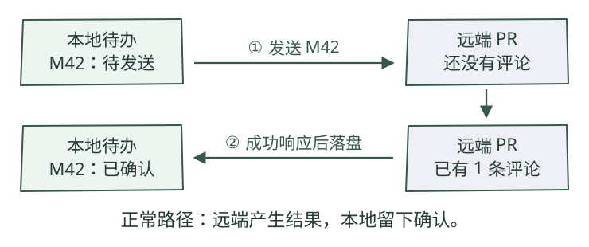
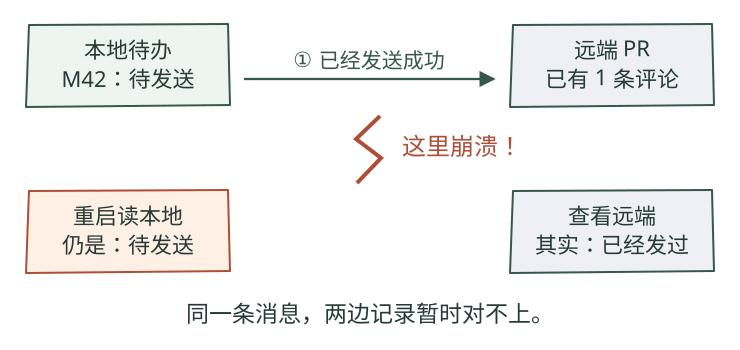
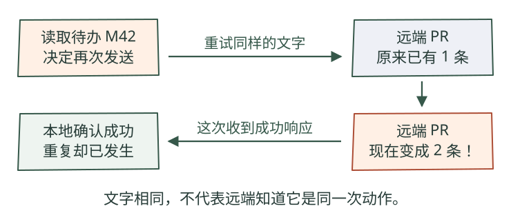
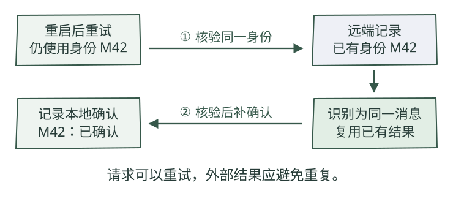

# 发出去之后崩溃，Agent 怎么继续？

Skill 基线 v0.18.1 · HTML 漫画图解试读 02 · 2026-11-02

修复代码完成后，Agent 要在 PR 下发一条结果评论。最难恢复的时刻，是远端已经收到、本地却还没记下成功。重启后只看本地记录，无法判断应不应该再发。

## 1. 先看一条消息正常走完

教学设定：登录超时已经修好，要向 PR #42 回复“修复完成，测试通过”。我们给这一次回复取一个身份 M42；它用来识别这次动作，不是 PR 编号，也不是每次重试重新生成的编号。



先看上方箭头：程序把消息发给远端。再看下方箭头：得到成功响应后，程序把本地状态改为已确认。两步都完成时，两边记录一致。

这里必须区分两个事实：**远端产生了评论**，以及**本地知道评论已经产生**。它们通常紧挨着发生，却不是同一件事。

## 2. 崩溃发生在两步之间，会留下什么？



红色断点位于发送成功之后、本地确认之前。进程可能退出，也可能一直收不到响应。重启时，本地数据库仍写着待发送，但远端已经有了评论。

因此，**待发送只说明本地没有完成确认，不能证明远端没有收到。** 网络超时也只能说明调用方没有及时得到确定结果。

如果在发送前就写已确认呢？进程若紧接着崩溃，远端没有收到，本地却以为完成，这条回复就会丢。把确认提前，只是把重复风险换成丢失风险。

## 3. 为什么“存数据库，失败就重试”仍然不够？



本地待办确实让程序记住还有一件事没确认。可是远端如果把第二次调用当成一次全新的创建请求，就会出现两条相同评论。**保存待办解决了忘记继续的问题，不能单独解决重复执行的问题。**

也不能简单按评论正文去重。同一句“测试通过”可能属于两轮不同的修复；两次业务上不同的回复，应该拥有不同身份。反过来，同一回复的网络重试应沿用同一身份。

## 4. 给动作稳定身份，重试时核验同一结果



这次恢复仍使用 M42。若远端能识别这个身份，重复请求可以返回已有结果；如果平台没有原生去重接口，适配器需要借助远端标记查询、核验已有结果，再决定是否发送。

这种“重复请求同一动作，避免产生多个外部结果”的性质叫**幂等**。关键不是不许再调用，而是让同一动作的重复调用能够收敛到同一结果。图中展示的是已存在的分支；若确认没有发送过，才创建带 M42 身份的评论，然后记录确认。

### 对应到 Super-agent 原型

固定版本的扩展文档要求发送使用稳定的 `message.id`：GitHub 通过隐藏评论标记识别，飞书使用幂等键。图里的 M42 是教学代号，不是源码的真实 ID 格式。[发送契约与幂等要求][cookbook]

两种方式的保证强度需要分别看：远端原生支持幂等键，可以在其承诺的范围和期限内去重；“先查标记，再创建”本身不是跨请求的原子操作，如果两个发送者同时查到不存在，仍可能同时创建。因此需要发送协调，并核查具体实现，不能只凭这张图宣称严格只执行一次。

## 5. 把两部分接起来：本地不忘事，远端少重复

本地也存在一个更早的断点：如果先保存工作结果，尚未保存回复待办就崩溃，重启后可能知道修复完成，却不知道还有评论要发。解决方式是把关联记录放进同一个**数据库事务**，使它们一起提交或一起回滚。

```text
本地事务：
  保存工作结果
  保存待发消息 M42 和发送任务
提交事务

发送器处理待办：
  用 M42 调用具备去重或核验能力的发送适配器
  已确认远端结果 → 写入本地发送确认
  暂时失败或结果不明 → 保留待办，稍后核验或重试
```

这是教学伪代码，不是可直接运行的原型 API。**本地事务不能包住远端平台**：本地提交和远端评论创建之间，仍有网络与进程故障。

原型里的几个名字，现在可以放回这条过程理解：[架构文档][architecture]

| 部件 | 负责什么 | 没有单独保证什么 |
| --- | --- | --- |
| Engine | 在事务中改变工作状态，并排入外部工作 | 不把远端操作变成本地事务的一部分 |
| Effects | 持久保存待执行动作，安排执行和失败退避 | 不保证所有外部动作天然幂等 |
| Outbox | 管理出站消息收据及对应的回复任务 | 收据尚未确认，不等于远端没有收到 |
| 发送适配器 | 对接平台，利用身份、标记或平台能力处理重试 | 能力依赖平台和具体实现 |

这里的副作用（effect）就是会改变系统外部状态的动作，例如发评论或启动执行器；不是“出了不良反应”。Outbox 可以理解为保存在数据库里的发件箱。名字不重要，重要的是各自负责哪一个断点。

## 6. 什么时候仍然需要停下来核验？

假设 Agent 要执行一条没有去重能力的 Shell 命令，命令已经改变外部系统，但成功回执丢了。把同一条命令写进持久队列，并不会自动让它安全重跑。

| 恢复时掌握的证据 | 下一步 | 为什么 |
| --- | --- | --- |
| 能确认同一消息已经存在 | 补本地确认 | 外部结果已满足，避免再次创建 |
| 远端原生支持有效的幂等键 | 按其契约沿用同一键重试 | 去重范围、有效期和参数规则由平台定义 |
| 查询不到标记，但查询可能不完整 | 继续核验，保留不确定状态 | 查不到不能直接当成没发生 |
| 动作不可安全重做，结果又不明 | 提供证据，请人决定 | 盲目重试可能扩大影响 |

可靠恢复因此有成本：要持久存储身份与收据，处理积压和退避，维护适配器，并保留可排查证据。人工介入仍然是处理无法自动消除的不确定性的必要路径。

## oOO!

恢复的核心，是弄清楚哪些事实已被可靠记录、哪些外部结果已发生、哪些仍不确定。持久待办让工作在重启后继续，稳定身份和发送端去重帮助重试收敛；两者配合，才能减少遗漏与重复。

代价是状态、收据、核验和发送协调变复杂。这套机制适合需要持续推进、对外交付的 Agent，但不能推广成任意工具调用都能严格只执行一次。

## 来源与阅读边界

本节是原报告故障恢复部分的教学重写。案例、M42、图和伪代码为教学构造；此次重新查阅了以下固定提交文档，未运行原型或做故障注入，也未对所有适配器做源码审计。

- [007 Architecture：Engine、Effects、Outbox][architecture]
- [008 Cookbook：发送契约与 Idempotent sends][cookbook]
- [霞鹜漫黑：图中文字字体，OFL 1.1](https://github.com/lxgw/LxgwMarkerGothic)。本页嵌入报告实际图字的字体子集，授权信息见随附 FONT-LICENSE.txt。

[architecture]: https://github.com/deepseek-ai/dsh-superagent-prototype/blob/6337fc823ce20251c8de8085948165c81aaa701e/docs/007-architecture.md
[cookbook]: https://github.com/deepseek-ai/dsh-superagent-prototype/blob/6337fc823ce20251c8de8085948165c81aaa701e/docs/008-cookbook.md#5-replies-the-channel
